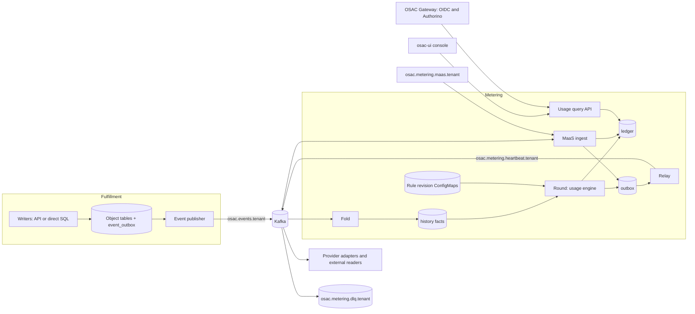
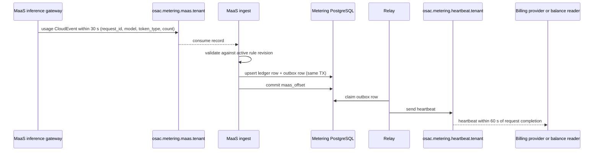

# Metering on the OSAC Event Log

| Field       | Value                                 |
|-------------|---------------------------------------|
| Author(s)   | TBD                                   |
| Jira        | [OSAC-5753](https://redhat.atlassian.net/browse/OSAC-5753) |
| PRD         | [prd.md](prd.md)                      |
| Date        | 2026-11-22                            |

# 1. Overview

This design implements OSAC metering by consuming the durable, per-tenant event
log that fulfillment already publishes. Fulfillment writes every committed
object change to `osac.events.<tenant>` (OSAC-983), so metering does not need a
second lifecycle detector, a CRD watch, or an AAP hook: it folds the event log
into per-resource facts, rates those facts from immutable rule revisions, emits
per-tenant usage CloudEvents, and serves tenant-scoped and provider-scoped
usage queries. VMaaS, CaaS, BMaaS, block storage, and ExternalIP/NATGateway
allocation use this path; MaaS token usage, which is a measured per-request
quantity rather than an object lifecycle, enters through a dedicated measured
usage topic.

The metering database is a rebuildable projection of Kafka, not a second source
of truth. Kafka event, heartbeat, and dead-letter records are retained
indefinitely, usage aggregates are retained for at least 13 months, duplicate
delivery never increases a meter, and an invalid rule revision stops billing
rather than billing incorrectly. See [PRD](prd.md) for detailed requirements.

# 2. Goals and Non-Goals

## 2.1 Goals

- Consume the existing per-tenant event topics for all lifecycle-metered
  services without adding object event types or changing fulfillment's write
  path [PRD: CAP-14].
- Derive usage from event timestamps at one-second precision so billing is
  independent of how often the rating loop runs [PRD: CAP-4].
- Keep meter policy as data (a rule revision) so adding or removing a meter and
  changing its states, unit, multiplier, or dimensions is a configuration
  change [PRD: CAP-5, CAP-6].
- Make every stage idempotent: at-least-once event delivery, at-least-once
  heartbeat delivery, and a database restore must not change a billed quantity
  [PRD: CAP-16, D-2].
- Keep the metering database rebuildable from retained Kafka records and the
  rule revisions, so an upgrade or restore cannot create a billing gap
  [PRD: CAP-7, CAP-15].
- Serve one usage query API with tenant, provider, project, resource, template,
  catalog, and meter grouping; enforce tenant and project scope there and in the
  console [PRD: CAP-1, CAP-8, CAP-9, CAP-10, D-1].
- Deploy metering as an independent stack: fulfillment keeps publishing when
  metering is absent, and a provider may read the event log with its own
  consumer [PRD: CAP-14].

## 2.2 Non-Goals

- Costing, price lists, invoice generation, budgets, and quota enforcement; a
  separate costing PRD owns those [PRD: §2.2].
- Workload-level metering inside tenant clusters, VMs, or hosts; OSAC cannot see
  tenant-managed workloads.
- Object Storage, VirtualNetwork and Subnet, and network bandwidth metering
  [PRD: §2.2].
- A raw event query or replay API. The usage API returns aggregates and
  allowlisted billing dimensions, never raw object snapshots.
- Tenant offboarding and deletion of a tenant's retained event, heartbeat, or
  dead-letter topics.
- Replacing a provider's billing system. The shipped adapters are optional
  provider integrations; the heartbeat topics and reader grants are the stable
  contract.

# 3. Motivation / Background

OSAC provisions VMs, clusters, bare-metal instances, volumes, and networking
objects but has no usage record. Providers therefore build per-service
collectors, and the resulting data model differs per service and per provider.
The reliable event distribution design (OSAC-983) removes the hardest part of
metering: every committed mutation, including direct SQL changes, now produces
an ordered event on that tenant's own topic. Metering builds on that capture
rather than re-deriving lifecycle transitions from current object state, which
would lose short-lived resources and every intermediate state.

The event log is not a meter. Events are full object snapshots with lifecycle
ordering, at-least-once delivery, and a finite default retention (seven days in
OSAC-983). Billing needs durable transitions, a rating policy, ownership
attribution across child resources, late corrections, and a query surface.
Those are the responsibilities of the metering service and its PostgreSQL
projection. The projection is allowed to be rebuilt because the topics are the
retained source of truth; this is why metering can survive a database restore,
an image upgrade, or a rule reload without gaps [PRD: CAP-15].

Two constraints shape the design. First, duplicate events must be harmless. A
re-produced event can be delivered more than once, so facts are keyed by the
resource's own transition time, not by the Kafka offset, and the rating loop
sends differences against a committed ledger rather than re-sending totals.
Second, a bad meter definition must stop billing rather than bill wrong: rule
revisions are immutable, validated against the tracked-field registry, and
refuse to load when malformed or backdated [PRD: D-2, CAP-16].

# 4. Design

## 4.1 Architecture



The diagram shows the two independent halves of the system. Fulfillment
captures mutations in the writer's transaction and publishes them to the
tenant's event topic; metering folds those events into facts, rates the facts,
and relays usage heartbeats to a second per-tenant topic. The takeaway is that
the only durable inputs are Kafka and the rule revisions: `history`, `ledger`,
and `outbox` can all be rebuilt, while the provider adapters and external
readers consume the stable heartbeat topic rather than the metering database.

The metering service runs four per-tenant loops and one cluster-wide query
server:

- **Fold.** Consumes partition 0 of `osac.events.<tenant>` from the offset
  stored in `progress`, batches up to 200 records, and in one transaction writes
  the tracked facts and advances the offset. The fold extracts only fields
  annotated on the private resource protos; it never stores the raw event
  payload. It skips undecodable, foreign-tenant, unknown-payload, and
  retention-gap records with a labeled metric rather than stopping the tenant
  [Codebase: osac-metering/metering-service/internal/fold/fold.go].
- **Round.** On the configured heartbeat interval (15 minutes by default),
  computes the expected usage for every resource and meter from `history` and
  the active rule revision, compares it with `ledger`, and writes only the
  difference to `outbox`. It closes an open billing piece when a state or
  dimension changes and opens a new one under the new key. All timestamps are
  whole seconds and a run shorter than one second bills nothing [PRD: CAP-4].
- **Relay.** Sends each outbox heartbeat to
  `osac.metering.heartbeat.<tenant>` and deletes the row after Kafka
  acknowledges it. The CloudEvent id is a deterministic hash of the billing
  identity and interval, so a resend after a crash carries the same id and a
  reader drops the duplicate [PRD: CAP-16].
- **MaaS ingest.** Consumes `osac.metering.maas.<tenant>`, validates each
  measured token record against the active rule revision, writes a ledger row
  and an outbox row in one transaction, and lets the relay deliver it
  immediately. It does not wait for the round, which is what meets the
  60-second MaaS processing bound [PRD: CAP-13].
- **Usage query API.** Serves `ListUsage` from `ledger` (and the read-only
  database role), prorating pieces that cross the query boundary. The OSAC
  Gateway authenticates the caller and injects organization, role, and project
  context; the service independently enforces the same tenant and project scope
  before it builds a query.

**Event-log consumption is direct, not through the `Watch` bridge.** OSAC-983
records metering as a future `Watch` consumer, and that contract remains valid
for third parties; the built-in metering service instead reads the per-tenant
topics directly because it must commit a Kafka offset in the same transaction
as the folded facts. The `Watch` bridge auto-commits a consumer-group offset
when it polls, not when the consumer finishes durable work; a crash between poll
and fold would lose a billing transition, and metering has no periodic object
resync that could repair it. Direct partition consumption also avoids a second
hop and a second copy of every event. Third-party metering can still use either
the `Watch` API or a read grant on `osac.events.*` [PRD: CAP-14]. This is
discussed again under Alternatives.

### MaaS measured-usage path



The sequence shows why MaaS is a separate ingress: a token count is already a
measured quantity, so it is rated and relayed directly instead of waiting for a
time-based round. The takeaway is the two distinct latency budgets: lifecycle
meters tolerate a round interval up to the configured heartbeat interval, while
MaaS usage must reach the heartbeat topic within 60 seconds [PRD: CAP-13].

## 4.2 Data Model / Schema Changes

### Metering PostgreSQL

All tables are created in a metering-owned database; no fulfillment table is
altered. The schema is forward-only and rebuildable from Kafka.

**`history`** — one row per fact: the value one field of one resource held from
one transition time. Columns: `tenant`, `resource_type`, `resource_id`,
`field`, `since`, `value`, `event_offset`, `topic_generation`. Primary key
`(tenant, resource_type, resource_id, field, since)`. A duplicate event carries
the same transition time, so it collides with the existing row instead of
creating a second fact. `event_offset` and `topic_generation` let the round find
resources whose facts changed and let the fold resume after a topic-prefix
change. Indexes: `(tenant, event_offset)`, `(tenant, since)`, and
`(tenant, field, value)` for ownership-root lookups [Codebase:
osac-metering/metering-service/internal/database/schema.go].

**`ledger`** — the committed usage pieces. Columns: `id` (surrogate),
`tenant`, `resource_type`, `resource_id`, `owner_resource_type`,
`owner_resource_id`, `project`, `catalog_item`, `template`, `meter`,
`component`, `unit`, `dimensions` (JSONB), `start_time`, `end_time`,
`quantity_micro`, and `kind` (`accrual` or `correction`). A unique index on
`(tenant, resource_type, resource_id, meter, component, dimensions, start_time,
kind)` makes an at-least-once repeat idempotent. The round extends an open
accrual row in place while the resource stays in the same state and dimension
key; a state or dimension change closes it and starts a new row. A retroactive
adjustment is a `correction` row with a negative `quantity_micro`, so a query
sums both kinds. The table is partitioned monthly on `start_time`; the query
indexes are `(tenant, start_time)`, `(tenant, owner_resource_id, start_time)`,
`(tenant, project, start_time)`, and `(tenant, resource_type, start_time)`.

**`outbox`** — heartbeats waiting for the relay. Columns: `seq`, `tenant`,
`id` (unique CloudEvent id), `payload` (JSONB), `round_time`, `kind`
(`round` or `maas`). The relay deletes a row only after Kafka acknowledges it,
so a crash-resend reuses the same id.

**`progress`** — one row per tenant: `event_offset`, `event_topic`,
`topic_generation`, `heartbeat_offset`, `maas_offset`, `last_round_time`, and
`last_round_event_offset`. The fold, MaaS ingest, and relay update their own
columns in the transaction that commits their work.

**`rule_revisions`** — `revision`, `effective_at`, `meters_yaml`. A revision
that has been used to bill can never be removed or reinterpreted; the service
refuses to start if it disappears.

**`replayed_heartbeats`** — `(tenant, id)` applied during a database rebuild, so
a copy the relay resent after a crash counts once.

**`tenant_leases`** — `(tenant, holder, expires_at)` used to shard tenant loops
across metering replicas. A replica acquires a lease before starting a tenant's
loops and renews it; a failed replica's lease expires and another replica takes
over. The per-tenant fold transaction also takes a database advisory lock, so a
brief double-run cannot double-fold [Codebase:
osac-metering/metering-service/internal/database/schema.go].

There is no table for raw event payloads, prompts, or responses. Metering
persists only the tracked facts and the billing dimensions.

### Fulfillment-side data contract

Metering does not add a fulfillment table. It relies on three existing or
additive contracts:

- **Metering annotations.** Billable fields on private resource protos carry
  `(osac.private.v1.metering)` options: `kind` (`CONSTANT`, `FIXED_ONCE_SET`,
  `VARIES`), `transition_time` for varying fields, and `owner_resource` for an
  ownership root. The registry is compiled from these annotations and is the
  single source of tracked field paths [Codebase:
  proto/private/osac/private/v1/metering_type.proto].
- **Source-contract triggers.** The fulfillment migration attaches the
  source-contract triggers that reject a changed metering value without a later
  transition time and reject an earlier transition time. A drift test compares
  the installed trigger configuration with the registry, and the startup schema
  check refuses a tracked table whose triggers are missing [Codebase:
  fulfillment-service/internal/database/metering.go].
- **Event payloads.** The private `Event` oneof carries the full object
  snapshot. No new event type is needed for VMaaS, CaaS, BMaaS, Volume,
  ExternalIP, or NATGateway [Codebase:
  proto/private/osac/private/v1/event_type.proto].

### Rule revision data format

A revision is an immutable ConfigMap named `osac-metering-rules-<NNNN>` with
`effective_at` and a single YAML document:

```yaml
effective_at: "2026-12-01T00:00:00Z"
meters:
  - resource: ComputeInstance
    meter: compute
    unit: second
    billable_when:
      states: [RUNNING]
    dimensions: [instance_type, image, boot_disk_size_gib]
  - resource: Cluster
    meter: control_plane
    unit: second
    billable_when:
      states: [PROGRESSING, READY]
      turns_billable_once: [READY]
    dimensions: [template, version]
```

Fields: `resource`, `meter`, `component` (defaults to the meter), `unit`,
`billable_when` (`states`, `turns_billable_once`, `turns_billable_once_from`,
`fields`), `multiplier`, and `dimensions`. A revision is rejected if it names an
unknown resource, meter, state, field, or dimension, if it has no billable
state, or if its `effective_at` is in the past [Codebase:
osac-metering/metering-service/internal/rules/rules.go].

### Heartbeat usage event

The heartbeat is a CloudEvent of type `osac.resource.heartbeat.v1`, published
on the tenant's own topic:

```json
{
  "specversion": "1.0",
  "id": "0f3c…",
  "type": "osac.resource.heartbeat.v1",
  "source": "osac-metering",
  "time": "2026-11-22T10:00:00Z",
  "osactenant": "acme",
  "osacresourcetype": "compute_instance",
  "osacresourceid": "vm-7",
  "data": {
    "tenant_id": "acme",
    "resource_type": "compute_instance",
    "resource_id": "vm-7",
    "owner_resource_type": "compute_instance",
    "owner_resource_id": "vm-7",
    "meter": "compute",
    "component": "compute",
    "billing_dimensions": {
      "deployment": "prod-east",
      "tenant": "acme",
      "meter_type": "second",
      "project": "team-a.frontend.staging",
      "catalog": "small-vm",
      "template": "small",
      "instance_type": "small",
      "image": "rhel-9",
      "boot_disk_size_gib": "40"
    },
    "usage": {
      "semantics": "interval",
      "from": "2026-11-22T09:45:00Z",
      "to": "2026-11-22T10:00:00Z",
      "quantity": "900.000000",
      "unit": "second",
      "precision": "second"
    },
    "heartbeat_time": "2026-11-22T10:00:00Z",
    "last_applied_offset": 412,
    "rules_revision": "0001",
    "external_billing_account_id": "acct-17"
  }
}
```

Every usage event carries the identity dimensions `deployment`, `tenant`,
`project`, `catalog`, `template`, and `meter_type`, plus the meter's own
dimensions. `project` is the full dot-separated project path from
`metadata.project`, which is what makes nested-project rollups possible
[Codebase: proto/public/osac/public/v1/metadata_type.proto]. `catalog` and
`template` are the reference's `name` when set, else its `id`; this satisfies the
requirement that a billing system determine the catalog offer and template from
the metering data alone [PRD: CAP-17], and applies equally to provider-defined
and tenant-defined catalog items because metering carries the reference and
leaves the Service decomposition to billing [PRD: D-3]. `owner_resource_type` and
`owner_resource_id` make a child resource's usage summable under its parent VM or
cluster [PRD: CAP-11, CAP-12].

The CloudEvent `id` is a lower-case hex SHA-256 of tenant, resource type,
resource id, meter, component, billing dimensions, interval start, interval end,
and heartbeat time. It excludes the quantity and the external billing account,
so a resend carries the same id. A correction carries a later heartbeat time and
therefore a different id; readers match a correction by its billing identity, not
by id or quantity. The schema is additive-only and versioned in the `type`
suffix.

Token usage uses the same envelope with `unit: token`, `precision: second`,
and billing dimensions `model`, `provider`, `subscription`, and `token_type`
(`input`, `output`, `cached`, `total`). A `token_type: total` record carries
`"additive": false`; the query API excludes non-additive records from sums
unless the caller explicitly requests the `total` series, so a reader cannot
double-count total tokens against the per-type records [PRD: CAP-3].

### Aggregate retention

`ledger` is partitioned by month. The configuration value
`usage.retentionMonths` defaults to 13 and is rejected at startup if it is
below 13; a monthly reaper drops only partitions older than that value. Kafka
event, heartbeat, and dead-letter topics are configured with
`retention.ms: -1` and `retention.bytes: -1`, so the rebuild source is not
deleted by time or size [PRD: §4, CAP-7].

## 4.3 API Changes

### Usage query API

A new public `UsageService` in the metering component, exposed through the OSAC
Gateway at `/api/metering/v1` (gRPC and REST transcoding):

```protobuf
service UsageService {
  rpc ListUsage(ListUsageRequest) returns (ListUsageResponse);
  rpc ListMeters(ListMetersRequest) returns (ListMetersResponse);
}

message ListUsageRequest {
  google.protobuf.Timestamp from = 1;   // required, UTC, whole seconds
  google.protobuf.Timestamp to = 2;     // required, exclusive
  repeated string group_by = 3;         // allowlisted dimensions
  UsageFilter filter = 4;
  TimeGranularity granularity = 5;      // NONE, HOURLY, DAILY, MONTHLY
  int32 page_size = 6 [(buf.validate.field).int32 = {gte: 1, lte: 1000}];
  string page_token = 7;
}

message UsageFilter {
  repeated string tenants = 1;        // Cloud Provider Admin only
  repeated string projects = 2;       // dot-path prefix match
  repeated string resource_types = 3;
  repeated string resource_ids = 4;
  repeated string owner_resource_ids = 5;
  repeated string meters = 6;
  repeated string templates = 7;
  repeated string catalog_items = 8;
}

message UsageAggregate {
  map<string, string> dimensions = 1;
  string meter = 2;
  string component = 3;
  string unit = 4;
  string quantity = 5;                // fixed-point, six decimals
  google.protobuf.Timestamp from = 6;
  google.protobuf.Timestamp to = 7;
}

message ListUsageResponse {
  repeated UsageAggregate usage = 1;
  string next_page_token = 2;
  google.protobuf.Timestamp retention_start = 3;
}

message ListMetersRequest {}

message Meter {
  string resource = 1;
  string meter = 2;
  string component = 3;
  string unit = 4;
  repeated string dimensions = 5;
}

message ListMetersResponse {
  string revision = 1;
  repeated Meter meters = 2;
}

enum TimeGranularity {
  TIME_GRANULARITY_NONE = 0;
  TIME_GRANULARITY_HOURLY = 1;
  TIME_GRANULARITY_DAILY = 2;
  TIME_GRANULARITY_MONTHLY = 3;
}
```

`group_by` accepts `tenant`, `project`, `resource_type`, `resource_id`,
`owner_resource`, `meter`, `template`, `catalog`, `token_type`, `model`, and
`provider`; an unknown value is `INVALID_ARGUMENT`. `from` and `to` must be UTC
with whole seconds and `from < to`; `from` earlier than retained ledger data is
`FAILED_PRECONDITION` with the earliest available timestamp rather than a silent
partial answer. `granularity` buckets results in UTC and prorates a ledger piece
that crosses a bucket boundary by its overlap in seconds; `NONE` returns one row
per distinct billing key. Sums include negative correction rows.

Example:

```
GET /api/metering/v1/usage?from=2026-10-01T00:00:00Z
  &to=2026-11-01T00:00:00Z&group_by=project&group_by=meter
  &filter.resource_types=compute_instance
```

returns one `UsageAggregate` per project and meter, with the project's full
dot-path and a `quantity` in seconds. A tenant admin can omit `filter.projects`
to get every project in the organization; a tenant user must supply exactly one
project prefix they are authorized to view.

### MaaS measured-usage ingress

MaaS sources publish CloudEvents of type `osac.metering.maas.usage.v1` to
`osac.metering.maas.<tenant>`:

```json
{
  "specversion": "1.0",
  "id": "maas-request-abc:input",
  "type": "osac.metering.maas.usage.v1",
  "source": "osac-maas",
  "time": "2026-11-22T10:00:00Z",
  "osactenant": "acme",
  "data": {
    "tenant_id": "acme",
    "request_id": "req-abc",
    "model": "granite-8b",
    "provider": "osac-maas",
    "subscription": "gold",
    "token_type": "input",
    "token_count": "512",
    "request_started_at": "2026-11-22T09:59:55Z",
    "request_completed_at": "2026-11-22T10:00:00Z",
    "project": "team-a.frontend"
  }
}
```

`request_id` plus `token_type` is the idempotency key. The ingress rejects a
record that names a token type or dimension the active revision does not define,
a negative or non-numeric count, a completion time before the start time, or a
tenant that disagrees with the topic. It never accepts prompt or response
content [PRD: CAP-3, CAP-13].

### Configuration surfaces

- `metering.enabled` in the installer (default `true`) controls whether the
  metering stack is deployed. Omitting it does not change fulfillment; the event
  topics and their read grants remain [PRD: CAP-14].
- `metering.heartbeat.interval` (default `15m`) is the lifecycle rating and
  heartbeat interval.
- `metering.topics.retentionMs` (default `-1`) applies to heartbeat and
  dead-letter topics; `metering.eventTopics.retentionMs` (default `-1`) applies
  to the billing event topics when metering is enabled.
- `metering.readers` grants an external billing reader one KafkaUser with read
  and describe on the heartbeat prefix and read on its consumer group.
- `metering.eventReaders` grants a provider's own metering stack read on
  `osac.events.*` when the built-in stack is not deployed [PRD: CAP-14].
- `metering.adapters.m360.enabled` and its API URL/secret reference are optional
  provider integration values.

The usage query API has no CLI command in this design; the metering CLI surface
is the installer's Helm values and the rule revision ConfigMaps.

## 4.4 Scalability and Performance

**Assumed scale for the first release:** 500 tenants and 10,000 billable
resources per installation, with a 15-minute default heartbeat interval. That
is about 960,000 heartbeat records per day and 380 million ledger rows over 13
months, partitioned into 13 monthly partitions of roughly 30 million rows. The
assumption is stated here so the sizing can be rechecked before implementation.

- **Fold throughput.** Each tenant's topic is single-partition, so ordering is
  preserved without keys. A worker pool of configurable size owns disjoint
  tenant leases; a tenant is processed by one replica at a time, and different
  tenants fold in parallel. Each batch is up to 200 events in one transaction, so
  the database sees one offset update per batch rather than one per event.
- **Round and ledger.** The round extends an open ledger piece in place instead
  of writing a new row every interval. A continuously running, unchanged
  resource therefore produces one ledger row per state/dimension span, not one
  per round; the heartbeat stream still carries one increment per interval. This
  is why 13-month retention stays feasible.
- **Kafka.** Event topics are one partition per tenant; heartbeat and
  dead-letter topics are one partition per tenant. The total partition count
  grows linearly with tenant count; the metering installation shares the
  `osac-kafka` cluster, so the combined `osac.events.*`, `osac.metering.*`
  partition budget must be checked against the broker's practical ceiling.
- **Query cost.** Every query is bounded by `tenant` and a time range, and the
  monthly partitions and `(tenant, start_time)` indexes let the planner prune.
  `group_by` on a dimension backed by a ledger column avoids JSON extraction;
  arbitrary JSON dimension grouping is limited to the meter's declared
  dimensions. The query API uses a read-only database role so a heavy query
  cannot compete with the fold's write transaction.
- **MaaS.** Token usage does not run through the round. The ingest path commits
  one ledger row and one outbox row per record, so its throughput is bounded by
  the MaaS request rate rather than by billable resources. The 60-second bound
  holds as long as the MaaS source meets its 30-second emission bound.
- **Storage.** Event, heartbeat, and dead-letter topics retain indefinitely, so
  Kafka storage grows with total object changes, not just billable resources.
  This is a deliberate cost of rebuildability; the installer sizes Kafka
  accordingly and the `osac_metering_kafka_retained_bytes` metric tracks it.
  The ledger's 13-month floor is the minimum, not a target; a provider may set a
  longer `usage.retentionMonths`.
- **CPU and memory.** The service is I/O-bound: one shared Kafka client plus a
  goroutine set per active tenant. The 512 MiB limit in the chart is sized for a
  catch-up pass of up to 500 round groups plus the Go runtime; a larger worker
  pool raises the limit proportionally.

## 4.5 Security Considerations

Tenant isolation is enforced at three layers. Event and heartbeat topics are
per tenant, so a tenant's data is physically separate at rest; metering is a
trusted platform service with a cluster-wide read on event topics because it
must meter every tenant. The usage query API is the tenant-facing boundary: the
OSAC Gateway authenticates the caller, Authorino injects the verified
organization, role, and project context, and the service independently rejects a
request whose tenant or project scope is outside that context. Kafka ACLs are
not the isolation boundary; application scoping is [PRD: D-1].

- **No raw payload exposure.** The query API returns aggregates and allowlisted
  dimensions, never object snapshots, prompts, or secret material. The fold
  persists only annotated fields. Secret object events carry only metadata and
  backend coordinates, never secret data (OSAC-983), and metering does not
  persist those coordinates [Codebase:
  enhancement-proposals/enhancements/OSAC-983-reliable-event-distribution/design.md].
- **MaaS confidentiality.** The MaaS ingress accepts token counts and model
  metadata only. The MaaS source is responsible for redacting prompt and
  response text before emitting; the ingress rejects unknown fields and never
  logs the payload.
- **Authentication.** The Gateway validates OIDC tokens; Kafka uses mTLS and the
  cluster's SCRAM-SHA-512 mechanism; PostgreSQL uses TLS and a secret-mounted
  connection string. The M360 API key is a provider-supplied secret and is never
  logged or returned by an API.
- **Input validation.** The query API validates the time range, `group_by`,
  page size, string lengths, and project path segments. The rule revision parser
  rejects unknown keys and unknown fields; the MaaS ingress validates every
  numeric and timestamp field before writing.
- **Least privilege.** The loops use a read-write database role; the query API
  uses a read-only role. The metering KafkaUser has read on `osac.events.*` and
  `osac.metering.maas.*`, read/write on `osac.metering.heartbeat.*` and
  `osac.metering.dlq.*`, and access to its consumer groups. A reader gets read
  and describe on the heartbeat prefix only.
- **Log hygiene.** Structured logs carry tenant, resource type, resource id,
  meter, and a skip or failure reason; they never carry a payload, a billing
  account secret, or a token string.

## 4.6 Failure Handling and Recovery

- **Metering down while provisioning continues.** Fulfillment is unaffected.
  Event topics accumulate records; on restart the fold resumes from the stored
  per-tenant offset and catches up. No usage is lost while retention holds
  [PRD: D-2, CAP-14].
- **Kafka unavailable.** The fold stops consuming and does not advance offsets;
  the relay retries the outbox. On recovery both resume from committed state.
  The outbox is durable in PostgreSQL, so a relay crash resends with the same
  CloudEvent id.
- **Database unavailable or restored from backup.** Loops fail readiness and do
  not advance Kafka offsets. On restore, the fold replays `osac.events.*` from
  the stored offset and the ledger is rebuilt from `osac.metering.heartbeat.*`
  using `replayed_heartbeats` to absorb the relay's crash-resends. The provider
  drops duplicate heartbeat ids, so a restore cannot bill twice [PRD: CAP-15,
  CAP-16].
- **Duplicate event delivery.** A re-produced event lands at a new offset but
  carries the same transition time; the fact primary key collides and the
  ledger's expected usage is unchanged. A re-produced event that the fold
  already applied is re-extracted and matches the same facts. A duplicate
  heartbeat is dropped by the reader on its id.
- **Short-lived resource.** A resource that runs 30 seconds produces two
  transition facts and a 30-second ledger piece at the next round; the one-second
  minimum is lower than the run, so nothing is unmetered [PRD: CAP-4].
- **FAILED state.** `FAILED` is never a billable state. When a resource enters
  `FAILED`, the round closes its open piece at the `FAILED` transition and stops
  the meter. Under D-5 the service also emits negative corrections for usage
  previously recorded for the failed resource and for resources owned by it, so
  the net meter value for the failed root is zero; the exact refund scope is
  listed in Open Questions because D-5's wording admits a narrower reading
  [PRD: D-5].
- **Cluster deleted before first ready.** The `Cluster` control-plane rule lists
  `turns_billable_once: [READY]`; a span that closes before `READY` never
  becomes billable. Worker-node resources inherit the root gate through
  `turns_billable_once_from: root`, so neither the cluster nor its nodes bill
  [PRD: CAP-12].
- **Invalid or backdated rule revision.** A malformed revision stops the
  metering service and refuses restart rather than billing under a partial rule
  set. A revision that would reprice a span already billed is rejected. A valid
  future revision is applied between rounds; open pieces are closed under the
  old revision and new pieces open under the new one [PRD: CAP-5].
- **Removed meter.** A revision that omits a meter stops that meter at the
  revision's effective time. The round computes zero expected usage and sends a
  final negative correction for the open piece, so stopping collection does not
  leave an unexplained open span.
- **Retention gap in the event topic.** If an operator overrides event topic
  retention and records below the stored offset are deleted, the fold logs a
  `retention` skip, advances to the oldest retained record, and increments
  `osac_metering_events_skipped_total{reason="retention"}`. The usage for the
  deleted range cannot be rebuilt; the alert makes the gap visible rather than
  hiding it.
- **Unknown event payload.** A metering build that predates a new billable
  resource type skips the unknown payload with
  `reason="unknown_payload"` and advances the offset. Metering must be upgraded
  with or before the fulfillment release that introduces the payload; the alert
  is the signal that a version-skew window produced unmetered usage.
- **Provider adapter rejection.** The shared adapter runner retries, then writes
  the rejected heartbeat to `osac.metering.dlq.<tenant>` with the original
  offset. A DLQ send failure does not acknowledge the source record. Replay
  follows the documented procedure: stop the adapter, reset its position to the
  rejected record's original offset, restart; the provider drops ids it already
  has.
- **Query API failure.** The console shows an error; billing and provisioning
  are unaffected. The API returns `FAILED_PRECONDITION` for a range older than
  retained ledger data and `INVALID_ARGUMENT` for an unknown group-by or an
  inverted range.
- **Controller restart mid-fold.** The fold transaction either commits facts and
  the offset together or rolls back both; a restart reprocesses the batch and
  lands on identical fact rows. The per-tenant advisory lock prevents a second
  replica from applying the same batch concurrently.

## 4.7 RBAC / Tenancy

No new tenant-scoped CRD and therefore no new
`osac.openshift.io/tenant` or `osac.openshift.io/owner-reference` metadata is
introduced. The tenancy change is behavioral and applies to the usage API:

| Caller | Scope | Enforcement |
|---|---|---|
| Cloud Provider Admin (`cloud-provider-admin`) | All tenants and projects | Authorino validates the role; the API may omit `filter.tenants` and receives every tenant. |
| Tenant Admin (`tenant-admin`) | Own organization, all projects including nested | The tenant is taken from the verified organization header; a request naming another tenant is `PERMISSION_DENIED`. |
| Tenant User | Projects they can view | The request must name exactly one project prefix; Authorino evaluates `VIEW_PROJECT` for that project, and the API rechecks the injected project grant. |

The `system` and `shared` tenants are platform-built-in and are not billed;
their topics exist but their usage is excluded from heartbeat delivery. A
Cloud Provider Admin may include them in a diagnostic query, but the default
provider view excludes them [Codebase: osac-metering/schema/topics.go].

Kafka ACLs are listed under Security. There is no per-tenant Kafka principal:
metering is the platform principal, and the per-tenant topics provide
data-at-rest separation rather than ACL-based tenant separation [PRD: D-1].

## 4.8 Extensibility / Future-Proofing

- **New meter for a tracked resource.** A new rule revision adds the meter,
  unit, states, multiplier, and dimensions. No code change. Removing a meter is
  also a revision.
- **New billable resource type.** Annotate the resource's private proto fields
  with the metering option, add the payload to the private `Event` oneof if it
  is not already there, map the table in fulfillment, attach the
  source-contract triggers, and ship a rule revision. The fold, round, and relay
  are generic over the field registry and the rules [Codebase:
  osac-metering/README.md].
- **New provider adapter.** Implement `ProviderAdapter` and use the shared
  `Runner` for deduplication, retry, and DLQ routing; do not reimplement those
  behaviors in the adapter.
- **New usage dimension.** Add the field annotation and the dimension mapping,
  then ship a rule revision; a published heartbeat schema version is additive,
  so an older reader keeps working.
- **Different event transport.** Because the fold is driven by a per-tenant
  offset and a fact extractor, a future adoption of the OSAC-983 `Watch` API
  would replace the consumer and offset store without changing the history,
  ledger, or query API. The direct-topic choice is not baked into the rating
  model.
- **Future quota enforcement and costing.** The ledger's per-interval pieces and
  the query API's `from`/`to` aggregates are the input a quota or costing layer
  would consume; this design does not add those layers.

# 5. Interface Changes

## IC-1: Public usage query API

**Requirements:** CAP-1, CAP-8, CAP-9, CAP-10, CAP-17, D-1

New `osac.metering.v1.UsageService` gRPC service and REST surface at
`/api/metering/v1/usage`. `ListUsage` accepts `from`, `to`, `group_by`,
`filter`, `granularity`, and pagination; it returns `UsageAggregate` rows with
allowlisted dimensions, meter, component, unit, fixed-point quantity, and the
bucket interval. Tenant and project scope is enforced from the verified gateway
context; Cloud Provider Admins may query all tenants, Tenant Admins their
organization, and Tenant Users one project with `VIEW_PROJECT`. `ListMeters`
returns the active meter definitions. The API never returns raw events or
payloads.

## IC-2: Console usage views

**Requirements:** CAP-1, CAP-2, CAP-8, CAP-9, CAP-10

New osac-ui usage pages backed by the usage query API, with the Go proxy
routing `/api/metering/v1/*` to the metering service. A Cloud Provider Admin
sees all tenants with filters for tenant, resource type, template, catalog,
meter, and time range, and can group by tenant, project, resource type, or
template. A Tenant Admin sees the organization with a nested-project tree and
the same resource/template breakdown. A Tenant User sees only projects they can
view. CaaS views show worker-node usage separated by resource class
(`instance_type` / host class) and the control plane as its own meter.

## IC-3: Installer values for the metering stack

**Requirements:** CAP-5, CAP-14, CAP-15

New umbrella-chart values: `metering.enabled`, `metering.database`,
`metering.kafka`, `metering.heartbeat.interval`,
`metering.topics.retentionMs`, `metering.eventTopics.retentionMs`,
`metering.readers`, `metering.eventReaders`, and the optional adapter values.
`metering.enabled=false` omits the metering workloads but leaves fulfillment's
event topics and grants intact. The chart creates the metering service account,
the database secret reference, the KafkaUser/ACLs, the ServiceMonitor, and the
PrometheusRule.

## IC-4: Meter rule revision ConfigMaps

**Requirements:** CAP-5, CAP-6, D-4, D-5

New immutable `osac-metering-rules-<NNNN>` ConfigMaps with `effective_at` and
the meter YAML. A revision is the complete meter set, is validated against the
tracked-field and dimension registries, and is applied between rounds. A
validator or admission policy denies deletion of a revision that has been used;
the service refuses to start when one is missing. A future revision may add or
remove meters, change states, change the multiplier, or change dimensions.

## IC-5: Heartbeat usage CloudEvent schema

**Requirements:** CAP-1, CAP-2, CAP-3, CAP-8, CAP-11, CAP-12, CAP-17, D-5

New `osac.resource.heartbeat.v1` CloudEvent on
`osac.metering.heartbeat.<tenant>`, with the identity dimensions
(`deployment`, `tenant`, `project`, `catalog`, `template`, `meter_type`), the
owner attribution (`owner_resource_type`, `owner_resource_id`), the meter's own
dimensions, and the interval usage record. The CloudEvent id is the stable
deduplication key. Corrections are negative-quantity records with a later id;
`token_type: total` is marked non-additive.

## IC-6: Event-topic retention, Kafka ACLs, and reader grants

**Requirements:** CAP-7, CAP-14, §4

When metering is enabled, the installer sets `retention.ms: -1` and
`retention.bytes: -1` on the per-tenant event topics so the rebuild source is
retained indefinitely. It creates the metering KafkaUser with read on
`osac.events.*` and `osac.metering.maas.*`, read/write on
`osac.metering.heartbeat.*` and `osac.metering.dlq.*`, and the consumer-group
ACLs. `metering.readers` grants an external billing reader one credential with
read and describe on the heartbeat prefix; `metering.eventReaders` grants a
provider's own metering stack read on the event topics. When metering is
disabled, the event topics are not changed and no metering ACLs are created.

## IC-7: Metering field annotations and source-contract triggers

**Requirements:** CAP-11, CAP-12, CAP-17, D-5

New `(osac.private.v1.metering)` annotations on billable private-proto fields,
with `kind`, `transition_time`, and `owner_resource`, plus the fulfillment
source-contract triggers and drift/startup checks that keep the installed
triggers aligned with the registry. The annotation surface is private; the
public resource APIs are unchanged. For VMaaS, the `RUNNING` state drives the
compute meter while attached `Volume` and `ExternalIP` resources bill for the
VM's full existence under the VM as owner. For CaaS, worker-node resources carry
their cluster as owner and their instance type or host class as the resource
class dimension, and the cluster's control plane is a separate meter.

## IC-8: MaaS measured-usage ingress

**Requirements:** CAP-3, CAP-13

New `osac.metering.maas.usage.v1` CloudEvent on
`osac.metering.maas.<tenant>`, carrying `request_id`, `model`, `provider`,
`subscription`, `token_type`, `token_count`, and request start/completion
times. The MaaS source emits within 30 seconds of completion; the ingest
validates against the active rule revision, writes ledger and outbox in one
transaction, and the relay delivers the heartbeat within the 60-second bound.
`request_id` plus `token_type` is the idempotency key.

## IC-9: Metering health metrics and alerts

**Requirements:** CAP-5

New `osac_metering_*` Prometheus metrics and opt-in alert rules:
`osac_metering_fold_lag_seconds` (gauge, tenant), `osac_metering_events_skipped_total`
(counter, tenant, reason), `osac_metering_round_last_time_seconds` (gauge,
tenant), `osac_metering_round_failures_total` (counter, tenant),
`osac_metering_outbox_depth` (gauge, tenant), `osac_metering_heartbeat_publish_latency_seconds`
(histogram, tenant), `osac_metering_ledger_bytes` (gauge),
`osac_metering_kafka_retained_bytes` (gauge), and
`osac_metering_usage_query_errors_total` (counter, code). Alerts cover a stalled
round, a growing outbox, skipped events, new dead letters, fold lag, and query
error rate. This is the operator's pipeline-health surface for CAP-5.

# 6. Alternatives Considered

- **Consume CRD watches or each service's database instead of the event log.**
  Rejected: a watch of current state cannot reconstruct a resource that was
  created and deleted between watches, loses intermediate state transitions, and
  duplicates per-service lifecycle logic. The event log is already the durable,
  write-path-independent capture from OSAC-983 [PRD: CAP-4].
- **Consume the OSAC-983 `Watch` API instead of the per-tenant topics.**
  Rejected for the built-in service because the bridge auto-commits a
  consumer-group offset on poll, not after the fold commits, so a crash could
  skip a billing transition; metering has no periodic object resync to repair
  that. `Watch` remains the right contract for third-party consumers and for a
  future transport swap, and the fold is structured so that swap would not
  change the history or query model.
- **Compute usage directly from the event log at query time, with no history or
  ledger.** Rejected: every query would rescan the retained event log, need the
  rules at query time, and recompute corrections; a billing-grade answer must be
  deterministic and independent of when it is asked.
- **A single shared topic for all tenants.** Rejected in OSAC-983 for
  data-at-rest isolation; metering inherits the per-tenant topics and adds
  per-tenant heartbeat and dead-letter topics for the same reason.
- **Application-level metering emission (dual write from the API).** Rejected:
  the transactional outbox and trigger path already guarantee capture; a second
  write path reintroduces the dual-write loss window.
- **A stream processor (Flink, Kafka Streams) instead of PostgreSQL fold and
  round.** Rejected for the first release: the billing state is small, the
  round needs serializable comparisons against a ledger, and a relational store
  gives auditable, rebuildable state with the team's existing operational
  skills. The cost is that the query API and loops share PostgreSQL; the
  read-only role and partitioning contain that cost.
- **Pre-aggregated hourly or daily usage tables instead of summing ledger
  pieces.** Rejected for the first release: corrections and nested-project
  queries make a second aggregate easy to get wrong, and the ledger's monthly
  partitions plus per-tenant indexes answer the required ranges. A rollup table
  can be added later without changing the API.
- **Put the usage query API in fulfillment-service and proxy to metering.**
  Rejected because it would make fulfillment depend on an optional metering
  deployment, contradicting independent deployment; exposing the metering API
  through the same gateway keeps the write path and the read path separate
  [PRD: CAP-14].
- **Send MaaS token usage through the lifecycle event log.** Rejected: a token
  count is measured usage, not an object transition, and the lifecycle round
  cannot guarantee the 60-second bound. A dedicated measured-usage topic keeps
  the two latency budgets and schemas separate [PRD: CAP-13].
- **Meter policy as code.** Rejected: adding or removing a meter would require
  a release in every installation. Immutable ConfigMap revisions make policy
  data while keeping the "bad revision stops billing" safety property
  [PRD: CAP-5, CAP-6].
- **Persist the raw event payload for audit and recompute later.** Rejected:
  the event topics are the retained raw log, and copying payloads into the
  metering database would duplicate sensitive metadata and make the projection
  larger without adding rebuildability.

# 7. Observability and Monitoring

New Prometheus metrics:

| Metric | Type | Labels | Problem signal |
|---|---|---|---|
| `osac_metering_fold_lag_seconds` | gauge | `tenant` | Older than `heartbeat.interval` for 10 minutes means the fold is behind. |
| `osac_metering_events_skipped_total` | counter | `tenant`, `reason` | Any increase is usage that cannot be billed; `retention` and `unknown_payload` are especially urgent. |
| `osac_metering_round_last_time_seconds` | gauge | `tenant` | Older than twice the interval for 5 minutes means billing stopped. |
| `osac_metering_round_failures_total` | counter | `tenant` | Any increase over 10 minutes. |
| `osac_metering_outbox_depth` | gauge | `tenant` | Sustained growth means the relay or Kafka is stuck. |
| `osac_metering_heartbeat_publish_latency_seconds` | histogram | `tenant` | Rising p99 means the provider's heartbeat stream is delayed. |
| `osac_metering_ledger_bytes` | gauge | - | Tracks 13-month aggregate retention and partition size. |
| `osac_metering_kafka_retained_bytes` | gauge | `topic` | Tracks indefinite event/heartbeat retention growth. |
| `osac_metering_usage_query_errors_total` | counter | `code` | A rising `PERMISSION_DENIED` or `FAILED_PRECONDITION` rate signals a UI or scope bug. |
| `osac_metering_maas_ingest_latency_seconds` | histogram | `tenant` | Above 60 seconds violates CAP-13. |
| `osac_metering_rules_loaded` | gauge | - | Zero or a drop means the service is failing closed. |

Alerts: `MeteringRoundStalled`, `MeteringRoundFailures`,
`MeteringOutboxBacklog`, `MeteringEventsSkipped`, `MeteringDeadLetterQueue`,
`MeteringFoldLag`, and `MeteringRulesUnavailable`. Kubernetes events are not
used because there is no CRD; the service exposes structured logs with tenant,
resource type, resource id, meter, and reason on every skip, fold failure,
publish failure, and query rejection. The logs omit payloads and secrets. No
alerting rules are installed unless the provider enables the PrometheusRule,
matching the chart's opt-in monitoring pattern [Codebase:
osac-metering/charts/osac-metering/templates/prometheusrule.yaml].

# 8. Impact and Compatibility

- **No change to existing resource APIs or provisioning workflows.** The
  design adds a metering stack and reads fulfillment's event log; it does not
  alter object CRUD, AAP playbooks, or the fulfillment public API
  [PRD: CAP-14].
- **Event topic retention change.** OSAC-983 defaults `osac.events.<tenant>`
  to seven days; a metering-enabled installation sets it to indefinite. This is
  a configuration change with a Kafka storage cost, not a protocol change.
  Installations that omit metering keep the shorter default.
- **Additive APIs.** The usage query API, the MaaS ingress, and the heartbeat
  schema are new. The heartbeat schema is additive-only and versioned in the
  CloudEvent type; a new field is a new version file, and an existing version
  file never changes.
- **Private proto annotations.** The metering options are private; the public
  resource messages and generated UI bindings are unchanged.
- **No CRD migration.** There is no new CRD and no CRD version skew.
- **Metering database.** It is a new database, so there is no migration of
  fulfillment's schema. Metering's own schema is forward-only; a downgrade
  requires restoring the previous metering image plus a forward migration,
  not a `down` migration.
- **Version skew.** Metering must be upgraded with or before a fulfillment
  release that adds a billable payload; an older metering build skips the
  unknown payload and alerts. Kafka client/broker skew stays within the
  client version validated by the installer's Kafka chart.
- **Provider migration.** An external billing reader keeps the same heartbeat
  topic and id contract across metering upgrades. A provider replacing the
  built-in adapters with its own reader needs only the reader grant.
- **Upgrade safety.** Rolling a metering replica is safe because each tenant
  loop holds a lease and commits offsets with its facts; the new replica waits
  for the lease or resumes from the committed offset. A database restore
  replays the topics and relies on the heartbeat ids for deduplication
  [PRD: CAP-15].

# 9. Open Questions

## 9.1 Exact refund scope for a resource that transitions to FAILED

- **Owner:** Product owner of the metering PRD (OSAC-985) with the billing
  stakeholders
- **Impact:** Failure Handling and Recovery; `ledger` correction model; the
  heartbeats a provider receives. D-5 can be read as "revoke every prior
  interval for the failed resource and its owned resources" or as "close the
  open interval at the failure and do not revoke previously confirmed billable
  time." This design implements the first, broader reading.

## 9.2 Which component owns MaaS usage emission

- **Owner:** MaaS service owners (to be determined)
- **Impact:** IC-8 and the 60-second CAP-13 latency. MaaS has no implemented
  resource in the current OSAC tree, so the emitting gateway, its retry and
  buffering behavior, and whether it can meet the 30-second emission bound are
  unresolved.

## 9.3 DNS resource metering

- **Owner:** DNS API owners (OSAC-1050)
- **Impact:** IC-7 and the VMaaS attribution requirement. CAP-11 names DNS
  resources allocated to a VM, but the PRD's Services in Scope does not list DNS
  and there is no DNS resource in the current tree. This design provides the
  generic owner attribution; a DNS meter needs a resource and an allocation
  rule.

## 9.4 Event-topic retention versus the OSAC-983 seven-day default

- **Owner:** fulfillment-service maintainers and platform operators
- **Impact:** IC-6 and CAP-7. Indefinite event retention satisfies rebuildability
  but changes OSAC-983's storage and resume-window assumptions. The owner must
  confirm the KafkaTopic owner, the storage sizing, and whether every tenant
  topic or only billing-relevant topics get indefinite retention.

## 9.5 Default heartbeat interval and scale target

- **Owner:** OSAC platform team
- **Impact:** Scalability and Performance; provider transaction cost. This
  design assumes 500 tenants, 10,000 billable resources, and a 15-minute default.
  A lower interval improves tenant-visible freshness but multiplies rated
  provider transactions; a higher interval reduces cost but delays the console.

## 9.6 Boundary of config-only custom meters

- **Owner:** OSAC platform team
- **Impact:** Extensibility and IC-4. CAP-6 says a provider registers a custom
  meter "via a configuration update." A meter over fields already in the
  tracked-field registry is config-only. A genuinely new custom service still
  needs its resource annotated, its table mapped, and its triggers installed,
  which is a code release rather than a ConfigMap edit. The design does not add
  an arbitrary-payload custom usage ingress.

## 9.7 Metering independence default

- **Owner:** OSAC installer owners
- **Impact:** IC-3 and CAP-14. `metering.enabled` defaults to true for a
  complete installation. The owner must confirm whether a provider that omits
  metering still receives the billing event-topic grants and whether the
  installer should warn when metering is disabled but event retention remains
  finite.

## 9.8 Nested-project grouping semantics in the console

- **Owner:** osac-ui owners and the organizations EP owners
- **Impact:** IC-2 and CAP-9. The API groups by the full dot-path and filters
  by dot-boundary prefix. The console must decide whether a parent row shows a
  rolled-up total or only its own direct usage, and whether a tenant user with
  `VIEW_PROJECT` on a parent sees child-project usage.
