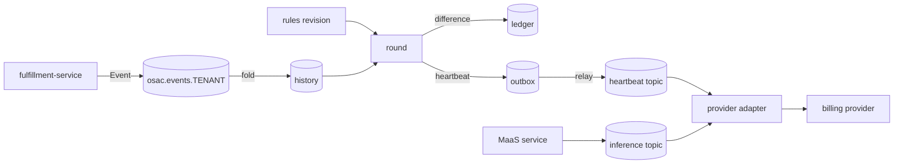

# Metering on the Event Log

## Summary

This design adds an on-premises metering service that turns the event log
fulfillment already publishes into billable usage. The service folds each
tenant's events into a history of billable facts, computes usage every minute
from versioned rules, and publishes signed CloudEvent heartbeats to a
per-tenant topic for the billing provider. See [PRD](prd.md) for detailed
requirements.

## Motivation

Fulfillment already writes one ordered, durable `Event` per committed change to
each tenant's `osac.events.<tenant>` topic. Nothing turns those records into usage
today, so each provider that needs a bill builds its own collector.

The event log gives metering every state change with its authoritative time, the
full object, the tenant, and parent references. It also makes usage rebuildable:
Kafka stays the source of truth, so a lost database is replayed, not restored.
The cost is at-least-once delivery, retained history, and second-level precision.

### Goals

- Read the existing per-tenant event topics. Fulfillment's publishing is unchanged.
- Derive the billable fields from metering annotations on the private protos, so
  fulfillment and metering read one list.
- Compute every meter from immutable rules data, not from compiled code.
- Make each published quantity rebuildable from Kafka and unchanged across
  restarts and replays.
- Keep metering optional. No provisioning path depends on it.

### Non-Goals

- Prices, invoices, and quota enforcement, deferred to a costing PRD.
- The tenant-facing and provider-facing usage query API, and the osac-ui console
  pages. This design produces the stored usage those views read. A separate
  deliverable adds the API, the project-level RBAC filtering, and the UI (see
  Open Questions).
- Metering inside tenant workloads: VMs, clusters, and hosts.
- Object Storage, VirtualNetwork, Subnet, and bandwidth metering, all deferred
  by the PRD.
- The MaaS inference producer. The MaaS service owns emitting inference usage
  records. This design consumes them.
- The provider's own infrastructure cost.

## Proposal

Five pieces deliver the design.

- **fulfillment-service** marks the billable fields on its private protos and
  rejects writes that would make their change times unreliable. It publishes
  events as it does today.
- **osac-metering** is a new service. It runs a fold, round, and relay loop for
  each tenant, independently across tenants.
- **PostgreSQL** stores the facts, usage spans, heartbeat outbox, and read
  offsets.
- **Kafka** stores the input events and output heartbeats. Provider adapters read
  heartbeats and submit usage to a billing provider.
- **A Helm chart** deploys the service, its Kafka users and topics, its rules
  revisions, and the adapters.

**Terminology.**

- **Event log** — the per-tenant Kafka topic `osac.events.<tenant>`.
- **Fact** — one tracked field's value and the time it took effect, stored in the
  `history` table.
- **Ledger** — the table of usage spans already computed and sent.
- **Meter** — one named measurement for one resource type.
- **Round** — the one-minute computation that turns facts into heartbeats.
- **Heartbeat** — one CloudEvent with a signed quantity for one interval.
- **Billable root** — the parent resource whose state decides whether a child
  bills.
- **Rules revision** — an immutable ConfigMap with complete meter definitions
  and their effective time.



The diagram shows the two halves of the pipeline and the one independent input.
The read side folds committed events into facts, and the write side turns facts
into signed differences.

### Workflow Description

Actors: **Cloud Infrastructure Admin** installs and runs metering. **Tenant
User** and **Tenant Admin** create metered resources. **Cloud Provider Admin**
uses the billing output. The **billing system** reads heartbeats. Starting state:
OSAC runs, Kafka runs, fulfillment publishes events, and metering is not
installed.

1. The Cloud Infrastructure Admin installs the `osac-metering` chart with its
   Kafka and database connections, heartbeat interval, and rules revisions.
2. Fulfillment creates `osac.events.<tenant>` at tenant onboarding. Metering
   creates the tenant's heartbeat and dead-letter topics the first time it
   serves the tenant.
3. A Tenant User creates a VM through the public API. The row commit appends one
   `Event` to the tenant's event topic.
4. The tenant's fold reads the event from its stored offset and writes the
   event's facts and the new offset in one transaction. Kafka separates step 3
   from step 4, so fulfillment never waits for metering.
5. Every minute the round reads the facts recorded since its last run and the
   rules revision in effect. It writes the minute's usage difference to the
   ledger and the outbox in one transaction.
6. The relay sends each new heartbeat to `osac.metering.heartbeat.<tenant>` and
   records its offset.
7. A provider adapter consumes heartbeats, drops ids it has already submitted,
   and sends the usage to the billing provider.
8. The Cloud Provider Admin reads the provider's report, which is built from the
   heartbeats.

**Error paths.**

| Situation | What happens |
|---|---|
| A billing provider rejects a heartbeat | The adapter retries. A record that stays rejected goes to the dead-letter topic. The heartbeat stays on its own topic for replay. |
| A resource enters FAILED | The next round writes a negative correction for usage already sent and does not bill the failed span. |
| A tenant has no event topic | The fold retries on its discovery tick. No usage is billed for that tenant until the topic exists. |

### API Extensions

- No new gRPC service, CRD, admission webhook, aggregated API server, or
  finalizer.
- The private proto field option `osac.private.v1.metering` marks each billable
  field and says how it changes.
- `Event.payload` gains a case for every new billable resource. The publisher
  derives its table-to-payload mapping from this oneof.
- Fulfillment SQL migrations install the tracked-field write checks. They add
  checks and change no columns. A schema check fails startup when a metered table
  lacks them.
- New Kafka topics: the per-tenant heartbeat and dead-letter topics, and the
  shared inference topic.
- New CloudEvent schema `osac.resource.heartbeat.v1`, with versions that never
  change.
- New Helm values: database and Kafka connections, heartbeat interval, topic
  retention, rules revisions, readers, and adapters.

Operational impact: when metering is down, provisioning continues untouched and
usage resumes from Kafka. When the event publisher is down, metering has nothing
new to read and resumes without loss.

## UX Alignment

Not applicable: no `@temp-api` file exists for metering, and this design adds no
UI. The usage console pages are part of the separate usage query deliverable
named under Non-Goals.

### Implementation Details/Notes/Constraints

**Tracked fields.** The private proto is the one list of billable fields. An
annotation marks each field and says how it changes. For a varying field it also
names the timestamp field that records the change.

```protobuf
ClusterVersionReference version = 6 [(osac.private.v1.metering) = {
  kind: METERING_FIELD_KIND_VARIES
  transition_time: "status.version_transition_time"
}];
```

Fulfillment enforces the list at write time, including direct SQL. A changed
varying field must come with a later change time. A constant field cannot change.
A fixed-once-set field can be set once. A violating write rolls back. The fold
trusts these stored times to place each span's start and end. A drift test
compares the installed checks with the annotations and fails when they disagree.

**Consumption and offsets.** Each tenant has one fold loop on partition 0 of
`osac.events.<tenant>`. It reads from the tenant's stored offset. When the offset
is before the oldest retained record, it starts at the oldest record and reports
the gap. The service discovers tenants by listing event topics every 30 seconds
and skips `system` and `shared`. The fold rejects a payload whose tenant differs
from its topic and counts the record as skipped.

**History.** The `history` table stores one row per fact: `(tenant,
resource_type, resource_id, field, since, value, event_offset, topic_generation)`.
Facts are append-only. The key includes `since`, so replaying an event cannot
create a second copy.

**Round and ledger.** The round reads facts recorded at or after the last round
offset and evaluates the active rules revision. It computes each meter's usage for
the minute and writes only the difference from the ledger. Ledger rows are keyed
by tenant, resource, meter, component, dimensions, and start time, so a repeated
round writes zero new usage. A per-tenant advisory lock and the database clock
keep a second process or a skewed pod clock from changing the result.

**Duplicates and determinism.** Kafka delivery is at-least-once. A repeated event
writes no new fact. A repeated round writes no new ledger row. A heartbeat id is
unique and stable for its span, so a resent heartbeat bills once. The same events
and rules always produce the same usage, including after a restart, an upgrade,
or a database restore.

**Rules revisions.** A revision is an immutable ConfigMap named
`osac-metering-rules-<NNNN>` with complete meter definitions and an `effective_at`
time. A new revision is a new number, never an edit. A revision can reference only
tracked fields. A malformed revision stops billing instead of billing wrong,
because a retry cannot fix a typo and a wrong bill is worse than a late one.

**Default meters.** Revision 0001 defines the meters below. Every heartbeat also
includes `deployment`, `tenant`, `meter_type`, `project`, `catalog`, and
`template`.

| Resource | Meter | Billable states | Meter dimensions |
|---|---|---|---|
| ComputeInstance | compute | RUNNING | instance_type, image, boot_disk_size_gib |
| Cluster | control_plane | PROGRESSING, READY; bills from READY | template, version |
| BareMetalInstance | allocation | STARTING, RUNNING, STOPPING, STOPPED, DELETING; bills from STARTING or RUNNING | instance_type, cluster, node_set |
| BareMetalInstance | consumption | RUNNING | instance_type, cluster, node_set |
| Volume (block) | capacity | AVAILABLE, DELETING; bills from AVAILABLE | storage_tier; quantity is provisioned GiB × seconds |
| ExternalIP | allocation | ALLOCATED, DELETING; bills from ALLOCATED | pool, ip_family, attached |
| NATGateway | allocation | READY, DELETING; bills from READY | virtual_network, external_ip |

FAILED is absent from every state list. A failed resource therefore stops
billing, and a cluster that fails before READY bills nothing for its control
plane or its workers.

**CaaS worker nodes.** A worker node is a BareMetalInstance with `status.cluster`
and `status.node_set` set. Its allocation and consumption meters give one usage
series per node set, split by `instance_type`, the resource class the PRD
requires. The `component` field routes worker usage to the provider's CaaS
billing line. A worker bills only after its cluster reaches READY, so a cluster
deleted before READY leaves no worker usage.

**Attribution.** The BareMetalInstance `status.cluster` fact is the owner link for
worker usage. A volume's parent VM comes from the ComputeInstance record's
`status.volumes` list, and an external IP's target comes from the
ExternalIPAttachment record. The fold records these parent ids as facts.

**Heartbeat content.** A heartbeat is a CloudEvent of type
`osac.resource.heartbeat.v1`. It contains the tenant, resource type and id,
meter, component, dimensions, interval, signed quantity, round time, last folded
offset, rules revision, and the tenant's external billing account id when set.
Quantities are fixed-point text and timestamps have whole seconds. A positive
quantity adds usage and a negative one corrects it.

**Topics, partitions, and retention.** Each tenant's event topic has one
partition, so its events arrive in one order. The heartbeat and dead-letter topics
have one partition per tenant. The shared inference topic has three partitions.
Source, heartbeat, dead-letter, and inference topics retain records indefinitely,
as the PRD requires and a full rebuild needs. The metering database keeps history
and ledger rows for at least 13 months. Indefinite retention has a real storage
cost, listed under Risks.

**MaaS inference.** Inference usage is not an object change, so it is not on the
event log. MaaS is assumed to publish one CloudEvent per request to the shared
`osac.metering.inference` topic, with type `osac.inference.usage.v1`. The record
names the tenant, project, model, provider, subscription, and all four token
counts. Provider adapters read this topic alongside the heartbeat topics. Its own
topic meets the 60-second processing requirement, which a one-minute round
cannot.

**Sub-minute resources.** Every span starts and ends at a stored second-precision
time. A VM that lives 30 seconds produces 30 seconds of compute usage. A resource
that starts and ends inside one second produces zero, which the PRD accepts.
Every metered resource has 1-second resolution.

**Rebuild.** Stop the service, drop and recreate the database, and start it. Each
fold starts from the oldest retained event. The rounds rebuild the ledger from
history, and the relay resends heartbeats with the same ids. A provider that
drops ids it has seen bills each span once. The recovery window is the
source-topic retention.

**Scale and deployment.** One partition per tenant topic means one consumer per
tenant. Cross-tenant parallelism comes from one loop set per tenant. The chart
runs one replica with a `Recreate` strategy, and per-tenant advisory locks keep
the loops correct if a second process starts during a rollout.

### Security Considerations

Metering is a platform service, not a tenant-facing endpoint. It has Kafka
credentials that read every tenant's event topic, and those topics already
contain each tenant's object data. Tenant users never reach the service or its
database.

A `Secret` event contains only metadata and the secret's coordinates in the
external secret store. The fold never sees secret material, and neither do the
heartbeat topics.

A heartbeat contains tenant and resource ids, meter dimensions, and the tenant's
external billing account. It does not contain the object record, user data, or
credentials. A reader can read every tenant's heartbeats by design, as the
operator guide documents. The `system` and `shared` tenants are excluded from
that grant.

Events come from fulfillment, which the deployment trusts. The fold still rejects
a payload whose tenant differs from its topic and skips a payload this build
cannot read.

### Failure Handling and Recovery

| Failure | What happens | How it recovers | What the user sees |
|---|---|---|---|
| Fold process crashes | The transaction with the facts and offset rolls back | The fold restarts at the committed offset and replays the event | No loss; at most a repeated fact write |
| Metering database is lost | History, ledger, and offsets are gone; Kafka is intact | Recreate the database and replay from the oldest retained event | No double bill if the provider drops repeat ids |
| Database is restored from a backup | The stored offset is behind Kafka head | The fold replays from the backup's offset; facts and ledger deduplicate | No double bill |
| Rules revision is malformed | The service stops billing | The operator fixes the revision or removes it | Usage pauses; no wrong bill |
| Billing provider is down | The adapter retries | The heartbeat topic keeps the records; the adapter catches up | Late usage, not lost usage |
| Provider rejects a record permanently | The adapter writes it to the dead-letter topic | The operator fixes the record and replays the dead-letter topic | One gap until replay |
| Kafka is unreachable | Loops retry; no partial commit | The backlog is read when Kafka returns | Usage pauses |
| Source retention is shortened | The fold finds the gap at startup | It reports the gap and bills from the oldest retained record | Usage before the gap cannot be rebuilt |
| A resource enters FAILED | Its billable span closes | The next round writes a negative correction | Net usage drops to what the states justify |

### RBAC / Tenancy

No new tenant-scoped resource is introduced, so no `osac.openshift.io/tenant` or
`osac.openshift.io/owner-reference` annotation is added. Each tenant's events
live in that tenant's topic, and the fold rejects a record whose payload tenant
differs from it.

The `system` and `shared` tenants are never billed, and their heartbeat topics are
excluded from reader grants. A billing reader sees every billable tenant by
design. Usage query RBAC, including `VIEW_PROJECT` filtering, belongs to the
separate deliverable.

### Observability and Monitoring

- `osac_metering_round_last_time_seconds` and
  `osac_metering_round_failures_total` (gauge and counter, per tenant) — the last
  successful round and failed attempts. A round older than 600 seconds for 5
  minutes means billing for that tenant has stopped.
- `osac_metering_outbox_depth` (gauge, per tenant) — heartbeats written but not
  yet sent. Positive for 15 minutes means the relay or the broker is stuck.
- `osac_metering_events_skipped_total` (counter, per tenant and reason) — events
  the fold could not bill. Any increase can mean lost usage.
- `osac_metering_rules_reload_failures_total` and `osac_metering_rules_loaded` —
  a failed load or a zero count means rules are not advancing.
- `osac_metering_adapter_events_submitted_total`,
  `osac_metering_adapter_events_failed_total`,
  `osac_metering_adapter_duplicates_suppressed_total`,
  `osac_metering_adapter_dlq_events_total`,
  `osac_metering_adapter_dlq_send_errors_total`, and `osac_metering_dlq_depth` —
  provider submission, retries, dead letters, and dead-letter occupancy.
- Alerts: `MeteringRoundStalled`, `MeteringRoundFailures`,
  `MeteringOutboxBacklog`, `MeteringEventsSkipped`, and
  `MeteringDeadLetterQueue`.

### Risks and Mitigations

- **One failing tenant stalls its own billing.** The loops are per tenant, so the
  blast radius is one tenant. Mitigation: the per-tenant round metric and alert
  identify it.
- **Indefinite retention grows storage without bound.** Mitigation: size Kafka
  for the expected event volume, monitor disk, and treat retention as a billing
  requirement, not a default.
- **A metering bug bills the wrong amount.** Mitigation: rules are data,
  revisions are immutable, and the fold is deterministic. The provider drops
  repeat ids, and negative corrections fix retroactive spans.
- **The tracked-field list drifts from the database checks.** Mitigation: the
  drift test fails the build, and the schema check fails startup.
- **A billing provider sees every tenant's usage through one reader.**
  Mitigation: the operator guide documents it. The credential is read-only,
  scoped to the heartbeat prefix, and excludes `system` and `shared`.
- **One partition per tenant limits a single tenant's throughput.** Mitigation:
  per-tenant loops scale across tenants. A tenant that needs more needs a
  separate design.
- **MaaS usage has no query store in this design.** Mitigation: tracked as an
  open question with the MaaS owner.

### Drawbacks

- **Usage lags by up to a minute and a half.** The round interval plus the relay
  delay means a billable event is not visible to the provider immediately. A
  shorter interval sends more provider transactions.
- **The metering database is another stateful service.** It has to be operated,
  backed up or rebuilt, and sized.
- **Billing depends on the event payload shape.** A change to a tracked field
  needs a coordinated change in fulfillment, the checks, and the rules.
- **Indefinite retention is expensive.** Keeping every event and heartbeat
  forever is the price of a full rebuild.

## Alternatives (Not Implemented)

- **Consume through the fulfillment `Watch` API (group mode).** The private
  `Watch` stream already supports a group and a filter. Rejected: it adds a bridge
  hop per event, makes fulfillment the metering bottleneck, and re-encodes data
  metering reads directly.
- **Meter inside fulfillment at write time.** Rejected: it puts billing logic in
  the provisioning path, misses direct SQL writes, cannot be rebuilt, and lets a
  metering bug affect provisioning.
- **Poll a resource list every minute.** Rejected: a resource that lives and dies
  between polls is missed, transition times are lost, and the scan is expensive.
- **Publish running totals instead of interval differences.** Rejected: a lost or
  duplicated total corrupts the bill. Signed differences plus deduplication
  recover from both.
- **Read the PostgreSQL change log with logical replication.** Rejected: a
  replication slot is server-local state that does not survive failover without
  provider-specific setup. The event log already provides the change stream.
- **Define meters in code.** Rejected: a provider could not add or retire a meter
  without a release, and the PRD makes that a configuration operation.

## Open Questions

1. **Who owns the usage query API and the console views?** Owner: To be
   determined. Impact: CAP-8, CAP-9, and CAP-10. This design stores the facts and
   ledger those views need but exposes no query endpoint.
2. **Who produces MaaS inference records, and where can tenants query them?**
   Owner: MaaS service owner, to be confirmed. Impact: CAP-3 and CAP-13. The
   shared topic serves provider submission. No per-tenant query store exists.
3. **How does a provider meter a custom service with no OSAC object?** Owner: To
   be determined. Impact: CAP-6. The rules can add a meter only for a resource in
   the event log. A custom service needs an external usage topic like MaaS.
4. **Is `BareMetalInstanceType` the CaaS resource class?** Owner: To be
   determined. Impact: CAP-2 wording. This design uses the worker's
   `instance_type` and `node_set`.
5. **Does DNS become a billable resource?** Owner: To be determined. Impact: one
   VMaaS acceptance criterion names DNS, and no DNS resource exists in the API.
6. **What production retention should source topics use?** Owner: Cloud
   Infrastructure Admin for the deployment. Impact: CAP-7 and the rebuild window.
   Indefinite retention meets the PRD and costs storage.
7. **Who creates a tenant's event topic, and when?** Owner: fulfillment-service
   team. Impact: metering discovery latency. This design assumes fulfillment
   creates it at tenant onboarding.

## Test Plan

### Unit Tests

- The annotation registry rejects an unknown kind, a missing transition field, and
  a transition field that is not a timestamp.
- Rule parsing rejects an unknown dimension, an unknown tracked field, a
  duplicate meter, and a malformed `effective_at`.
- The usage engine computes a span that starts and ends inside one round, a span
  that spans two rounds, and a span that crosses a state or type transition.
- A FAILED transition produces a negative correction for a span already sent.
- The fold rejects a foreign-tenant payload, an unknown payload, and a payload
  without a resource id or creation time.
- A duplicate event writes no new fact. A repeated round writes no new ledger row.
- The relay resends the same heartbeat id after a crash between send and delete.

### Integration Tests

Run against real PostgreSQL and Kafka.

- Fold determinism: cap the fold at an arbitrary point, restart it, and assert
  the same history with duplicate and shuffled records.
- Round correctness: start, stop, resize, delete, and fail a resource, and assert
  the signed quantities and corrections on the heartbeat topic.
- Volume capacity meters by provisioned GiB × seconds, and an attached versus
  detached external IP changes only the `attached` dimension.
- A cluster reaches READY and its worker node sets bill under the right
  `instance_type` and `node_set`. A cluster deleted before READY bills nothing.
- Rebuild: drop the database, restart, and assert the same heartbeat ids and
  quantities.
- Rules revisions take effect at `effective_at`. An invalid revision stops the
  service.
- A provider rejection lands on the dead-letter topic and does not advance past
  the failed record.

### E2E Tests

- A Tenant User creates a VM, and the provider gets compute usage for the running
  interval only. Stopping and pausing produce no further compute usage, while
  the VM's volumes and external IP keep billing.
- A VM deleted during provisioning, and a VM that enters FAILED, produce no
  compute usage after the failure and a correction for any usage already sent.
- A 30-second VM appears in usage.
- A cluster produces control-plane usage and per-node-set worker usage by
  instance type.
- A duplicate event does not increase any meter.
- The metering service is upgraded while a VM runs, and usage has no gap and no
  double bill.
- A tenant with no usage has no heartbeats, and the `system` and `shared` tenants
  never appear on a heartbeat topic.
- The MaaS path delivers one inference record with all four token counts to the
  provider.

## Graduation Criteria

Not targeting a release yet. Expected stages when it is: Dev Preview, Tech
Preview, GA.

## Upgrade / Downgrade Strategy

- This adds new components and new topics. No existing API changes.
- A metering image update is a `Recreate` rollout. The fold resumes from stored
  offsets and the round from the ledger, so no data migration is required.
- A new rule revision is a new ConfigMap. Published heartbeat schema versions
  never change.
- Downgrade restores the previous image. If the database schema is not
  compatible, rebuild the database from the retained topics. Remove rule
  revisions the older image cannot parse, or the service stops billing.

## Version Skew Strategy

Fulfillment and metering can roll out in either order. An older metering build
ignores fields it does not know, so it bills no field a newer fulfillment adds. A
newer metering build reading events from an older fulfillment sees no new fields
and writes no facts for them. Deploy fulfillment first when a release adds a
tracked field, because the write checks must exist before the fold trusts the
change times.

The MaaS producer is independent. A producer that starts before the adapters
leaves records on the inference topic until an adapter reads them.

## Support Procedures

- **Detect a stopped tenant.** Check `osac_metering_round_last_time_seconds` and
  the `MeteringRoundStalled` alert. Check the tenant's consumer lag and fold
  errors in the logs.
- **Detect a sending problem.** Check `osac_metering_outbox_depth` and the
  `MeteringOutboxBacklog` alert. Check the relay logs and broker reachability.
- **Detect lost usage.** Check `osac_metering_events_skipped_total` by reason. A
  nonzero `foreign_tenant`, `unknown_payload`, or `missing_*` reason means a
  record was not billed.
- **Disable metering.** Scale the deployment to zero or uninstall the chart.
  Provisioning is unaffected. Events stay in Kafka and the folds catch up when
  metering returns.
- **Revoke a billing reader.** Remove its entry from the chart values and apply.
  The broker denies its next fetch.
- **Recover a bad bill.** Fix the rules revision or the record, replay the
  dead-letter topic, or rebuild the database from Kafka. Never delete a tenant's
  source topic unless the history is intentionally discarded.

## Infrastructure Needed

- A Kafka cluster with per-topic creation and Kafka user ACLs. The deployment
  uses Strimzi.
- A PostgreSQL database for metering, with enough storage for indefinite history
  and ledger retention.
- Container images for the metering service and each enabled adapter.
- CI jobs for the integration suites that need real PostgreSQL and Kafka.
