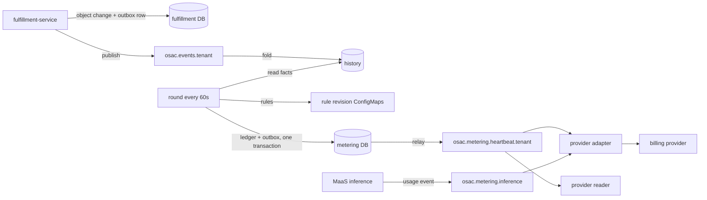

# Metering on the OSAC Event Log

The PRD owns motivation, goals, non-goals and user outcomes. This document
defines how metering turns fulfillment's events into billable usage.

## Scope

- CAP-1: delivered for the provider. Metering writes one usage event per
  billable resource and meter to the tenant's heartbeat topic. A provider reader
  aggregates those events by tenant, resource type, and template. The console
  view is deferred with CAP-8 to CAP-10.
- CAP-2: delivered. CaaS worker nodes are BareMetalInstance objects owned by a
  Cluster. Their allocation and consumption meters send instance_type, cluster,
  and node_set, so GPU and CPU workers are priced apart.
- CAP-3: delivered to the billing provider. The MaaS inference path emits one
  usage event per completed request with tenant, model, and token-type fields.
  Adapters forward it to the provider. An OSAC console view is deferred.
- CAP-4: delivered. Usage is derived from each resource's own change timestamps,
  so a resource that lives 30 seconds bills for 30 seconds. The shortest billable
  run is 1 second. Sub-second lifetimes are not captured, as the PRD states.
- CAP-5: delivered. Meters are versioned ConfigMaps, and adding or removing one
  is a new revision. Metrics and alerts report pipeline health.
- CAP-6: delivered for resource types whose events are in the event log. A new
  meter is a rules revision. A new resource type also needs tracked fields and an
  event payload in its service. Direct-usage services use the shared inference
  path (Open Question 6).
- CAP-7: delivered. Event, heartbeat, and dead-letter topics keep every record,
  and the metering database rebuilds from them.
- CAP-8: deferred to a separate tenant usage view feature. This design stores and
  publishes tenant-scoped usage but defines no tenant query API.
- CAP-9: deferred to the same feature. Metering records each resource's project
  as a billing dimension, so the view can roll up nested projects.
- CAP-10: deferred to the same feature.
- CAP-11: delivered for compute and lifetime billing. A stopped or paused VM
  stops its compute meter, but its volumes and external IPs keep their meters
  until deletion. Grouping them under the parent VM needs a reference the
  resource does not record today (Open Question 5).
- CAP-12: delivered. A cluster control plane bills only in PROGRESSING or READY,
  and its PROGRESSING span bills only after the cluster first reaches READY. A
  cluster that fails or is deleted before READY bills nothing, and its workers
  inherit the gate.
- CAP-13: delivered. The inference path is not tied to the 60-second round. The
  MaaS inference service emits within 30 seconds of completion, and the adapter
  consumes and forwards within 60 seconds.
- CAP-14: delivered. Metering is a separate deployment with its own database and
  Kafka users. Provisioning does not depend on it. A provider can read the event
  topics with its own Kafka user and run its own metering.
- CAP-15: delivered. Forward-only migrations, immutable rule revisions, additive
  schema versions, and stored offsets keep data and measurement across an upgrade.
- CAP-16: delivered. Fact rows are keyed by tenant, resource, field, and start
  time, so a duplicate inserts nothing. Heartbeat IDs are deterministic, so a
  resent heartbeat is dropped by the provider.
- CAP-17: delivered. Every heartbeat includes the catalog item, template,
  instance type or host class, image, cluster version, and storage tier the meter
  names. A billing system resolves the offer from the usage event alone.
- Operational expectations: delivered. The metering database keeps ledger rows
  and history without automatic deletion, and every recovery topic keeps every
  record. The installation sizes Kafka for that retention.

## High-Level Design

Terminology:

| Term | Meaning |
|---|---|
| Fact | One tracked field of one resource, with the value and the time it took effect. |
| Ledger | The table of usage pieces already billed. The round compares against it. |
| Round | The per-tenant loop that computes expected usage and sends the difference. |
| Heartbeat | One usage event: a signed quantity over one interval for one meter. |
| Meter | A named measurement for a resource type, such as a VM's running seconds. |
| Component | The provider's billable line a meter feeds. It defaults to the meter name. |
| Rule revision | An immutable ConfigMap with a complete set of meters and an effective time. |
| Correction | A heartbeat with a negative quantity for the same key as earlier usage. |
| Ownership root | The parent resource whose state gates and groups a child's usage. |

Components:

- fulfillment-service captures object changes in the same database transaction
  that writes them. An outbox trigger writes an event row, and the event
  publisher sends it to `osac.events.<tenant>`. Each tenant topic has one
  partition, so a tenant's events arrive in one order.
- metering-service runs three loops per tenant. The fold copies facts from the
  event topic into history. The round computes expected usage and writes
  corrections and new usage to the ledger and outbox. The relay sends outbox
  heartbeats to `osac.metering.heartbeat.<tenant>`.
- The metering PostgreSQL database stores history, the ledger, the outbox,
  progress, rule revisions, and the ids of heartbeats applied during a recovery.
- Rule ConfigMaps define every meter. The chart ships revision 0001, and an
  admission policy prevents edits to a released revision.
- Provider adapters consume every heartbeat topic and the shared inference topic.
  The shared runner deduplicates, retries, and routes rejected records to the
  dead-letter topic. A provider reader is a separate Kafka user for a provider
  that does not use an adapter.

The diagram shows two paths. The lifecycle path folds events into facts, rates
them once a minute, and publishes heartbeats. The inference path bypasses the
round because token usage is already measured when the request ends. The event
log is the only lifecycle input, and every output is a resendable heartbeat.

Default meters in revision 0001:

| Resource | Meter | Unit | Bills in | Dimensions |
|---|---|---|---|---|
| ComputeInstance | compute | second | RUNNING | instance_type, image, boot_disk_size_gib |
| Cluster | control_plane | second | PROGRESSING, READY; after first READY | template, version |
| BareMetalInstance | allocation | second | STARTING, RUNNING, STOPPING, STOPPED, DELETING; after first STARTING or RUNNING | instance_type, cluster, node_set |
| BareMetalInstance | consumption | second | RUNNING | instance_type, cluster, node_set |
| Volume | capacity | gibibyte_second | AVAILABLE, DELETING; after first AVAILABLE; BLOCK volumes with a vendor id | storage_tier, protocol, provisioned_size_gib |
| ExternalIP | allocation | second | ALLOCATED, DELETING; after first ALLOCATED | pool, ip_family, attached |
| NATGateway | allocation | second | READY, DELETING; after first READY | virtual_network, external_ip |

Every meter also sends these identity dimensions: deployment, tenant, project,
catalog, template, and meter_type. Project is absent when the resource has none.

### Guard Rails

- Fulfillment commits the object change and its event row together. The event
  log has no change without an event and no event without a change.
- The fold writes a batch of facts and the tenant's event offset in one
  transaction. A crash replays from the stored offset and never skips a record.
- A fact is keyed by tenant, resource type, resource id, field, and start time.
  Replaying an event or receiving a duplicate inserts no new fact.
- A fact starts at the resource's own change time, not the event time and not
  the time metering read it. A varying field's change must include a later
  change time, and fulfillment's database trigger rejects a write that does not.
  A write that changes only the time keeps the old time. Constant and set-once
  fields cannot change.
- The round compares expected usage with the ledger and writes only the
  difference. The ledger rows and the outbox heartbeats commit in one
  transaction, so no interval bills twice and none is dropped.
- Quantities are fixed-point micro-units. Heartbeats print six decimal places.
  Intervals are UTC whole seconds, start inclusive and end exclusive.
- A heartbeat ID is a SHA-256 of the tenant, resource, meter, component,
  dimensions, interval, and round time. It excludes quantity and billing account,
  so a resend has the same ID. The relay deletes an outbox row only after the
  broker acknowledges the send, so a crash between send and delete resends that
  ID.
- Each tenant's loops read only that tenant's event topic and write rows keyed by
  that tenant. Kafka ACLs do not separate tenants here, because metering is one
  principal that reads every event topic. The code that chooses the topic and
  writes rows is the isolation rule.
- Billing behavior comes only from rule revisions. A revision is immutable and
  complete, not a patch. A malformed revision, or one that would reprice
  intervals already billed, stops metering instead of billing wrong.
- A resource bills only in the states its meter names. FAILED never bills. A
  deferred span bills retroactively only after the resource or its ownership
  root reaches the confirming state. A span that closes before then never bills.
- A resource with an ownership root inherits the root's gate. When the root's
  facts are missing, the gate stays shut and the child is not billed as
  standalone.
- The recovery topics keep every record: retention.ms is -1, retention.bytes is
  -1, cleanup.policy is delete, and each event and heartbeat topic has one
  partition. Metering refuses to serve a topic that breaks this.
- The fold advances past a record it cannot use and counts it by reason:
  undecodable, foreign tenant, unknown payload, missing id or time, or a
  retention gap. A bad record cannot stall a tenant. The alert reports the lost
  usage.
- A tenant's history is deleted only after its event topic is absent from three
  consecutive discovery passes. A transient listing failure cannot destroy
  billing history.

## API and Access Changes

This design adds no public API and no CRD. The usage event is the interface a
provider reads. Tenant usage views have their own future API (CAP-8 to CAP-10).

The fold reads these tracked fields from the existing private `Event` payloads:

| Resource | Tracked fields |
|---|---|
| ComputeInstance | status.state (varies), status.instance_type (varies), spec.boot_disk.size_gib (constant), spec.catalog_item (constant), spec.disk_image (constant) |
| Cluster | status.state (varies), spec.version (varies), spec.template (constant) |
| BareMetalInstance | status.state (varies), spec.instance_type (constant), spec.catalog_item (constant), status.cluster (set once, owner Cluster), status.node_set (set once) |
| Volume | status.state (varies), spec.storage_tier (constant), status.protocol (constant), status.provisioned_size_gib (set once), status.vendor_volume_id (set once) |
| ExternalIP | status.state (varies), status.attached (varies), status.attribution (varies), spec.pool (constant), status.address (set once) |
| NATGateway | status.state (varies), spec.external_ip (constant), spec.virtual_network (constant) |

The fold also records metadata.creation_timestamp, metadata.deletion_timestamp,
metadata.project, spec.catalog_item, and spec.template as facts. A deletion
event uses the event timestamp as the authoritative deletion time.

Heartbeat CloudEvent, type `osac.resource.heartbeat.v1`:

| Part | Fields |
|---|---|
| Attributes | specversion=1.0, id, type, source=osac-metering, time=usage.from, osacresourceid, osacresourcetype, osactenant |
| Payload | tenant_id, resource_type, resource_id, meter, component, billing_dimensions, usage, heartbeat_time, last_applied_offset, rules_revision, external_billing_account_id |
| usage | semantics=interval, from, to, quantity, unit, precision=second |

Resource type values are compute_instance, cluster_order, bare_metal_instance,
external_ip, nat_gateway, and volume. The ID is a lower-case hex SHA-256 of the
tenant, resource type, resource id, meter, component, sorted dimensions,
interval start, interval end, and heartbeat time. It leaves out quantity and
billing account, so a correction has a new ID and a resend has the same ID.

A rule revision is a ConfigMap named `osac-metering-rules-<NNNN>` with
`effective_at` in RFC 3339 and `meters.yaml`. Each meter names a resource, meter,
unit, billable states, optional deferred-billing states, optional field
conditions, an optional multiplier, and ordering dimensions. For example, the
default compute meter names resource ComputeInstance, meter compute, unit
second, billable state RUNNING, and dimensions instance_type, image, and
boot_disk_size_gib.

A revision is the complete set of meters that takes effect at its time. A new
revision is a new name. A released revision is never edited. Metering reloads
revisions every minute and swaps the calculator between rounds.

Kafka topics and users:

| Topic | Partitions | Owner | Retention |
|---|---|---|---|
| `osac.events.<tenant>` | 1 | fulfillment publisher | -1 |
| `osac.metering.heartbeat.<tenant>` | 1 | metering | -1 |
| `osac.metering.dlq.<tenant>` | 1 | metering | -1 |
| `osac.metering.inference` | 3 | metering chart | -1 |
| `osac.metering.inference.dlq` | 3 | metering chart | -1 |

The metering Kafka user reads the event topic prefix and the inference topic,
and creates, reads, writes, and describes the heartbeat and dead-letter prefixes
it creates. A provider reader gets read on the heartbeat prefix and read on one
consumer group named after the reader. Deny entries remove the `system` and
`shared` tenant topics, which exist but are never billed. A reader has no access
to the raw event topics, the dead-letter topics, or the inference topic.

Database tables (internal, no external access):

| Table | Key rows |
|---|---|
| history | tenant, resource_type, resource_id, field, since, value, event_offset, topic_generation |
| ledger | tenant, resource_type, resource_id, meter, component, dimensions, start_time, end_time, quantity_micro |
| outbox | seq, tenant, id (unique), payload, round_time |
| progress | tenant, event_offset, heartbeat_offset, last_round_time, last_round_event_offset, event_topic, topic_generation |
| rule_revisions | revision, effective_at, meters_yaml |
| replayed_heartbeats | tenant, id |

A tenant never reaches Kafka directly. Tenant usage reaches it only through the
deferred usage view. A provider reader sees every billable tenant's heartbeats,
and its credential is the provider's trust scope. The installation documents that
one credential reads every tenant. The external billing account ID is copied onto
heartbeats when the tenant has one, and it is not shown to tenant users.

## Observability

- `osac_metering_round_last_time_seconds{tenant}`, `_round_failures_total{tenant}`,
  and `_outbox_depth{tenant}`: round health and relay backlog. A last-round
  time older than ten minutes means the tenant is not billed.
- `osac_metering_events_skipped_total{tenant,reason}`,
  `_rules_reload_failures_total{reason}`, and `_rules_loaded`: input and rule
  health. Any skipped event is unbilled usage.
- `osac_metering_adapter_events_submitted_total`, `_events_failed_total`,
  `_duplicates_suppressed_total`, `_retry_duration_seconds`, `_dlq_events_total`,
  and `_dlq_depth`: provider delivery health.
- Alerts: a stalled round, round failures, an outbox backlog, any skipped event,
  any new dead letter, and consumer lag above a threshold that is not falling.
- Logs: structured errors on fold skips, round failures, relay failures, rule
  reloads, and dead-letter routing. Entries name the tenant, resource, and
  reason, and include no credentials or payload data.
- Readiness fails when a tenant's loop exits or a discovered tenant's loop cannot
  start. A round that logs errors does not fail readiness, which is why the
  metrics above exist.

## Security

Tenant isolation has two layers. Each tenant's events and heartbeats sit in its
own topics, so data is separate at rest. At run time metering is the only Kafka
principal for both prefixes, so Kafka ACLs cannot separate tenants. The code
that selects a topic and writes a row is the enforced scope. The fold rejects an
event whose payload names another tenant, and every row is keyed by the topic's
tenant.

The shared `osac.metering.inference` topic is the one place where several
tenants' usage shares a log. Only OSAC adapters read it, and provider readers
cannot. Per-tenant separation for inference records needs a different layout
(Open Question 2).

Credentials are Kubernetes Secrets: Kafka SCRAM credentials, the database
password, and the M360 API key. The rule ConfigMaps contain no secrets. A Secret
object's event payload has only metadata and backend coordinates, never secret
material, so metering inherits that property from the event log.

The rule ConfigMaps are protected by an admission policy that rejects edits and
deletes of a released revision. A provider cannot silently reprice history.

## Scale

Metering load follows events, not API calls. The fold writes a fact only when a
tracked field changes, and the round writes one heartbeat per billable meter per
minute. A quiet resource produces no facts and only its ongoing interval.

The first bottleneck is the per-tenant round. Every minute it reads the tenant's
changed facts, computes expected usage, and compares it with the ledger. History
and ledger indexes keep the read bounded to changed resources. The second is
Kafka storage, because event and heartbeat topics keep every record. Sizing
covers events per second times retention plus heartbeats per tenant per minute
times retention. The third is tenant count: each tenant has two topics and a
running set of loops.

The default is one replica. Database uniqueness and transactions prevent double
billing if two replicas run the same work. A multi-replica deployment still needs
explicit tenant assignment so two replicas do not run every tenant's loops
(Open Question 4). Kafka keeps the backlog while a replica is down.

## Upgrade and Compatibility

Metering is a separate deployment with its own database. Upgrading it does not
upgrade fulfillment or change any OSAC resource. The order is: apply the new
rules revision and schema files, run migrations, then start the new pod.

All migrations are forward-only and additive. The service never edits a released
rule revision or a published heartbeat schema version. A new field is a new
version. History, the ledger, and progress survive the upgrade, and a missing or
older progress row replays from Kafka.

A rolling restart pauses rounds briefly. Each tenant's next round starts from
its stored `last_round_time`, recomputes expected usage, and sends the difference
including the paused minutes. No interval is lost and none bills twice.

The event topic prefix is installation configuration. Changing it points the
fold at a new topic and starts that tenant's history from the beginning. Events
on the old topic are not read. The fold records the topic name and a topic
generation so facts from the two topics never collide. Operators change the
prefix only with a planned cutover.

## Deployment

The `osac-metering` Helm chart deploys one metering pod, its database connection,
the rule ConfigMaps, the metering Kafka user, the adapters, the reader Kafka
users, and optional monitoring. It runs inside the OSAC umbrella chart and
receives the shared Kafka cluster name, namespace, bootstrap address, CA bundle,
deployment ID, and event topic prefix.

Setup steps:

- Provision the metering PostgreSQL database and put its connection in the
  workload database Secret.
- Provision the Strimzi `KafkaUser` with SCRAM credentials and the ACLs above.
  The CA bundle is the shared OSAC CA, not the Strimzi cluster CA.
- Ship rule revision 0001 and the admission policy. Operators add a revision
  through the chart, never by editing a released one.
- Create the shared inference topics. Metering creates each tenant's heartbeat
  and dead-letter topics on first serve and verifies their retention rules.
- Enable the M360 adapter, the echo adapter, or a provider reader. The echo
  adapter is for tests only.
- Enable the service monitor, Prometheus rule, and Kafka exporter lag alert when
  the cluster has Prometheus Operator or user workload monitoring.

Metering is installed by default because the umbrella chart treats billing as
non-optional. The component still meets CAP-14: fulfillment publishes events
whether or not metering exists, and a provider that runs its own metering reads
the event topics with its own Kafka user. Disabling the metering chart stops
usage publication but never blocks provisioning.

## Failure Handling and Recovery

| Failure | What happens | Recovery | What the user sees |
|---|---|---|---|
| Fulfillment event publisher is down | The outbox trigger still writes rows. No events reach Kafka. | The publisher drains the backlog when it returns. | Provisioning continues. Usage appears later. |
| Metering pod is down | Fold, round, and relay stop. Kafka keeps every event and heartbeat. | The new pod resumes each tenant from its stored offsets. | Billing is delayed, then catches up. |
| Metering database is lost or restored | History and ledger are gone. Event topics and heartbeat topics remain. | Rebuild history from the event topics, rebuild the ledger from the heartbeat topics, then resume rounds. | No double bill; usage resumes with a delay bounded by topic retention. |
| Fold crashes mid-batch | The transaction rolls back. The stored offset does not move. | Replay from the stored offset. | None. |
| Round crashes before it commits | No ledger or outbox row is written. | The next round recomputes the same interval. | None. |
| Round crashes after commit, before relay | The outbox row remains. | The relay resends it with the same heartbeat ID. | The provider drops a duplicate. |
| Relay cannot reach Kafka | Outbox rows accumulate. | Retry. The outbox-depth alert fires. | Heartbeats are delayed, not lost. |
| Kafka is unreachable | Consumers stall and the producer retries. Topics keep records. | Resume when Kafka returns. | Usage is delayed. |
| A record is undecodable or names another tenant | The fold skips it and advances the offset. | None; the event is reported as skipped usage. | The provider sees a gap and the alert reports it. |
| A topic lost records below the stored offset | The fold starts at the oldest retained record. | None; the gap cannot be rebuilt. | The skipped-events alert reports the gap. |
| A resource enters FAILED | Prior usage is over-billed. | The round sends a negative correction for the closed span. | The net usage is correct. |
| A rule revision is malformed or would reprice billed spans | The service stops rather than bill wrong. | Fix or remove the revision, then restart. | The pod is not ready and the round-stalled alert fires. |
| A provider rejects a heartbeat | The adapter retries, then routes the record to the dead-letter topic. | An operator fixes the provider and replays the dead-letter record. | The bill is missing that usage until replay. |
| A tenant is deleted | Resource deletions publish final corrections. | The topic stays readable; metering stops the tenant's loops after three missing discovery passes. | Final usage remains queryable. |

## Gotchas

- A round every 60 seconds does not mean 60-second resolution. Facts use the
  resource's own timestamps, so a resource that starts and stops inside one
  round still bills its exact seconds.
- A deletion event's event timestamp is the deletion time. Do not use
  metadata.deletion_timestamp, which is when deletion was requested.
- A varying field that changes without a later change time rolls the write back
  with SQLSTATE Z0006. A write that changes only the change time keeps the old
  time. Do not backfill either value.
- A project-less resource sends no project dimension. Do not add an empty
  project value. An empty value would split the same usage into two keys.
- A ComputeInstance's running instance type can arrive 15 to 20 seconds after
  RUNNING. The first heartbeat is dimensionless and a later correction re-keys
  it. Readers sum keys. They do not replace a resource's usage.
- MaaS inference usage never enters history or the round. It goes straight to
  the adapter, so a metering database rebuild does not replay inference records.
- Metering and adapters must see the same heartbeat ID. Do not change the ID
  inputs without a new schema version, because a provider's deduplication store
  depends on the existing IDs.
- The outbox is the only table that cannot be rebuilt from Kafka. A restore can
  lose unsent heartbeats. The round sends them again with the same identity.
- A clock difference over five minutes between the pod and PostgreSQL skips the
  round. Do not use the pod clock for billing times.

## Validation Strategy

Unit:

- Rule parsing and validation: a complete revision loads, a malformed revision
  fails with `ErrInvalid`, an unknown dimension is rejected, and a revision that
  would reprice billed spans is refused.
- Usage evaluation: state transitions, dimensions, multipliers, deferred spans,
  failed-state corrections, midnight splits, a 30-second lifetime, the 1-second
  minimum, and a cluster that never reaches READY.
- Fact extraction: each tracked field, project and catalog identity facts,
  deletion time, a foreign-tenant event, an unknown payload, and a missing id or
  creation time.
- Heartbeat construction: the deterministic ID ignores quantity and billing
  account, the CloudEvent fields match the schema version, and topic names,
  retention rules, and reader ACLs render as specified.

Component integration (real PostgreSQL and Kafka):

- The fold is deterministic across restarts, duplicate events, and reordered
  events. Facts and the offset commit together. A crash replays.
- The round computes only differences, writes the ledger and outbox in one
  transaction, and sends a correction when a resource enters FAILED.
- Catch-up rebuilds the ledger from the heartbeat topic without double billing,
  and the relay resends after a crash with the same ID.
- Combined pipeline: create, resize, stop, delete, and volume usage on the
  tenant's heartbeat topic. Fulfillment's tracked-field triggers and the drift
  test agree with the tracked-field registry.

Generated output and render:

- The generated usage event reference and JSON schema match the committed files.
  A published schema version is immutable.
- Helm lint and render for the metering chart, the rule ConfigMaps and admission
  policy, the metering Kafka user, and the reader grants.
- The M360 adapter test against a real M360 tenant when its three environment
  values are present. It skips otherwise.

E2E (deployed OSAC):

- A running VM produces compute usage. A stopped VM stops compute, but its
  volume and external IP keep billing.
- A resource that lives about 30 seconds appears in usage.
- A CaaS cluster that reaches READY bills its control plane and workers. One
  that fails before READY bills nothing. A worker node's usage separates by
  instance type and groups under the cluster.
- Duplicate events do not increase a meter.
- A deleted tenant's final correction reaches the heartbeat topic.
- A reader grant reads every billable tenant's heartbeats and cannot read the
  `system` or `shared` topics.
- An upgrade across the metering release leaves no gap in a VM's usage.

Manual and operational: reader revocation, consumer-lag alert delivery, and an
M360 readback of a billed total. The readback has no automated path today.

## Open Questions for the Brief

- 1. Tenant usage views: should CAP-8 to CAP-10 (and the console part of CAP-1)
  be a separate feature with a tenant-scoped Usage API, or a read API over the
  metering database? Owner: metering and fulfillment maintainers. Impact: a new
  API, tenant and project authorization, and UI work.
- 2. MaaS inference ownership: which component emits `osac.inference.usage.v1`,
  and is a shared topic acceptable for per-tenant records? Owner: MaaS team.
  Impact: CAP-3, CAP-13, and isolation at rest.
- 3. Retention cost: what recovery window is required, and what Kafka storage
  does the largest expected tenant count need? Owner: Cloud Infrastructure
  Admin. Impact: CAP-7 and cluster sizing.
- 4. Metering replicas: is one replica enough for the first release, and what
  tenant assignment should a multi-replica deployment use? Owner: metering
  maintainers. Impact: CAP-5 and the scale target.
- 5. Parent-VM attribution: which field on a Volume or ExternalIP names the
  owning ComputeInstance, and should it become an ownership root and a billing
  dimension? Owner: VMaaS and storage maintainers. Impact: CAP-11.
- 6. Custom meters: is the shared inference topic the general direct-usage path,
  or does CAP-6 need a separate per-tenant interface? Owner: metering
  maintainers. Impact: CAP-6 and the event schema.
