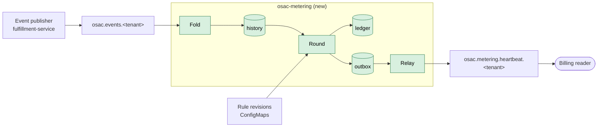

# Usage metering from the event log

Every OSAC tenant gets a usage stream built from fulfillment's resource changes. A new metering service reads each tenant's event topic and folds the events into dated facts. Every minute it rates those facts against versioned rules and writes one usage event per meter to the tenant's heartbeat topic. A billing system sums them, and a provider adds a meter with an immutable rule revision. Every usage result is rebuildable from Kafka and the rule revisions.

Design for metering and usage tracking (OSAC-5753). See the [PRD](prd.md) for requirements.

## Today and with this design

| | Today | With this design |
|---|---|---|
| Usage data | None. | A usage stream per tenant. |
| Billing input | A provider builds an export. | A billing reader sums the tenant's heartbeat topic. |
| Meter definitions | A code change and a redeploy. | A new immutable rule revision. |
| Recovery | No replayable record. | Event and heartbeat topics rebuild the database. |
| Short-lived or failed resources | Usage is missed or continues. | A 30-second VM bills. A FAILED resource is corrected. |

## How it works

Kafka keeps both durable logs. The loops between them turn changes into usage.

- **Consume.** The fold reads each tenant's event topic.
- **Fold.** The fold turns events into dated facts.
- **Rate.** A round compares computed usage with the ledger and sends the difference.
- **Publish.** The relay writes the difference as a CloudEvent.

Each step has its own section below.

## Definitions

- **Event**: one record of a resource change.
- **Fact**: one field value and the moment it took effect.
- **Round**: the pass that computes usage and sends the difference.
- **Ledger**: one row per usage piece already sent.
- **Heartbeat**: one usage event with a meter, quantity, and interval.
- **Rule revision**: an immutable set of meter definitions with an effective time.
- **Owner**: the resource whose state gates a child's billing.
- **Built-in tenant**: the `system` or `shared` tenant, which metering serves and never bills.

## Consume

1. **A tenant's event topic decides whether metering serves it.** The service lists `osac.events.*` every 30 seconds.

| Event topic | Metering behavior |
|---|---|
| Present | The tenant has loops. |
| Absent | The tenant has no loops, and its history stays. |

2. **The fold reads partition zero from the first retained record and commits its offset with the facts.** The `history` key makes a repeated fact a no-op.
3. **A record that is not a valid `Event` is logged and skipped.** It cannot stop billing.

## Fold

4. **A fact is one field value and the moment it took effect.** A varying field records its transition time, such as `status.state` with `status.state_transition_time`.
5. **Constant and fixed-once fields are dated at creation.**
6. **The tracked fields are declared on each private proto.** A `metering` annotation names the kind and transition field. A drift test keeps the triggers in step.
7. **An owner reference ties a child to its parent.** A bare-metal worker names its cluster, and the round reads the cluster's facts first.
8. **A resource that lives 30 seconds leaves two facts.** The round bills the 30-second span.

## Rate

9. **A round runs every 60 seconds on the PostgreSQL clock.**
10. **The fold position and the clock decide a round's behavior.**

| Round state | Behavior |
|---|---|
| At the watermark, clock within five minutes | Compare and send |
| Behind the watermark | Wait for the next round |
| Clock more than five minutes off | Skip the round |

11. **The active revision defines each meter's unit, states, dimensions, and multiplier.** The round sends only the difference.
12. **Each resource state has one usage outcome.**

| Resource state | Usage |
|---|---|
| Start billing | Start usage at the change |
| Billable | Accrue each round |
| Leave billing | Send a final correction |
| FAILED | Stop and correct prior usage |
| Cluster never READY | No billable span |

13. **A heartbeat stays within one UTC day and one rule revision.** A correction names that revision.
14. **Every heartbeat includes deployment, tenant, project, catalog item, template, meter type, and instance type.**

## Publish

15. **The round writes the ledger and the outbox in one transaction.** A crash cannot leave one without the other.
16. **The relay sends rows in order and deletes each after Kafka confirms.** A resend after a crash reuses the id.
17. **The heartbeat id is a SHA-256 of the key, interval, and round time.** A resend reuses it.
18. **The event, heartbeat, and dead-letter topics keep every record.** `retention.ms` and `retention.bytes` are `-1` with delete cleanup.
19. **MaaS inference usage arrives pre-metered on `osac.metering.inference`.** The adapters forward it.

## Guard Rails

20. **A restore replays the heartbeat topic before the next comparison.** The round applies each heartbeat once.
21. **A rule revision is immutable and takes effect forward.** A startup check refuses a missing or backward revision.
22. **A new revision loads between rounds under a lock, so no round mixes revisions.**
23. **Each loop takes a per-tenant advisory lock.** Overlapping pods take turns.
24. **A failed Kafka or database call leaves the offset unadvanced.** Each commit pairs the work with the offset.
25. **A lost database is rebuilt from the topics.** Events rebuild history, heartbeats the ledger, and ConfigMaps the rules.
26. **A metering outage does not block provisioning.** Events stay in the topic, and the fold resumes.

## Security

27. **The metering user reads every event topic and writes every usage topic.** A provider reader gets the heartbeat prefix and its own consumer group. Per-tenant topics keep each tenant's records separate.
28. **Raw events, the metering database, and dead letters stay inside the platform.** The heartbeat topics are the provider's input.
29. **Secret events contain metadata and backend coordinates only.** Secret material never reaches the database or a topic.
30. **An admission policy denies deleting a rule revision ConfigMap.** A lost revision breaks past usage.

## Where the code goes

- **New:** the `osac-metering` component: `metering-service`, `schema`, provider adapters, and the `osac-metering` Helm chart. The chart deploys the service, database, Kafka user, and rule revision 0001.
- **Changed:** fulfillment-service's private protos gain `metering` annotations, its database gains metering triggers, and the event publisher keeps every record. osac-installer adds the metering chart and its revision-protection policy.
- **Unchanged:** the public and private object APIs, the `Event` message, and every provisioning workflow.

## API

| Name | Kind | Who uses it |
|---|---|---|
| `osac.events.<tenant>` | Kafka topic | metering reads, fulfillment writes |
| `osac.metering.heartbeat.<tenant>` | Kafka topic | metering writes, billing readers read |
| `osac.metering.dlq.<tenant>` | Kafka topic | adapters write |
| `osac.metering.inference` | Kafka topic | MaaS writes, adapters read |
| `osac-metering-rules-<NNNN>` | ConfigMap | admin writes, metering reads |
| `metering.readers`, `metering.heartbeat.interval`, `metering.topics.retentionMs` | Helm values | admin configures |

Metrics: `osac_metering_round_last_time_seconds`, `osac_metering_outbox_depth`, `osac_metering_rules_loaded`, and the `MeteringConsumerLag` alert.

## Alternatives

- **Read fulfillment's database directly.** It would couple metering to a private schema.
- **Meter inside fulfillment-service.** A billing failure would reach provisioning, and fulfillment would grow a billing engine.
- **One shared usage topic.** A tenant reader could see another tenant's records. Per-tenant topics separate data.
- **Read events through the Watch API.** OSAC-983 anticipated this path. The bridge would read every event twice, so this design reads the topics directly.

## Not in this design

This design defers tenant and provider console views and the Usage API. It also defers custom-service meters for unpublished resource types and volume and public-IP attribution to a VM. The PRD items are CAP-6, CAP-8, CAP-9, and CAP-10, plus the provider console acceptance criterion. Open: does the Usage API read the ledger or the heartbeat topics? Who owns the MaaS inference producer? Can a tenant reader query across tenants?
