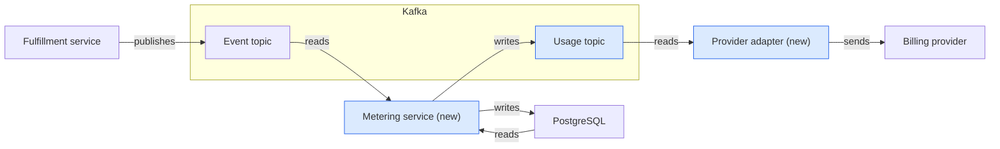

# Metering on the OSAC event log

Metering reads the event log fulfillment already writes and turns it into usage the provider can bill. A new metering service folds each tenant's events into PostgreSQL, compares the usage the billing rules expect with what it has already sent, and sends the difference as a usage event to that tenant's own Kafka topic. The provider's adapter reads those usage topics and sends each event to the billing provider, which adds them up. Cloud Provider Admins read every tenant's usage from their own reader, Tenant Admins and Tenant Users get their organization's usage through the provider's billing system, and Cloud Infrastructure Admins deploy the service, set the rules, and watch it. The OSAC console's own usage views, and any API that answers usage queries, are a separate change.

Ticket: the metering on the OSAC event log change (OSAC-5753).

## Today and with this design

| Today | With this design |
|---|---|
| Fulfillment publishes resource events on `osac.events.<tenant>`. | The same events also produce usage. |
| No OSAC component measures consumption. | The metering service writes one usage event per meter and interval. |
| A provider that bills builds its own collection. | The provider reads the tenant usage topics. |
| A hand-built collector cannot replay usage it already sent. | The usage topic and ledger make a replay exact. |

## How it works

Four parts run in order, one tenant at a time.

1. The fold copies each event's billable facts into PostgreSQL.
2. The round compares expected usage with the ledger.
3. The relay sends the difference to the tenant's usage topic.
4. The adapter sends usage to the billing provider.

Each step has its own section below.

## Definitions

- **Event**: one record of a resource change on `osac.events.<tenant>`.
- **Fact**: one value with the time it became true, such as state RUNNING at 10:02.
- **Meter**: a rule that names the billable states, unit, dimensions, and multiplier.
- **Round**: one tenant's one-minute comparison of expected usage with the ledger.
- **Usage event** (the code calls it a heartbeat): one CloudEvent with one quantity over one interval.
- **Ledger**: the rows that record usage already sent, one row per interval and set of dimensions.

## Step 1: Fold the events into facts

1. The fold reads the tenant's event topic `osac.events.<tenant>` from the offset stored for that tenant. It only reads; it never writes or creates the event topic.
2. The fold writes each billable fact to PostgreSQL's `history` table and advances the stored offset in the same transaction. A crash rolls back both, and a duplicate event writes the same facts again, so no usage doubles.
3. The fold takes the fact names from the metering annotations on fulfillment's private protos, so the fold and fulfillment's database triggers cannot drift. A test fails when a tracked table has no trigger.
4. The fold skips a record it cannot use: an event of another tenant, an unreadable payload, a missing time, or a range Kafka retention deleted. It counts each skip in `osac_metering_events_skipped_total` and never invents a value; a skipped record is usage the provider cannot bill, and the alert fires. Metering never writes fulfillment state, so its failure delays usage and never blocks provisioning.

## Step 2: Round each tenant every minute

5. A tenant's round runs every `heartbeat.interval` (60 seconds by default) on PostgreSQL's clock, and a pod more than 5 minutes off that clock skips the comparison. The service discovers tenants from the event-topic prefix every 30 seconds and creates the tenant's usage and dead-letter topics with the configured retention.
6. Before comparing, the round replays any usage event on the tenant's topic that the ledger does not hold. This repairs the ledger after a database restore, so a restored database resends nothing and the round bills only the gap it cannot rebuild.
7. The round computes the usage the rules say should exist up to the round time, compares it with the ledger, and writes only the difference to the outbox and ledger in one transaction. A positive difference is new usage, and a negative difference takes back usage already sent.
8. The rules are immutable ConfigMaps named `osac-metering-rules-<NNNN>` with an `effective_at`; revision `0001` ships the default meters. A new meter is the next revision, and a malformed or late revision stops the service instead of billing under rules it never loaded.
9. The rules follow the billing rules in the product requirements document (PRD). A virtual machine (VM) bills compute only while RUNNING; a volume and a public IP bill from the moment they become available, even when the VM is stopped; a cluster bills from its start only once it first reaches READY, with its workers under that gate and each worker carrying its instance type and node set. FAILED is never billable, and a resource that fails after it billed gets a negative difference in a later round.
10. A resource that is billable for less than a minute still bills for those seconds: the fold has its creation and deletion times, and the round bills the whole seconds between them. Every time is a whole second, the minimum the PRD allows.

## Step 3: Relay the usage events

11. The relay sends each outbox row to `osac.metering.heartbeat.<tenant>` and deletes the row only after Kafka acknowledges it. A crash between send and delete resends the same row with the same id, and the provider drops the copy.
12. A usage event's CloudEvent `id` is a SHA-256 of tenant, resource, meter, component, billing dimensions, interval, and heartbeat time; it leaves out the quantity and the billing account. A resend keeps the id, while a later correction has a new interval and a new id. Each event also carries tenant, project, catalog, template, deployment, meter type, and the meter's dimensions, so a provider can group usage by tenant, project, resource type, or template.
13. Each usage topic has one partition, so a tenant's usage events keep the order the relay sent them. The relay never moves the stored offset past a gap; catch-up fills the gap first.

## Step 4: Send usage to the provider

14. An adapter reads every tenant's usage topic and the shared Model as a Service (MaaS) inference topic, sends each CloudEvent to the provider, and commits its offset only after the provider accepts it. A rejected usage record goes to the tenant's `osac.metering.dlq.<tenant>` with its original offset, and a rejected inference record goes to `osac.metering.inference.dlq`; a failed dead-letter queue (DLQ) send does not acknowledge the source.
15. All adapters share one runner for deduplication, ordering, retry, and DLQ routing; a new provider implements `ProviderAdapter` and does not reimplement them. MaaS inference events arrive on `osac.metering.inference` from outside this design and take this adapter path, not the fold.
16. The per-tenant usage and DLQ topics keep every record by default (`topics.retentionMs: "-1"`), so a restored database can rebuild the ledger from them. The event topics default to 7 days under the reliable event distribution design (OSAC-983), which bounds a rebuild of facts from the event log. A restart resumes from the stored offsets, so an upgrade loses no usage.

## Security

- Metering reads every tenant's event topic and writes a tenant's usage only to that tenant's usage topic. It reads the tenant from the topic name and skips an event whose payload names another tenant.
- The built-in `system` and `shared` tenants are skipped, so platform events never bill.
- A provider reader gets a Kafka user with read access to the whole usage-topic prefix and its own group. This is how a Cloud Provider Admin sees every tenant; this design gives a tenant no Kafka credentials.
- The optional `external_billing_account_id` comes from the tenant's external billing id in its events. Events carry no credentials, and adapter credentials live in Kubernetes Secrets.

## Where the code goes

- New: `osac-metering/metering-service` (fold, round, relay), `osac-metering/schema` (CloudEvent and topic names), `osac-metering/adapters` (runner and provider adapters), and `osac-metering/charts/osac-metering`.
- Changed: `osac-installer/charts/osac` adds the metering subchart, its PostgreSQL database, and the Kafka access control lists (ACLs); `fulfillment-service` carries the metering annotations, event payloads, and triggers that feed the fold.
- Unchanged: the event distribution in the reliable event distribution design (OSAC-983), `osac-operator`, and `osac-ui`.

## API

The API is Kafka topics, Helm values, and rule ConfigMaps; the metering service serves no request API.

| Name | Who uses it | Contract |
|---|---|---|
| `osac.metering.heartbeat.<tenant>` | provider readers and adapters | `osac.resource.heartbeat.v1` CloudEvents |
| `osac.metering.inference` | adapters | `osac.inference.usage.v1` CloudEvents |
| `osac.metering.dlq.<tenant>` | operators | rejected event with its original offset |
| `heartbeat.interval`, `topics.retentionMs` | Cloud Infrastructure Admin | chart values |
| `osac-metering-rules-<NNNN>` | Cloud Infrastructure Admin | immutable meter rules with `effective_at` |

## Alternatives

Do nothing: the PRD's usage and billing input do not exist.
Read through the fulfillment Watch API: the bridge already filters and resumes, but it adds a hop and makes metering depend on the fulfillment API being up.
Let each provider meter OSAC from its own hooks: usage is fragmented and has no common contract.

## Not in this design

The usage query API, console views, the per-VM rollup of attached volume and public IP usage, costing, billing, quota enforcement, and metering for a service with no tracked fields.

## Questions for the developer

1. OSAC-983 gives event topics 7 days, but the PRD says records needed to rebuild metering are kept indefinitely. Is 7 days the accepted rebuild bound, with the usage topics carrying the old history, and should the chart reject a `topics.retentionMs` below 13 months?
2. Which component produces the MaaS inference events on `osac.metering.inference`, and does that event carry input, output, cached, and total tokens? No producer is in the OSAC source tree.
3. Are the tenant and provider usage views, and the per-VM rollup, expected from this design or from a separate usage query API and console design? This design produces Kafka usage events only.
