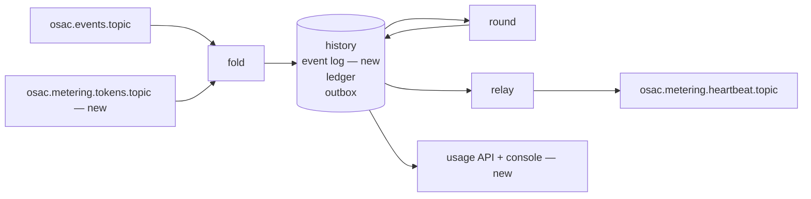

# Metering on the OSAC Event Log

The metering service reads the change events fulfillment publishes on each tenant's Kafka topic and turns them into billable usage. A fold copies the billable facts and the event offset into one database transaction. A per-tenant round compares expected usage with the ledger and writes a signed heartbeat to the outbox. A relay publishes each heartbeat to the tenant heartbeat topic, and a usage API serves the ledger to the console. Providers read one usage contract, and tenants see their own usage by project.

Design for metering on the OSAC event log (OSAC-5753). See the [PRD](prd.md).

## Today and with this design

| Aspect | Today | With this design |
|---|---|---|
| Meter coverage | Seven meters on six resource types | Worker node sets by class and Model as a Service (MaaS) tokens added |
| Failed resources | Billing stops at FAILED and earlier usage stands | Entering FAILED takes back all usage for the resource |
| Event record | Rebuild window bounded by the event topic retention | The fold keeps every billable event in the metering database |
| Usage query | Kafka heartbeat topics only | Usage API and console views per tenant and project |
| Meter changes | A rule revision ConfigMap | An immutable revision gate and a retention floor |

## How it works

The diagram shows two inputs and two outputs. The event topics and the MaaS token topic both feed the fold. The fold, the round, and the relay write only the metering database and the tenant heartbeat topic, so a reader never sees a raw event. The token topic and the usage API are new.

- **Fold.** Metering copies each billable event, its facts, and the offset into one database transaction.
- **Round.** Each minute, per tenant, metering compares expected usage with the ledger and writes the difference to the outbox with the ledger.
- **Relay.** The relay sends heartbeats in order and deletes each row after Kafka confirms the send.
- **Serve.** The usage API answers organization and project queries from the ledger.

Each step has its own section below.

## Definitions

- **Event**: one change that fulfillment publishes to a tenant event topic.
- **Fact**: the value one field of one resource held from a moment on.
- **Meter**: what metering measures, such as a running VM's seconds.
- **Ledger**: the usage metering has billed, per identity and interval.
- **Heartbeat**: one signed usage quantity that metering sends to a tenant heartbeat topic.
- **Correction**: a heartbeat with a negative quantity that takes back earlier usage.

## Fold

1. **Metering reads each tenant's event topic at its stored offset.** It discovers a tenant by listing the topics with the `osac.events.` prefix, and it keeps one offset per tenant.
2. **The fold writes the raw event, its facts, and the offset in one transaction.** A crash before the commit replays the event, and the fact key makes the replay idempotent.
3. **The event log keeps each metered event indefinitely.** The fold copies the event before it advances the offset, so a restore does not depend on the event topic's retention.
4. **Worker node sets are facts of their parent cluster.** The Cluster event carries each set's size and hardware profile. The node meter bills node-seconds for the set with the class as a dimension.
5. **The Bare Metal as a Service (BMaaS) allocation meter excludes a bare-metal instance a cluster owns.** The node meter bills that instance once, under the cluster.
6. **Token usage arrives on `osac.metering.tokens.<tenant>`.** The token loop drops a request id it has applied. It batches by model and token type, then writes the batch ledger row and heartbeat in one transaction. The loop flushes every 15 seconds, so token usage is queryable inside the 60-second target. Input, output, and cached tokens are separate meters, and total tokens are their sum.

## Round

1. **A round runs every 60 seconds for each tenant.** It starts after the fold reaches the event topic watermark, so it never bills from a partial view.
2. **Rules decide the billable states, dimensions, and multiplier.** An interval starts and ends at the second of the event that changed the state, so a resource that lives 30 seconds bills 30 seconds. A sub-second lifetime is not captured. Every heartbeat carries the deployment, tenant, project, catalog item, template, and meter-type dimensions.
3. **The round writes the ledger row and the outbox heartbeat in one transaction.** The ledger holds the total billed. The heartbeat holds the difference since the previous round and the event offset the round had folded.
4. **A resource that enters FAILED has all its usage taken back.** The round writes corrections for every ledger row of the resource's own meters, then stops billing it. A volume or public IP under the same VM keeps billing by its own state.
5. **A rule revision is immutable and has an effective date.** Adding a meter ships a new revision ConfigMap. Removing a meter sends a final heartbeat up to the effective time. A revision that would reprice an already-billed span refuses to start.
6. **A cluster bills from its first READY state.** A cluster that fails or is deleted before then bills nothing, and its node meter follows the cluster's billable state.

## Relay

1. **The relay sends heartbeats in outbox order to the tenant heartbeat topic.** One partition per topic keeps that order for every reader.
2. **The relay deletes an outbox row after Kafka confirms the send.** A crash between the send and the delete resends the same heartbeat id, and a reader drops the duplicate.
3. **The heartbeat id is a hash of the usage identity and the interval.** It covers tenant, resource, meter, component, dimensions, and interval. It leaves out quantity, so a resend matches and a correction gets its own id.
4. **A heartbeat the provider rejects lands on the tenant dead-letter topic.** A dead-letter write that fails leaves the source record unacknowledged, so the reader retries it.

## Serve

1. **The usage API reads the ledger and clips each interval to the query window.** The ledger holds the quantities the round billed, and a correction has already adjusted them.
2. **The API resolves organization and project scope with the `VIEW_PROJECT` permission from the Organizations model.** It never trusts a tenant or project value from the client.

| Caller | Visible usage |
|---|---|
| Cloud Provider Admin | All tenants and projects |
| Tenant Admin | Their organization, every project |
| Tenant User | Projects they belong to |

3. **The console shows usage by tenant, project, resource type, template, resource class, and model.** The project grouping includes nested projects. A parent resource view adds the resources it owns. The provider view adds the tenant and project filters.
4. **The API serves at least 13 months of aggregated data.** It reports the configured retention when a query reaches past it.
5. **The API reports pipeline health.** It exposes fold lag per tenant, outbox depth, and the retention of each heartbeat topic.

## Guard Rails

1. Every ledger writer writes the ledger row and the outbox heartbeat in one transaction, so a heartbeat exists only after its ledger row commits.
2. The fold writes the raw event, its facts, and the tenant offset in one transaction.
3. A duplicate event cannot double-bill, because fact writes are keyed and the outbox id is deterministic and unique.
4. The token loop drops a repeated request id before it writes a ledger row or a heartbeat.
5. Per-tenant ordering holds because each event and heartbeat topic has one partition and the fold keeps one offset per tenant.
6. Metering commits a Kafka offset only after the database transaction for that record commits.
7. A crash, restart, or upgrade resumes from the stored offsets, so the fold replays an uncommitted event and the relay resends an unconfirmed heartbeat.
8. A restore rebuilds the ledger from the retained heartbeat topic, and the next round re-sends the difference the backup lost.
9. A rule revision that would reprice an already-billed span refuses to start.
10. A round skips when the pod clock differs from the database clock by more than five minutes.
11. A round skips when the database clock has not passed the last round time.
12. Tenant isolation holds because metering reads only a tenant's own topic and the usage API filters by organization and project before it reads rows.
13. Event and dead-letter topics keep every record.
14. The heartbeat topic keeps every record by default, and its retention is never below 13 months.
15. A failed dead-letter write does not acknowledge the source record.
16. A metering outage cannot delay provisioning because fulfillment never calls metering on the write path.
17. A metering outage loses no record because the loops resume from their stored offsets.

## Security

Metering holds the only credential that reads the raw event topics. External readers get a read-only grant on the heartbeat topic prefix, and they cannot read `osac.events.*`, the dead-letter topics, or the metering database. The usage API reuses the Organizations permissions, so a caller cannot widen its scope with a query parameter. Heartbeats carry billing dimensions and no secret, and a cluster's node facts carry only size and hardware profile.

## Where the code goes

- **New:** `event_log`, `token_request`, the token loop, and the usage query server in `osac-metering`, `UsageService` in `fulfillment-service`, and the Usage pages in `osac-ui`.
- **Changed:** the fold, round, relay, rule revision `0002`, and chart in `osac-metering`, the Cluster metering annotations and pinned tables in `proto/`, and the generated contract.
- **Unchanged:** the fulfillment `Watch` API, the `osac.events.<tenant>` topics, the heartbeat schema `v1`, and the OSAC custom resources.

## API

1. `osac.public.v1.UsageService` (`ListUsage`, `GetHealth`) — new. Serves the console and tenant callers, with filters for tenant, project, resource type, meter, and period, and a `group_by` list.
2. `osac.private.v1.MeteringUsageService/ListUsage` — new. Serves fulfillment with the resolved tenant and project scope.
3. `osac.metering.tokens.<tenant>` topic and `osac.inference.usage.v1` event — new. One record per completed MaaS request.
4. `osac.metering.heartbeat.<tenant>` topic — unchanged. Carries the signed heartbeats.
5. `osac-metering-rules-<NNNN>` ConfigMap — changed to revision `0002` with the node and token meters.

| Value | Default | Set by |
|---|---|---|
| `metering.heartbeat.interval` | `60s` | installer |
| `metering.topics.retentionMs` | `-1` | installer, accepts `-1` or 13 months or more |
| `metering.tokens.retentionMs` | `-1` | installer |
| `metering.rules.revision` | `0002` | installer |

## UX Alignment

The console adds a Usage page in the provider scope and one in the tenant scope. Both are read-only tables with filters for project, resource type, meter, and period. No osac-ux usage library exists yet. The pages follow the existing list and detail patterns and avoid sub-resource actions, string-union storage classes, and Kubernetes-internal fields.

## Alternatives

- **Meter on the fulfillment write path.** It couples billing to provisioning and gives no rebuild from the event log.
- **Let MaaS write usage events to the tenant heartbeat topic.** It breaks the contract's producer rule and skips the token deduplication.
- **Do nothing.** The PRD goals for worker classes, tokens, failed-state adjustment, and console views stay unmet.

## Not in this design

Costing, price lists, budgets, and quota enforcement stay in a separate PRD. Object storage, virtual network and subnet, and bandwidth metering stay out per the PRD. Open: the MaaS field set for provider and subscription. Open: whether the usage API needs a materialized projection beside the ledger. Open: the retention floor for installations that keep records beyond 13 months.
