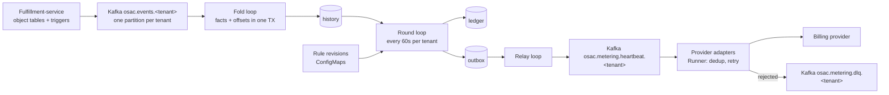

# Metering on the OSAC Event Log

| Field       | Value                                                            |
|-------------|------------------------------------------------------------------|
| Author(s)   | TBD                                                              |
| Jira        | [OSAC-5753](https://redhat.atlassian.net/browse/OSAC-5753)       |
| PRD         | [prd.md](prd.md)                                                 |
| Date        | 2026-11-22                                                       |

# 1. Overview

This design meets the metering PRD by making metering a pure consumer of the
durable event log fulfillment already publishes: the per-tenant
`osac.events.<tenant>` Kafka topics introduced by the reliable event
distribution design (OSAC-983). A metering service folds each tenant's events
into time-stamped facts in PostgreSQL, evaluates versioned billing rules once
per round, and emits the difference against what it has already billed as
idempotent usage events ("heartbeats") on per-tenant
`osac.metering.heartbeat.<tenant>` topics. Provider adapters relay heartbeats
to the billing system with deduplication, retry, and dead-letter routing.
Every table the service keeps is rebuildable from retained Kafka records and
the rule ConfigMaps, so a database loss never bills twice and never loses
usage. See [PRD](prd.md) for detailed requirements.

# 2. Goals and Non-Goals

## 2.1 Goals

- Derive all usage from the existing event log: no new emission path, no
  polling of fulfillment's API or database, and no change to any provisioning
  resource or workflow [PRD: CAP-14].
- Determinism: the same events and the same rule revision always produce the
  same usage, across restarts, upgrades, and database restores [PRD: §5].
- Write each event's facts and the consumer position in one database
  transaction, so at-least-once delivery never double-counts [PRD: CAP-16].
- Keep billing rules as data — immutable, versioned rule revisions a provider
  edits by configuration, not code [PRD: CAP-5, CAP-6].
- Make every metering table rebuildable from Kafka, so upgrades and restores
  cause no data loss and no measurement gaps [PRD: CAP-7, CAP-15, D-2].
- Run entirely on the deployment's existing Kafka and PostgreSQL, on
  premises; no external service sits in the metering path [PRD: §6].

## 2.2 Non-Goals

- Costing, rate authoring, invoicing, and quota enforcement — the billing
  integration features (OSAC-3784, OSAC-3793) own that seam.
- Tenant-facing cost and usage console views — delivered by the billing
  integration on top of the usage contract this design publishes (see Open
  Question 9.2 for the native-query question).
- Workload-level metering, object storage, VirtualNetwork/Subnet metering,
  and network bandwidth metering [PRD: §2.2].
- Changing the `Event` message, the `Watch` API, or any event format: metering
  is a consumer of `osac.events.*`, never a producer of it.

# 3. Motivation / Background

OSAC-983 gave every committed fulfillment mutation a durable, per-tenant,
totally ordered event on Kafka, captured by database triggers so that even a
direct SQL write produces one, and retained for replay. That log is exactly
the capture layer billing-grade metering needs: it never misses a change, it
carries each resource's state and the time of each transition at second
resolution, and it is retained indefinitely by default. Building a second
capture path — polling the fulfillment API, or reading fulfillment's database
— would duplicate capture, miss out-of-band writes, and drift from the event
contract. This design therefore adds no capture; it consumes what OSAC-983
already produces [Codebase:
enhancement-proposals/enhancements/OSAC-983-reliable-event-distribution/design.md].

What the event log does not provide is usage. Events record state
transitions, not quantities: a `ComputeInstance` event says the VM entered
`RUNNING` at 10:00, not that it consumed 600 instance-type-seconds. A
consumer must turn transitions into billable intervals, handle resources that
fail or vanish mid-interval, subtract what it has already reported, absorb
at-least-once duplicates, and hand the result to a billing system that may
reject or lose records. That transformation — fold events into facts, evaluate
rules, emit differences idempotently — is the whole of this design.

Because metering must never affect provisioning [PRD: D-2], the metering
service is a strict downstream consumer: fulfillment does not call it, wait
for it, or know it exists. If the metering stack is down, capture continues in
the event topics and the backlog drains on restart.

# 4. Design

## 4.1 Architecture

The metering subsystem is one service, `osac-metering`, made of a field
registry shared with fulfillment, three loops over one PostgreSQL database,
and a provider adapter framework:

- **Field registry** (`proto/metering`): annotations on the private protos
  declare, per billable resource, which fields metering tracks and how each
  behaves — `CONSTANT` (set at creation, never changes),
  `FIXED_ONCE_SET` (empty, then set once), or `VARIES` (changes over time,
  with a companion field holding the change time). One registry feeds both
  consumers that must agree: fulfillment's database triggers and the metering
  fold [Codebase: proto/metering/metering.go].
- **Fold**: a Kafka consumer, subscribed to every tenant topic with the regex
  `^osac\.events\..*$` under one consumer group, that writes each event's
  tracked fields into the `history` table as facts, idempotently, in any
  order. Facts and the folded offset are written in one transaction.
- **Round**: per tenant, every 60 seconds by default, the round catches up,
  computes the usage the rules expect from `history`, compares it with the
  `ledger` of usage already billed, and writes the difference to the `outbox`
  as heartbeat records.
- **Relay**: sends outbox records to the tenant's
  `osac.metering.heartbeat.<tenant>` topic and deletes each row after the send
  succeeds, so a crash between send and delete resends the same heartbeat id
  and the reader drops it as a duplicate.
- **Rules**: billing rules are data — immutable, versioned ConfigMaps
  (`osac-metering-rules-<NNNN>`) holding complete meter definitions with an
  `effective_at` time. The chart ships the default meters as revision 0001.
- **Adapters**: a shared `Runner` (Kafka consumer, dedup, retry, DLQ routing)
  and concrete `ProviderAdapter` implementations that relay heartbeats to the
  billing provider; a worked `billing-reader` example shows an outside reader
  the contract in code.

The diagram shows the pipeline's two decoupled halves: everything left of the
heartbeat topic is OSAC-internal and rebuildable; everything to its right is
the provider-facing contract. The takeaway is that the only coupling to
fulfillment is the event topic the fold consumes, and the only coupling to the
billing provider is the heartbeat topic the adapters read — each side can be
replaced or rebuilt independently.

**Direct topic consumption, not the `Watch` bridge.** OSAC-983 sketched a
consumption pattern for metering through the private `Watch` API (group mode
with a CEL filter). This design consumes the topics directly instead, with a
dedicated `KafkaUser` holding a `Read` ACL on the `osac.events.*` prefix. The
decisive reason is transactionality: the fold must write facts and advance its
position in the same database transaction, and a `Watch` client cannot express
that — Kafka auto-commits a group's offset when the bridge polls the record,
decoupling the delivery position from the metering service's processing, so a
crash between poll and database commit would lose events for metering forever.
Direct consumption also avoids routing every tenant event through a second
gRPC hop. See Alternatives for the full trade-off.

**Builtin tenants.** Fulfillment's `system` and `shared` tenants have event
topics like any other; their usage is never billed, and the service excludes
them by name [Codebase: osac-metering/schema/topics.go].

## 4.2 Data Model / Schema Changes

Four tables in the metering database; all are created idempotently at startup
and all but the outbox are rebuildable from Kafka or the rule ConfigMaps
[Codebase: osac-metering/metering-service/internal/database/schema.go].

**`history`** — what metering knows, and since when. One row per fact: the
value one field of one resource held from a moment on.

| Column | Type | Notes |
|--------|------|-------|
| `tenant` | `text not null` | Tenant owning the resource |
| `resource_type` | `text not null` | Proto message name, e.g. `ComputeInstance` |
| `resource_id` | `text not null` | The object's id |
| `field` | `text not null` | Tracked field path, e.g. `status.state` |
| `since` | `timestamptz not null` | The moment the value took effect, whole seconds |
| `value` | `text not null` | The value from then on, as text |
| `event_offset` | `bigint not null` | Position of the carrying event in the topic; the round uses it to find changed resources |
| `topic_generation` | `bigint not null default 0` | Which event topic the offset belongs to; a topic recreation advances it |

Primary key `(tenant, resource_type, resource_id, field, since)` makes the
fold idempotent: re-delivering an event writes the same row again. Indexes on
`(tenant, event_offset)` (resources whose facts changed since the previous
round), `(tenant, since)` (facts dated after the previous round, because a
writer's clock can run ahead of the round clock), and `(tenant, field, value)`
(resources a changed root owns). A tenant's external billing account id is a
row here too (`resource_type Tenant`), copied onto heartbeats by the round; it
is not a billable resource.

**`ledger`** — what metering has already billed. One row per committed usage
piece, keyed by `(tenant, resource_type, resource_id, meter, component,
dimensions, start_time)`, with `end_time` and `quantity_micro` (the billed
quantity in micro units of the meter's unit). The round compares the usage it
expects against this table and sends only the difference. Rebuildable from
the heartbeat topic, except pieces that were never sent — which the next
round's diff re-derives.

**`outbox`** — heartbeats waiting for the relay, in round order:
`seq bigserial primary key`, `tenant`, `id` (the heartbeat's CloudEvent id,
`unique` so a resend bills once), `payload jsonb`, `round_time`.

**`progress`** — where each tenant stopped: folded event offset, catch-up
heartbeat offset, and last round time, one row per tenant.

**Field registry and source-contract triggers.** The tracked fields live as
`metering` annotations on the private protos; a shared Go registry
(`proto/metering`) walks the compiled descriptors at startup, validates every
annotation (a varying field must name a real timestamp field), and exposes the
list per resource [Codebase:
proto/private/osac/private/v1/metering_type.proto]. Fulfillment maps the
resources to tables and its migrations attach two triggers per tracked table:
the outbox trigger from OSAC-983 and a source-contract trigger that enforces
the annotation contract in SQL — a `CONSTANT` field rejects changes, a
`VARIES` field must carry a later transition time when its value changes.
`CheckSchema` refuses to start the service when a mapped table lacks its
triggers, and a drift test fails when the installed triggers disagree with the
annotations. Adding a tracked field is three coordinated edits (annotation,
table mapping, trigger migration) and the tests fail until all three agree.

## 4.3 API Changes

No new gRPC or REST endpoints in fulfillment-service or the metering service;
no CRDs, webhooks, or finalizers. The interface this design introduces is a
data contract, not an API: the usage heartbeat CloudEvents on
`osac.metering.heartbeat.<tenant>`, specified in a generated, checkable
contract (reference document plus JSON Schema, regenerated by `make contract`
from the field registry, the default rule revision, and the published schema
versions) [Codebase: osac-metering/docs/contract/reference.md]. Its shape:

- CloudEvent type `osac.resource.heartbeat.v1`; the suffix is the schema
  version. Published schema versions are add-only and immutable; a new field
  is a new version file with an effective date, and replay decodes every
  retained record with the current (superset) shape.
- `id` is a lower-case hex SHA-256 over tenant, resource type, resource id,
  meter, component, billing dimensions, interval start, interval end, and
  heartbeat time — excluding the quantity, so a resend carries the same id and
  the reader drops it. This is the deduplication key [PRD: CAP-16].
- Payload: `tenant_id`, `resource_type`, `resource_id`, `meter`, `component`,
  `billing_dimensions` (the meter's dimensions plus the identity dimensions
  `deployment`, `tenant`, `project`, `catalog`, `template`, `meter_type`),
  `usage` (`semantics: interval`, `from` inclusive, `to` exclusive,
  `quantity` as fixed-point text with six decimals, `unit`, `precision:
  second`), `heartbeat_time`, `last_applied_offset`, `rules_revision`, and
  optional `external_billing_account_id`.
- A correction is a usage event with a negative quantity for the same
  resource, meter, component, and billing dimensions; the reader adds it to
  take back usage already sent. This is how failed-state adjustment is
  expressed [PRD: D-5].

## 4.4 Scalability and Performance

- **CPU and memory**: the fold is I/O-bound — one fact row per tracked-field
  change; the round evaluates rules only for resources whose facts changed
  since the previous round (the `history_by_offset` and `history_by_since`
  indexes), so a steady-state round does work proportional to change rate,
  not fleet size.
- **Database load**: writes scale with mutation rate (fold) plus one ledger
  upsert and one outbox insert per billable resource per round; reads scale
  with changed-resource count. A single PostgreSQL instance serves the
  deployment; tenants are the natural shard boundary if that ever stops
  holding.
- **Kafka load**: heartbeats are one event per billable meter per resource
  per round — with the default 60 s round, a tenant with 10,000 billable
  resources emits roughly 170 heartbeat records per second on its
  single-partition heartbeat topic. Event-topic consumption parallelizes
  across tenants (one partition per tenant topic), which is where the
  cross-tenant throughput comes from.
- **Retention and cleanup**: event, heartbeat, and DLQ topics default to
  unlimited retention (`topics.retentionMs: "-1"`), which is what makes
  rebuildability and indefinite history possible [PRD: §4, CAP-7]; a finite
  retention bounds the recovery window to it and must never be configured
  below the PRD's 13-month floor for aggregated data. The outbox is transient
  (rows deleted after send); `history` and `ledger` grow with fleet size and
  are the deployment's storage budget.
- **Assumed scale**: hundreds of tenants, thousands of resources per tenant.
  The per-tenant single-partition heartbeat topic caps intra-tenant relay
  throughput; that is accepted because per-tenant ordering of usage events is
  required for correct correction matching.

## 4.5 Security Considerations

- **Metering is a trusted, cluster-wide consumer.** Like the fulfillment
  controllers, the fold reads every tenant's events; it is deployed by the
  installer inside the trust boundary, with a `KafkaUser` whose `Read` ACL is
  scoped to the `osac.events.*` prefix. This adds a second Kafka principal
  where OSAC-983 assumed fulfillment-service was the sole one — an accepted,
  explicit deviation (see Impact and Compatibility). The raw event log is
  never republished: the contract states metering reads `osac.events.<tenant>`
  and never publishes it.
- **Tenant isolation on the output side is structural.** Heartbeats go to
  per-tenant topics; a reader (adapter or provider system) receives ACL grants
  scoped to exactly the tenants it serves, via chart reader grants, so a
  tenant-scoped reader cannot read another tenant's usage off the wire.
- **No secrets in the pipeline.** Event payloads carry object data only — for
  `Secret` objects, metadata and backend coordinates, never secret material
  (inherited from OSAC-983's capture). DLQ headers carry error text only, and
  adapter errors never include credentials or raw secrets.
- **Input validation is declarative and at startup**: the registry refuses an
  invalid annotation loudly; the service refuses to load a schema version
  whose effective date is in the future; the contract check fails CI when the
  published reference is stale.

## 4.6 Failure Handling and Recovery

- **Crash between heartbeat send and outbox delete:** on restart the relay
  resends the row; the CloudEvent `id` is unchanged, so the billing provider
  drops it as a duplicate. No double-billing [PRD: CAP-16].
- **Duplicate event delivery (at-least-once):** the fold writes the same fact
  row (primary-key idempotency) and the same ledger diff; nothing changes.
- **Kafka unreachable:** the fold stops advancing (offsets commit only after
  the database transaction succeeds), the outbox accumulates, rounds pause.
  On recovery the backlog drains in order; no loss, no gap [PRD: D-2].
- **Metering database lost or restored:** rebuild `history` by replaying the
  event topics, `ledger` from the heartbeat topic, rule revisions from the
  ConfigMaps. A rebuilt ledger lacks heartbeats that were never sent, and the
  next round's diff re-derives and resends them — the same rows, the same
  ids. Nothing bills twice; nothing is lost while the topics hold their
  records [PRD: CAP-15, §5].
- **Metering stack down entirely:** provisioning is unaffected — fulfillment
  never calls metering. Capture continues in the event topics; the fold
  resumes from its committed position [PRD: CAP-14, D-2].
- **Billing provider rejects a heartbeat:** the adapter retries, then writes
  the record to the tenant's `osac.metering.dlq.<tenant>` topic with an
  `original-offset` header. A DLQ send failure must not acknowledge the
  source event. Replay after a fix: stop the adapter, reset its consumer
  group to the earliest rejected record's original offset, restart — the
  provider drops the ids it already has, so only the rejected heartbeats
  bill [PRD: §4].
- **Event the fold cannot decode:** the tenant's fold stalls and raises
  ingestion-lag alerts rather than skipping the record — for a billing source,
  a loud stop is the safe failure; skipping would silently unbill. The record
  is fixed at the source (fulfillment) and the fold resumes.
- **Resource that fails after billing [PRD: D-5]:** `FAILED` is never a
  billable state; when a resource transitions to failed, the round emits a
  negative correction for the span it billed past the failure.
- **Resource deleted before it ever became billable [PRD: CAP-12]:** rules
  carry `turns_billable_once` — a billable span that closes before a
  confirming state (e.g. a cluster reaching `READY`) never bills at all,
  including its worker nodes.

## 4.7 RBAC / Tenancy

No new OSAC resources and no CRDs, so no `osac.openshift.io/tenant` or
`osac.openshift.io/owner-reference` annotations apply; tenancy is carried as
data. Every fact and every heartbeat carries the tenant (`tenant_id` payload
field, `osactenant` CloudEvent extension, and the per-tenant topic itself);
usage rows additionally carry the `project` identity dimension from the
resource's `metadata.project`, so project-level attribution and RBAC filtering
[PRD: D-1, CAP-9] are a reader-side grouping over dimensions the events
already carry — the billing integration applies `VIEW_PROJECT`-style filtering
when it exposes views. Visibility: a tenant-scoped reader sees only its own
heartbeat topic (ACL grant); a provider-admin reader holds grants on all
tenants' topics [PRD: CAP-1]. Builtin tenants (`system`, `shared`) are never
billed.

## 4.8 Extensibility / Future-Proofing

The pipeline carries no per-resource logic: the fold, rounds, and relay are
generic over the field registry and the rules. Adding a billable resource is
declarations only — annotate the proto fields, add the resource's case to the
`Event` payload oneof, map the table in fulfillment, attach the triggers, and
ship the next rules revision [Codebase: osac-metering/README.md]. Adding or
changing a meter (including custom services) is a new immutable rule revision
naming the resource, meter, unit, billable states, and dimensions — a
configuration update, queryable after deployment [PRD: CAP-6]. New schema
fields are new add-only versions. New billing providers implement
`ProviderAdapter` and reuse the shared `Runner` lifecycle rather than
reimplementing dedup, retry, and DLQ.

# 5. Interface Changes

## IC-1: Per-tenant usage event stream and published usage contract

**Requirements:** CAP-1, CAP-4, CAP-11, CAP-12, CAP-16, CAP-17, D-5

CloudEvents on `osac.metering.heartbeat.<tenant>` (one partition, at-least-once,
same `id` on resend), with the shape specified in §4.3 and the full field
tables in the generated contract reference. The stream is additive (differences
and negative corrections), queryable by summing events per resource, meter,
component, and billing dimensions. Every event carries catalog item and
template references as identity dimensions [CAP-17]; per-second interval
resolution means a resource billable for 30 seconds appears with a 30-second
quantity [CAP-4]; subsidiary resources (volumes, external IPs) bill on their
own states for the full duration of their existence, independent of VM power
state [CAP-11]; worker nodes bill as their own resources with instance/host
type as a dimension, so resource classes price independently [CAP-2 via the
BareMetalInstance and ComputeInstance rules]. Readers: provider adapters, the
worked `billing-reader` example, and any system the provider grants ACLs to.

## IC-2: Rule revisions as immutable ConfigMaps

**Requirements:** CAP-5, CAP-6

`osac-metering-rules-<NNNN>` ConfigMaps, each a complete set of meter
definitions (resource, meter, unit, `billable_when.states`,
`turns_billable_once`, field conditions, `multiplier`, dimensions) with a
future `effective_at`. Released revisions are immutable — a change ships as
the next revision — and an admission policy protects them in the cluster. A
Cloud Infrastructure Admin adds or removes a meter by shipping a new revision;
no code change or rebuild.

## IC-3: Metering field annotations and shared registry

**Requirements:** CAP-6, CAP-11, CAP-12

`metering` annotations on the private protos (`CONSTANT`, `FIXED_ONCE_SET`,
`VARIES` with transition time), the `proto/metering` registry that validates
them at startup, and the fulfillment-side source-contract triggers with their
`CheckSchema` and drift tests. This is the interface through which a new
service's resources become billable, and through which per-resource-class
dimensions (instance type, host type, node set) reach the usage events.

## IC-4: Dead-letter topics and replay procedure

**Requirements:** PRD §4 (dead-letter retention), D-2

`osac.metering.dlq.<tenant>` topics carrying heartbeats the billing provider
rejected, with an `original-offset` header, retained indefinitely. Replay is
the documented consumer-group offset reset described in §4.6. The DLQ has no
consumer of its own; `osac_metering_dlq_depth` reports retained records, not
unhandled ones.

## IC-5: Installer and chart configuration

**Requirements:** CAP-14, PRD §4

`charts/osac-metering` values: round interval (default `60s`);
`topics.retentionMs` (default `-1`; a finite value bounds the recovery window
and must never undercut the 13-month aggregated-data floor); reader grants
(principal to tenant/topic ACL mapping); Kafka bootstrap addresses. The
subsystem deploys with the umbrella chart; removing it affects only usage
export, never provisioning.

# 6. Alternatives Considered

- **Consume through the private `Watch` bridge (OSAC-983's sketched pattern).**
  Metering would call `Watch(filter, group)` like the controllers. Pros: no
  new Kafka principal; one consumption API for everything. Cons: the bridge
  auto-commits group offsets on poll, so the fold could not tie its database
  writes to its delivery position — a crash between poll and commit loses
  events for metering; every tenant event traverses an extra gRPC hop; the
  CEL filter is redundant for a consumer that needs every event. Rejected on
  the transactionality argument; OSAC-983's sketch is superseded here.
- **Poll the fulfillment API or read its database.** Pros: no Kafka consumer
  to operate. Cons: duplicates capture, misses out-of-band (direct SQL)
  writes that the event triggers already catch, and re-introduces the
  best-effort gap problem OSAC-983 exists to solve. Rejected.
- **Compute usage on read, from the raw event log, with no stored state.**
  Pros: nothing to rebuild. Cons: every query replays the whole log; no
  diffable "already billed" baseline, so emitting differences to a billing
  system — which needs increments, not queries — has no basis. Rejected: the
  fold-plus-ledger shape exists precisely to make incremental, idempotent
  export possible.
- **Send absolute cumulative usage instead of differences.** Pros: no
  corrections needed. Cons: a resend after a crash would need exactly-once
  delivery to avoid double-billing, which Kafka does not give; differences
  with a content-derived id make at-least-once safe. Rejected.
- **Rules as code, or rules as CRDs.** Rules in code defeat CAP-6 (a meter
  change would be a rebuild). Rules as a CRD add a controller, reconciliation,
  and RBAC surface for what is static, immutable data — a ConfigMap revision
  with an admission policy delivers the same immutability with none of that.
  Rejected.
- **Emit usage from the fulfillment controllers per resource.** Pros: no
  consumer at all. Cons: couples provisioning to billing, violating D-2 and
  CAP-14 — a metering outage would have to block or be silently lossy at the
  source. Rejected.
- **Do nothing (each provider builds their own metering).** The PRD rejects
  this: fragmented approaches and inconsistent data models. Rejected.

# 7. Observability and Monitoring

New Prometheus metrics from the metering service (name, type, alert signal):

- `osac_metering_fold_lag` (gauge, labeled by tenant) — event-topic consumer
  lag; sustained growth means the fold is stalled or undecodable events are
  blocking a tenant.
- `osac_metering_outbox_depth` (gauge) — heartbeats waiting for the relay; a
  sustained nonzero value with no sends means the heartbeat produce path is
  down.
- `osac_metering_round_duration_seconds` (histogram, labeled by tenant) —
  round wall time; growth beyond the round interval means rounds cannot keep
  up with the change rate.
- `osac_metering_heartbeat_send_total` / `osac_metering_heartbeat_errors_total`
  (counters) — relay throughput and failures.
- `osac_metering_dlq_depth` (gauge, labeled by tenant) — retained DLQ records
  (log occupancy); growth means the billing provider is rejecting heartbeats.
- `osac_metering_rules_revision` (gauge) — the active rule revision; an
  unexpected value after a config change means the revision did not load.

Structured log events on fold decode failures (with tenant, offset, resource
type), round diffs that emit corrections, and relay/DLQ failures. No
Kubernetes events (no CRD). Pipeline health — ingestion lag, storage usage —
is exactly what these metrics expose [PRD: CAP-5].

# 8. Impact and Compatibility

- **No backward-incompatible changes.** No existing API, CRD, or event format
  is modified; the metering annotations on the private protos are additive
  and private-only.
- **Fulfillment gains behavior, not dependencies:** migrations attach
  source-contract triggers to tracked tables, and `CheckSchema` enforces
  their presence. The triggers reject writes that violate the field contract
  (e.g. mutating a `CONSTANT` field), so only fields the API already rejects
  changing may be annotated `CONSTANT` — the drift test keeps this honest.
- **New Kafka principal:** metering's `KafkaUser` with `Read` on
  `osac.events.*` relaxes OSAC-983's "fulfillment is the sole principal"
  assumption. It is an internal, trusted, cluster-wide consumer — the same
  trust position as the controllers — and the event topics remain internal to
  the platform; only heartbeat topics are ever granted to outside readers.
- **Upgrade/downgrade:** the metering database carries no state that cannot
  be rebuilt, so an upgrade is: deploy new images, load the new rule
  revision, let the loops resume from their committed positions. A downgrade
  or database loss rebuilds from the retained topics as described in §4.6 —
  no measurement gaps while retention holds [PRD: CAP-15].
- **Version skew:** metering consumes events produced by older and newer
  fulfillment replicas from the same topics; the fold is tolerant of unknown
  fields (proto forward compatibility) and stalls loudly on a payload it
  cannot decode rather than guessing.

# 9. Open Questions

## 9.1 MaaS usage data source and latency

- **Owner:** MaaS platform team (to be confirmed)
- **Impact:** §4.1 fold input; §4.4 round interval; IC-1 contract fields for
  token meters.

The PRD scopes MaaS as consumption-based per token with 60-second query
latency [PRD: CAP-3, CAP-13, §2.3] but leaves data source ownership open. The
pipeline is generic — inference usage can enter as events on the tenant's
event topic once the MaaS platform emits them, with token counts as tracked
fields and a per-token meter in a rules revision. Does the MaaS platform emit
inference-completion events to `osac.events.<tenant>`, and does the 60-second
latency requirement demand event-driven rounds (or a shorter per-tenant round
interval) rather than the default 60-second round?

## 9.2 Native usage query API

- **Owner:** metering maintainers + billing integration owners (OSAC-3784)
- **Impact:** §4.3; IC-1; the PRD's tenant visibility capabilities.

PRD decision D-1 refers to a "Usage API" applying project-level RBAC, and
CAP-8/CAP-10 want Tenant Admins and Users viewing usage. This design exposes
usage as a per-tenant stream with a published contract, and the osac-ui cost
views are delivered by the billing integration reading that contract. Is a
first-party, tenant-facing usage query API (serving aggregated usage from the
ledger with project RBAC, independent of any billing provider) also required,
and in which milestone?

## 9.3 Parent-VM attribution for subsidiary resources

- **Owner:** metering maintainers
- **Impact:** IC-3 tracked fields; IC-1 dimensions for `volume`.

CAP-11 requires all resources belonging to a VM to be attributable to the
parent VM for a unified cost view. External IPs carry attachment and
attribution dimensions; volumes carry only `storage_tier` in the default
revision. Should volume attachment to a compute instance become a tracked
`VARIES` field (with its transition time) so heartbeats carry the parent VM,
or is the catalog/project/template identity sufficient for the unified view?

## 9.4 Resource-class dimensions for VM-based CaaS workers

- **Owner:** CaaS team
- **Impact:** IC-3 annotations for `ComputeInstance`; default rule revision.

CAP-2 requires worker-node usage broken down by resource class. Bare-metal
workers carry `cluster`, `node_set`, and `instance_type` dimensions today;
VM-based workers (OSAC-1589) are `ComputeInstance` resources whose default
dimensions do not include the parent cluster or node set. Should the
`ComputeInstance` annotation set gain parent-cluster and node-set fields so
VM workers meter with the same resource-class breakdown as bare-metal
workers?

## 9.5 Reader grants for providers substituting the built-in stack

- **Owner:** metering maintainers + security owners
- **Impact:** §4.5; IC-5; CAP-14.

CAP-14 lets a provider consume OSAC's lifecycle data without deploying the
built-in metering stack. The heartbeat contract is the supported surface, but
a provider replacing the stack entirely would need to read `osac.events.*`
directly — topics this design treats as internal. Should the installer
support granting an external metering consumer read ACLs on the event
topics (and document their contract), or must such providers run the fold
themselves as a supported deployment mode?
