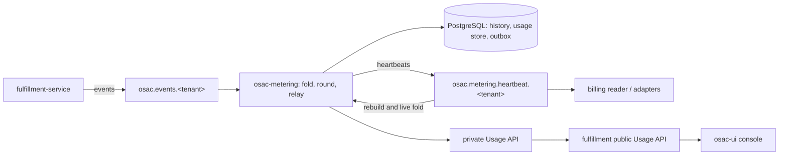

# Metering on the OSAC Event Log

## Summary

This design turns the per-tenant event topics fulfillment already publishes
(OSAC-983) into billable usage. A new osac-metering component folds those
events into a usage database, evaluates versioned meter rules every minute,
and sends per-interval usage events to per-tenant usage topics. A new
tenant-scoped Usage API reads the same records for the console. See
[PRD](prd.md) for detailed requirements.

## Motivation

Fulfillment records every committed resource change as an event on the
tenant's `osac.events.<tenant>` topic. The stream is ordered, replayable, and
covers every write path. Nothing today turns those changes into quantities a
billing system can add up, so each provider would build their own.

Four PRD requirements shape the design:

- Billing-grade correctness. Duplicate events must not double-count (CAP-16).
  Metering outages must leave no gaps (D-2). History must be rebuildable
  (CAP-7, CAP-15).
- Second granularity. A resource that exists for 30 seconds must be metered
  exactly (CAP-4).
- State-dependent billing. What bills depends on resource state. A transition
  to FAILED takes recorded usage back retroactively (D-5).
- Provider control. The stack runs on-premises. A provider with their own
  metering can read the event topics and skip the built-in stack (CAP-14).

The design keeps all of this out of fulfillment. Metering only reads the
event log, so a metering failure cannot affect provisioning.

### Goals

- Read `osac.events.<tenant>` directly as a Kafka consumer. Change nothing in
  fulfillment's write path.
- Same events and rules always produce the same usage — across restarts,
  upgrades, and database restores.
- Define meters as data: immutable, versioned rule revisions. A new meter is a
  configuration update (CAP-6).
- Bill at one-second resolution, with corrections that take usage back.
- Publish one usage topic per tenant, with a stable documented event schema,
  and serve tenant-scoped usage queries through fulfillment's public API.

### Non-Goals

- Costing, billing, and quota enforcement — a separate PRD owns them (PRD
  section 10).
- Workload-level metering inside tenant clusters, VMs, or hosts.
- Object Storage, VirtualNetwork, Subnet, and bandwidth metering (PRD
  non-goals).
- Changing the event log or its delivery — OSAC-983 owns that.
- Billing policy for physical reservation on bare metal — PRD D-4 defers it
  to the BMaaS metering PRD.

## Proposal

Five pieces:

1. **osac-metering** (new component). Three loops run against one PostgreSQL
   database — fold, round, and relay, defined in Terminology below. The
   round computes usage from history and rules and sends only differences.
2. **Metering field registry.** Annotations on fulfillment's private protos
   declare which fields metering tracks and how each behaves. Triggers and
   drift tests keep the annotations, the tables, and the payloads agreed.
3. **Rule revisions.** Meters live in immutable ConfigMaps with an effective
   date. A rule change or a new custom meter ships as the next revision.
4. **Usage API.** A new `Usage` gRPC service, public and private. Metering
   implements the private service from its usage store; fulfillment's public
   server proxies it with tenant and project scoping; the console reads the
   public service.
5. **Provider adapters.** A shared runner consumes the usage topics with
   deduplication, retries, and a dead-letter topic. The echo and M360
   adapters plug into it.

Metering is deployed by the osac-installer umbrella chart, always. Billing is
not optional, and no value turns it off.

### Terminology

| Term | Meaning |
|---|---|
| Fold | Loop that copies each event's tracked fields into `history`, idempotently. |
| Round | Per-tenant loop, every 60 s by default: catch up the fold, evaluate rules, emit usage differences. |
| Relay | Loop that sends usage records to Kafka and advances the outbox offset after the ack. |
| History | Table of tracked-field facts per resource, each with its transition time. |
| Usage store | What metering has sent, per usage key; the source for usage queries. |
| Usage key | Tenant, resource type, resource id, meter, component, and billing dimensions. |
| Heartbeat | One usage record: a CloudEvent on the tenant's usage topic with a quantity over one interval. |
| Correction | A heartbeat with a negative quantity. It takes back usage already sent. |
| Billing dimensions | Name–value pairs identifying the priced variant, such as instance type or storage tier. The PRD's resource class is one of these. |
| Component | The billable line a meter feeds. It is the meter name unless a rule sets another. |
| Rule revision | Immutable set of meter rules with an effective date. |

### Workflow Description

Actors: **Tenant User** (provisions resources, views usage), **Tenant Admin**
(views organization usage), **Cloud Provider Admin** (views usage across
tenants), **Cloud Infrastructure Admin** (deploys and operates the stack),
and the **billing reader** (the provider's billing system).

Starting state: OSAC is installed with `kafka.enabled: true`, the metering
chart is deployed, and at least one tenant exists.

Metered lifecycle, in order:

1. A Tenant User creates a VM from a catalog item through the console or CLI
   (fulfillment public API).
2. Fulfillment commits the change. The OSAC-983 triggers publish an event to
   `osac.events.<tenant>`.
3. The fold appends the event's tracked fields to `history` and advances its
   Kafka offset in the same database transaction.
4. The next round catches up the fold, evaluates the rules, and sends usage
   differences as heartbeats to `osac.metering.heartbeat.<tenant>`.
5. The billing reader consumes the heartbeats, drops ids it has already seen,
   and adds the rest up.



The diagram shows the two readers of the pipeline. The billing reader sums
heartbeats from the usage topic. The console queries the same records through
the Usage API, so the provider and the tenant see the same numbers. The arrow
from the usage topic back into metering is the rebuild path: the usage store
can always be refolded from retained records.

Behavior by resource state:

| Condition | Behavior |
|---|---|
| VM running | The `compute` meter bills instance-type-seconds. |
| VM stopped or paused | `compute` stops. Volume and public IP meters continue for as long as the resources exist (CAP-11). |
| Resource transitions to FAILED | FAILED never bills. The next round emits corrections that take back the usage already recorded for the resource (D-5). |
| Cluster deleted before it first becomes READY | Control-plane and worker usage was never sent; a span that closes before its confirming state never bills (CAP-12). |
| Resource exists 30 seconds | One heartbeat covers exactly its interval, down to the second (CAP-4). Sub-second resources are not captured. |
| Duplicate event arrives | The fold ignores it. No meter changes (CAP-16). |
| A tracked field changes, e.g. a VM resize | Later heartbeats include the new dimensions. Each usage key is summed on its own. |

View usage, in order:

1. A Tenant Admin or Tenant User opens the console's usage page. osac-ui
   calls the public `Usage` service through the console proxy.
2. Fulfillment checks tenant visibility, applies project RBAC for Tenant
   Users (PRD D-1, `VIEW_PROJECT` per the Organizations EP), and forwards
   the query to metering's private `Usage` service.
3. Metering aggregates the usage store over the requested period, grouped by
   project, resource type, meter, and template. A Cloud Provider Admin runs
   the same query with a provider scope and gets all tenants (CAP-1).

Operate, in order:

1. The Cloud Infrastructure Admin deploys OSAC; the installer includes the
   metering chart. Prerequisites are the AMQ Streams operator and a Kafka
   cluster.
2. To add or change a meter, ship the next rule revision ConfigMap with a
   future effective date (CAP-5, CAP-6). The service loads it at that time.
3. The admin watches fold lag, dead-letter depth, and round staleness (see
   Observability).

### API Extensions

- **New `Usage` gRPC service** in the public and private API trees. Sketch:

  ```protobuf
  service Usage {
    rpc ListUsage(ListUsageRequest) returns (ListUsageResponse);
  }

  message ListUsageRequest {
    // CEL filter over resource type, meter, project, and dimensions.
    optional string filter = 1;
    // Query window: `from` inclusive, `to` exclusive, UTC, whole seconds.
    google.protobuf.Timestamp from = 2;
    google.protobuf.Timestamp to = 3;
    repeated UsageGroupBy group_by = 4;  // tenant, project, type, meter, template
    optional int32 page_size = 5;
    optional string page_token = 6;
  }
  ```

  Each `UsageRecord` in the response holds the usage key (tenant, resource
  type and id, meter, component, billing dimensions), the unit, and the
  summed quantity as fixed-point text with six decimals. Metering implements
  the private service; fulfillment's public server proxies it after scoping.
  No CRUD: usage is derived data, never written through this API.
- **Metering annotations on existing private protos.** Field options declare
  the tracked fields. They change no wire format and add no RPC.
- No CRDs, webhooks, or finalizers. No resource owned by another party
  changes behavior.
- Operational impact: when metering is down, provisioning and event capture
  continue unchanged. Usage queries fail or serve stale data. Heartbeats
  pause and resume without loss when metering recovers.

## UX Alignment

Not applicable: no `osac-ux/libs/ui-components/src/api/v1/usage.ts` exists
today — the console usage pages are new UI on the public `Usage` service,
and their field mapping lands with that work.

### Implementation Details/Notes/Constraints

**Consumption.** Metering subscribes to every tenant event topic with the
regex `^osac\.events\..*$` under one consumer group, the same pattern the
fulfillment controllers use. Kafka tracks the group's position per topic. A
restart resumes per tenant, and a new tenant's topic joins on the next
metadata refresh. Metering commits an offset only after the fold's database
transaction commits.

**Field registry.** Each billable field in a private proto has a metering
option. `kind` says how the field behaves:

| Kind | Behavior |
|---|---|
| `CONSTANT` | Set at creation, never changes. |
| `FIXED_ONCE_SET` | Empty, then set once, never changes. |
| `VARIES` | Changes over time. `transition_time` names the field that records the change time. |

Fulfillment's migrations attach the triggers beside the OSAC-983 outbox
trigger on each mapped table. `CheckSchema` fails service startup when a
mapped table lacks them, and a drift test fails when the triggers disagree
with the annotations. Adding a billable resource touches only declarations,
one migration, a rules revision, and — when billing through a provider — one
adapter route.

**Rounds and corrections.** Each round computes the usage the retained
history implies under the rule revisions effective at each moment. It then
sends the difference against the usage store. This one rule produces every
adjustment the PRD asks for:

- A resource that stops being billable gets a final heartbeat closing its
  open interval at the state transition time, down to the second.
- A resource that transitions to FAILED has an implied usage of zero, so the
  difference is negative everything previously sent — the retroactive
  adjustment of PRD D-5.
- A dimension change re-keys the usage; the old key keeps its recorded span
  and the new key starts fresh.

**Deferred spans.** A rule may list confirming states
(`turns_billable_once`). A span that closes before any of them is never
sent — how a cluster deleted before READY bills nothing (CAP-12).

**Heartbeat contract.** One usage topic per tenant,
`osac.metering.heartbeat.<tenant>`, single partition, ordered. Each heartbeat
is a CloudEvent of type `osac.resource.heartbeat.v1` with:

- The usage key: tenant, resource type and id, meter, component, billing
  dimensions.
- One interval: `from` inclusive, `to` exclusive, UTC, whole seconds.
- A quantity as fixed-point text with six decimals. Negative for a
  correction.
- The rule revision that produced it, the round time, and the event-log
  offset the round had folded.
- The tenant's external billing account id, when the tenant has one. The
  provider supplies it; metering copies it as given.

The CloudEvent `id` is a SHA-256 over the usage key, the interval, and the
round time. It excludes the quantity, so a resend keeps the same id and a
reader drops it (CAP-16). Every heartbeat also includes identity dimensions:
deployment, tenant, project, catalog item, and template (CAP-17). A parent
dimension names the owning VM or cluster for child resources, so the full
cost of a VM or cluster is one query (CAP-11, CAP-12). Worker nodes include
their cluster, node set, and host type; the host type is the PRD's resource
class for CaaS (CAP-2).

Schema versions are add-only and effective-dated. A new field is a new
version file; a published file never changes. The published reference and a
checkable JSON schema are generated from the registry and the default
revision; CI fails when they are stale.

**Rules as data.** A revision is a ConfigMap (`osac-metering-rules-<NNNN>`)
holding complete meter definitions and an `effective_at` time. Revisions are
immutable; an admission policy protects them, and a change ships as the next
revision with a later effective date. The default revision (0001) defines
the meters:

| Resource | Meter | Unit | Bills while | Dimensions |
|---|---|---|---|---|
| ComputeInstance | `compute` | second | RUNNING | instance type, image, boot disk size |
| Cluster | `control_plane` | second | PROGRESSING, READY (confirmed by READY) | template, version |
| BareMetalInstance | `allocation` | second | STARTING through DELETING (confirmed by STARTING or RUNNING) | instance type, cluster, node set |
| BareMetalInstance | `consumption` | second | RUNNING | instance type, cluster, node set |
| Volume | `capacity` | gibibyte-second | AVAILABLE, DELETING (confirmed by AVAILABLE), block protocol only | storage tier, multiplied by provisioned GiB |
| ExternalIP | `allocation` | second | ALLOCATED, DELETING (confirmed by ALLOCATED) | pool, IP family, attached |
| NATGateway | `allocation` | second | READY, DELETING (confirmed by READY) | virtual network, external IP |

**Usage queries and retention.** The usage store is built from the usage
topics. Metering's own sends and any externally emitted records both land
there through the same fold used to rebuild after a restore. Queries
aggregate the store over a window. The API enforces no minimum freshness
beyond the round interval, which the PRD accepts for VMaaS and CaaS.
Aggregated usage is retained for at least 13 months; the retention value is
configurable but never below that floor. Rebuild restores anything trimmed.

**Rebuild.** Everything is rebuildable from retained records: history from
the event topics, the usage store from the usage topics, revisions from the
ConfigMaps. Losing or restoring the database never bills usage twice
(CAP-7, CAP-15).

**Event topic retention.** OSAC-983 ships `osac.events.*` topics with a
7-day retention as its resume window. Metering requires the rebuild window
to be unbounded (PRD operational expectations), so this design sets the
event topics' retention to unlimited (`retention.ms: -1`) in the chart
values. Unlimited retention trades disk for rebuildability; see Risks.

**MaaS.** Inference usage is not a lifecycle change in fulfillment's
database, so it never appears in the event log. Token counts are measured
where inference runs. This design resolves CAP-13 as follows. The component
that serves inference emits usage records directly to the tenant's usage
topic under the same heartbeat schema, within 30 seconds of request
completion. Meters cover input, output, cached, and total tokens, plus one
per-request meter. Dimensions cover model, provider, subscription, and
project. The fold and rounds are not involved. The usage topics keep these
records, so the 60-second queryability requirement is met by the usage-topic
fold, and quota systems can read the topic directly. Who owns the emitting
component is Open Question 1.

**Provider isolation (CAP-14).** A provider running their own metering can
read `osac.events.<tenant>` for their tenants with their own Kafka
credentials. The event log itself stays internal to the built-in stack:
metering reads it and never republishes it. Deploying the built-in stack
requires no operator action on existing OSAC resources; the source contract
ships inside fulfillment's normal releases.

### Security Considerations

Metering reads every tenant's events, like the fulfillment controllers. It
is a trusted in-cluster component. Isolation is enforced on the way out:

- Usage records are written only to the tenant's own usage topic. A tenant's
  records never appear on another tenant's topic.
- The public `Usage` service filters through fulfillment's existing tenant
  visibility logic, the same check that governs every other public query.
- The private `Usage` service is reachable only inside the cluster.
- The event log is never republished. Only derived usage records leave
  metering.

Events carry no secret material: OSAC-983 captures the row's `data`, and
secret rows hold only backend coordinates. Adapter errors reach dead-letter
headers without credentials or raw secrets. Kafka uses SCRAM-SHA-512 on the
shared cluster, matching OSAC-983's infrastructure. ACLs: metering reads
`osac.events.*`, reads and writes `osac.metering.heartbeat.*`, and writes
the dead-letter topics; adapters read heartbeat topics and write dead-letter
topics.

### Failure Handling and Recovery

| Failure | What happens | How it recovers | What the user sees |
|---|---|---|---|
| Fold or metering down | Offsets freeze. Rounds stall. Heartbeats pause. | On restart the fold catches up and the next round sends exactly the missing differences. Provisioning is unaffected (D-2). | Usage queries go stale, then catch up. No gap, no double billing. |
| Kafka unreachable | Sends retry. The outbox accumulates. | Backlog drains on recovery, in order. | Same as above. |
| Relay crashes between send and offset advance | The same records are resent with the same ids. | The reader drops ids it has already seen. | None. |
| Database lost or restored | The usage store is gone. | Rebuild from the retained event and usage topics and the ConfigMaps. | Usage history returns; nothing bills twice. |
| Invalid rule revision | The service refuses to load it and keeps the previous revision. | Ship a corrected next revision. | Rounds continue on the last good revision. |
| Reader rejects a heartbeat | The adapter routes it to `osac.metering.dlq.<tenant>`. | Fix the cause, stop the adapter, reset its offsets to the rejected record's original offset, restart. The reader drops ids it has. | The rejected usage bills once the cause is fixed. |

### RBAC / Tenancy

No new tenant-scoped resources exist, so no tenant or owner-reference
annotations apply. Visibility rules for the `Usage` service:

- A Tenant Admin sees their own tenant's usage, no one else's.
- A Tenant User sees the projects they hold `VIEW_PROJECT` on, per the
  Organizations EP (PRD D-1).
- A Cloud Provider Admin sees all tenants.

Fulfillment enforces these with its existing tenancy logic before proxying.
Metering applies no policy of its own; its private API is cluster-internal.

### Observability and Monitoring

New Prometheus metrics, one bullet each:

- `osac_metering_fold_lag` (gauge, per topic) — event-log offsets behind the
  high watermark. Sustained growth means the fold is stalled.
- `osac_metering_round_staleness_seconds` (gauge, per tenant) — time since
  the tenant's last completed round. Above the round interval means rounds
  are not keeping up (CAP-5 pipeline health).
- `osac_metering_relay_outbox_rows` (gauge) — unsent usage records. Growth
  means Kafka or the relay is down.
- `osac_metering_heartbeat_errors_total` (counter) — failed sends.
- `osac_metering_dlq_depth` (gauge, per tenant) — retained dead-letter
  records. Nonzero means the reader is rejecting usage.
- `osac_metering_rules_revision` (info gauge) — the loaded revision. A
  mismatch against the newest shipped revision means a revision failed to
  load.
- `osac_metering_topic_log_bytes` (gauge, per topic) — retained record
  volume. Growth drives disk sizing for the unlimited-retention topics
  (CAP-5 storage health).

Structured logs on fold, round, and relay failures, and on skipped unknown
event payload types. No Kubernetes events: there is no CRD.

### Risks and Mitigations

- **Unlimited retention grows without bound.** Event and usage topics keep
  every record, and the PRD requires it. Mitigation: document disk sizing
  per tenant, expose topic occupancy metrics, and let a provider accept a
  bounded rebuild window explicitly by setting a finite retention — never
  silently.
- **A bad rule revision bills wrong amounts.** Mitigation: revisions are
  immutable and take effect only at a future date; verify a revision against
  the echo adapter before pointing the provider adapter at it.
- **Registry drift.** A tracked field whose trigger or annotation is missing
  or stale produces wrong facts. Mitigation: `CheckSchema` fails startup on
  a mapped table without triggers, and the drift test fails on disagreement.
- **Dimension cardinality.** High-cardinality dimensions (images, pools)
  grow the usage store and slow queries. Mitigation: index the store on the
  query keys, page the API, and keep analytics-heavy joins out of the
  console path.
- **Round catch-up under many tenants.** Rounds are per tenant every 60 s; a
  burst of tenants or events can overrun the interval. Mitigation: rounds
  only send differences, catch-up is bounded by fold throughput, and round
  staleness is alarmed.

### Drawbacks

- A second stateful database whose contents are derivable from Kafka. It
  exists for query latency and for a checkable published schema; the
  rebuild path keeps it honest.
- Delta heartbeats make readers sum records and handle corrections. A
  snapshot API would be simpler to read, but a resent snapshot cannot be
  deduplicated, so it double-bills under at-least-once delivery.
- Direct Kafka consumption couples metering to the event topics' layout.
  Consuming through the `Watch` API would hide it, at the cost of routing
  billing through the bridge (see Alternatives).
- Metering reads every tenant's events cluster-wide. Isolation holds on the
  way out, not on the way in; a leak in the publish path would cross
  tenants. Covered by an isolation test.

## Alternatives (Not Implemented)

- **Consume through the fulfillment `Watch` API** (the two-hop pattern
  OSAC-983 validated for metering). Rejected: it makes billing delivery
  depend on the bridge's availability and processes every tenant event
  through one service. Direct topic reads with scoped ACLs keep the billing
  path independent and parallelize across tenant topics.
- **Compute usage on read** instead of rounds. Rejected: rule revisions
  change over time, and recomputing under the current rules would silently
  rewrite billed history. Rounds stamp every record with the revision that
  produced it.
- **Cumulative snapshots instead of deltas.** Rejected: a resent snapshot
  with a different total double-bills. Deltas with stable ids replay
  safely.
- **Compute usage inside fulfillment.** Rejected: it couples billing logic
  to the provisioning write path, so a metering failure could affect
  provisioning — exactly what PRD D-2 forbids.
- **Serve usage queries from the billing provider's system.** Rejected: the
  console would depend on an external system, and a provider may run none.
  OSAC's own store works on-premises with no billing provider configured.

## Open Questions

### 1. MaaS data-source ownership

- **Question:** Which component emits inference usage records to the usage
  topics — the model-serving platform itself, or an OSAC-owned collector in
  front of it? The PRD leaves data source ownership open.
- **Owner:** MaaS platform team and OSAC platform team.
- **Impact:** The emitting component, the token meters' first revision, and
  the 30-second emission path.

### 2. DNS records on stopped VMs

- **Question:** The PRD's VMaaS acceptance criteria list DNS alongside
  storage and public IPs as resources that keep billing while a VM is
  stopped, but the services table does not include DNS metering. Should a
  DNS allocation meter ship, or is DNS out of scope?
- **Owner:** PRD author.
- **Impact:** One more meter in the default revision and registry entries
  for DNS fields.

### 3. Boundary with the BMaaS metering PRD

- **Question:** PRD D-4 defers physical-reservation billing to the BMaaS
  PRD, while the services table includes BMaaS allocation and consumption.
  Do the `BareMetalInstance` meters above belong to this design's CaaS
  worker coverage, or to the BMaaS PRD's first revision?
- **Owner:** OSAC platform team.
- **Impact:** Contents of default rule revision 0001 and the split of
  follow-up work.

## Test Plan

### Unit Tests

- Fold idempotency: replaying an event changes no fact and no offset.
- Rule evaluation per meter: billable states, confirming states, field
  conditions, and the capacity multiplier.
- Round differences: open interval, final close at a transition time,
  dimension re-key, and full take-back on FAILED.
- Heartbeat id: the same usage key, interval, and round time yield the same
  id; a different quantity does not change it.
- Usage aggregation over a window, grouped by each `group_by` value.

### Integration Tests

Against real PostgreSQL and Kafka in containers, per the component's
integration-testing guidance:

- End to end: an event on `osac.events.<tenant>` produces the expected
  heartbeat on `osac.metering.heartbeat.<tenant>`, with the exact interval.
- A resource that exists 30 seconds produces one heartbeat covering exactly
  that span.
- A resource that transitions to FAILED produces corrections equal to its
  prior usage.
- A cluster deleted before READY produces no usage at all.
- A duplicate event and a resent heartbeat change no totals.
- Wipe the database, rebuild from topics, and assert the rebuilt usage store
  equals the pre-wipe one; repeat after an upgrade (CAP-15).
- A rule revision with a future `effective_at` changes evaluation only from
  that time; an invalid revision is refused and the previous one keeps
  running.
- Dead-letter replay: a rejected heartbeat bills exactly once after the
  offset reset procedure.

### E2E Tests

In `tests/e2e/`, pytest via osac-test-infra:

- A tenant creates a VM, stops it, and deletes it. The public `Usage` API
  returns compute seconds for the running span only, and volume and IP
  allocation for the full existence.
- Tenant isolation: tenant A's usage query returns no tenant B records, for
  every persona scope.
- A Cloud Provider Admin queries usage across all tenants, broken down by
  tenant and template.

Tricky areas: second-granularity interval assertions against wall-clock
round timing, Kafka retention configuration in the harness, and
dimension-key stability across a VM resize.

## Graduation Criteria

Not targeting a release. Graduation criteria will be defined when targeting
one. Expected stages: Dev Preview → Tech Preview → GA based on production
deployment feedback.

## Upgrade / Downgrade Strategy

Metering is new, so there is no in-place upgrade from a prior metering
version. Within OSAC releases, upgrades preserve the database; every
migration is additive, rule revisions are immutable and append-only, and
usage schema versions are add-only with effective dates. If the database is
lost across an upgrade, rebuild restores it from retained topics, and the
upgrade test asserts the rebuilt store equals the old one (CAP-15).

There is no downgrade mechanism. Redeploying the previous image works
because all state derives from retained Kafka records and ConfigMaps;
nothing in a newer release invalidates them.

## Version Skew Strategy

Metering tolerates event payloads from newer fulfillment releases: unknown
payload types are skipped and counted, and unknown fields are ignored.
Rules revisions with future effective dates let a new metering version roll
out before its rules take effect. The public `Usage` proxy in fulfillment
requires the private service in metering. The installer deploys metering
before or with the fulfillment release that enables the proxy. Until then
the proxy fails closed with `UNAVAILABLE`.

## Support Procedures

- **Detection:** rising `osac_metering_fold_lag` or
  `osac_metering_round_staleness_seconds` means ingestion is behind; rising
  `osac_metering_relay_outbox_rows` or `heartbeat_errors_total` means sends
  are failing; nonzero `osac_metering_dlq_depth` means the reader rejects
  usage; a `rules_revision` mismatch means a revision failed to load.
- **Disable:** scale metering to zero. Provisioning and event capture are
  unaffected. Re-enabling resumes with no gap and no double billing.
- **Recover:** a lost database rebuilds from retained topics; rejected
  heartbeats replay through the dead-letter offset-reset procedure in the
  component README.

## Infrastructure Needed

Kafka read ACLs for metering on `osac.events.*`, read and write on
`osac.metering.heartbeat.*`, and write on the dead-letter topics, on the
shared `osac-kafka` cluster OSAC-983 deploys. A PostgreSQL instance for
metering, deployed by the installer. No new repositories or CI
infrastructure.
