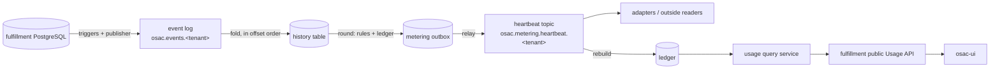

# Metering on the OSAC Event Log

This design meets the metering PRD by consuming the event log fulfillment
already publishes: every billable resource change is an event on the tenant's
`osac.events.<tenant>` topic, and a metering subsystem folds those events into
usage, publishes usage events to per-tenant heartbeat topics, and serves usage
queries to the console. Billing providers and tenants read the same numbers.

The PRD owns motivation, goals, and non-goals. This document specifies the
pipeline, the contracts, and the query API. Costing, billing, and quota
enforcement stay out, as the PRD says.

## Scope

One bullet per PRD capability.

- CAP-1 (provider-wide aggregated usage): delivered. The usage query API
  serves per-tenant, per-resource-type, per-template breakdowns to Cloud
  Provider Admins.
- CAP-2 (worker nodes by resource class): delivered. CaaS worker nodes are
  `BareMetalInstance` resources. Their meters include `instance_type` (the
  bare-metal instance type is the resource class) and `cluster` dimensions.
- CAP-3 (MaaS token usage): deferred. The event log records fulfillment
  lifecycle changes only. It never contains inference token counts, so MaaS
  metering needs the inference platform to publish its own usage events.
  Deferred to that platform's design, reusing the heartbeat contract.
- CAP-4 (sub-minute resources): delivered. The shortest run that bills is one
  second. A 30-second resource bills 30 seconds.
- CAP-5 (deploy, upgrade, monitor): delivered. The installer deploys the
  subsystem, rule revisions upgrade it, and the metrics below report pipeline
  health.
- CAP-6 (custom meters via configuration): delivered for resources already in
  the event log. A new meter is a new immutable rule revision. Metering a
  service with no events in the log is deferred with MaaS.
- CAP-7 (indefinite history): delivered. Event, heartbeat, and dead-letter
  topics keep every record by default, and the usage database is rebuildable
  from them.
- CAP-8 (tenant usage view): delivered. Tenant Admins query their own
  organization's usage through the public usage API and the console.
- CAP-9 (per-project usage): delivered. Every usage event includes the
  `project` dimension, and the query API groups by it.
- CAP-10 (tenant user usage): delivered. Tenant Users see usage for the
  projects they can view.
- CAP-11 (VMaaS consumption rules): delivered. Compute meters bill only
  `RUNNING`. Volume and ExternalIP meters bill in every state of the parent
  VM's lifetime, including stopped and paused.
- CAP-12 (CaaS consumption rules): delivered. A cluster's control plane bills
  from `PROGRESSING`, but only once the cluster reaches `READY`. A cluster
  that fails or is deleted before its first `READY` never bills.
- CAP-13 (MaaS 60-second latency): deferred with MaaS.
- CAP-14 (independent deployment): delivered. The subsystem reads the event
  log and never writes to fulfillment. A provider running their own billing
  reads the published heartbeat contract with their own credentials.
- CAP-15 (lossless upgrades): delivered. The database is rebuildable from the
  topics, and rule revisions are immutable, so an upgrade loses nothing.
- CAP-16 (duplicate safety): delivered. The fold deduplicates events by
  offset, and usage event ids are deterministic, so a resend is dropped.
- CAP-17 (catalog traceability): delivered. Every usage event includes
  `catalog` and `template` dimensions.

## High-Level Design

### Terminology

- **Event log**: the per-tenant Kafka topics `osac.events.<tenant>` that
  fulfillment's publisher writes. Accepted design OSAC-983.
- **Fold**: the loop that copies each event's facts into the `history` table,
  idempotently, in event-log order.
- **Round**: the per-tenant loop that runs every minute, computes expected
  usage from history and rules, and writes the difference from the ledger to
  an outbox.
- **Relay**: the loop that sends outbox rows as heartbeats to the tenant's
  heartbeat topic and advances the heartbeat offset.
- **Heartbeat**: one usage event: a measured quantity over one interval for
  one resource and meter, sent as a CloudEvent. Negative quantity means a
  correction.
- **Meter**: what is measured on a resource, for example a running VM's
  seconds. A rule in a rule revision defines it.
- **Rule revision**: an immutable set of meter rules with an effective date,
  shipped as a ConfigMap.
- **Ledger**: the record of heartbeats already sent, per usage key.
- **Usage key**: tenant, resource, meter, component, and billing dimensions
  together. A dimension change re-keys the usage.
- **Reader**: the provider's system that reads heartbeat topics. OSAC
  adapters are readers. Outside systems can be granted the same read.

### Components

- **Fulfillment event pipeline** (OSAC-983, unchanged): database triggers
  capture every committed change, the publisher forwards each event to
  `osac.events.<tenant>`, one partition per tenant. Metering only reads it.
- **Metering source contract** (fulfillment): proto annotations name each
  billable field and how it changes. Fulfillment triggers reject a
  metering-relevant change whose transition time is not later than the
  previous one. Change times are whole seconds. This is what makes the
  event log a billing-grade source.
- **osac-metering** (`metering-service`): the fold, round, and relay loops
  over one PostgreSQL database. The usage engine is pure: it reads facts,
  rules, and the round time, and nothing else.
- **Rules**: versioned ConfigMaps (`osac-metering-rules-<NNNN>`). Revision
  0001 ships the default meters for the six in-scope resources.
- **Adapters** (`echo`, `m360`): readers that consume heartbeat topics and
  forward to billing providers. A shared `Runner` owns dedup, retry, and
  dead-letter routing. Concrete adapters only map events.
- **Usage query service** (new): serves aggregated usage from the metering
  ledger to fulfillment's public API.
- **Console pages** (new, osac-ui): usage views for Tenant Admins, Tenant
  Users, and Cloud Provider Admins.

### Data flow



The diagram shows the two consumers of the same heartbeat stream: the billing
provider adds the events up, and the usage query serves the same ledger to
tenants and the provider's admins. The takeaway: everything downstream of the
event log is derived state. Losing the database loses nothing, because
history, ledger, and rules are each rebuildable from Kafka and ConfigMaps.

### Guard Rails

- The fold writes facts and the event offset in one database transaction. A
  crash between them never drops an event and never records it twice.
- Kafka offsets are committed only after successful processing and flush.
- The same events and rules always produce the same usage, across restarts,
  upgrades, and database restores. The usage engine reads no clock, no other
  tenant's data, and nothing but facts, rules, and the round time.
- Delivery is at-least-once everywhere. The fold deduplicates an event by its
  `(tenant, offset)`. A repeated event changes nothing.
- A heartbeat's CloudEvent `id` is a SHA-256 over the usage key, the
  interval, and the heartbeat time. It leaves out the quantity, so a resend
  keeps the same id and readers drop it.
- A correction is matched by tenant, resource, meter, component, and billing
  dimensions. Never by quantity, event id, or interval.
- Each round emits the difference between expected usage and the ledger,
  positive or negative. A retroactive fact change therefore corrects usage
  already sent (PRD decision D-5).
- `FAILED` is never billable. A run that closes before reaching a
  `turns_billable_once` state never bills (PRD CAP-12).
- A run shorter than one second bills nothing. Every timestamp is whole
  seconds (PRD CAP-4).
- A released rule revision never changes. A new meter or state rule is a new
  revision with a future `effective_at`.
- Metering never writes to fulfillment. A metering outage pauses billing and
  never affects provisioning (PRD decision D-2).
- Metering processes one tenant's events only from that tenant's topic. The
  usage query returns only the caller's authorized tenants and projects.
- The heartbeat and dead-letter topics refuse compaction. Their retention is
  the rebuild window and defaults to indefinite.
- The `system` and `shared` tenants are never billed.

## API and Access Changes

### Metering field annotations

Each billable field on a private proto is annotated in `proto/metering`:

| Kind | Behavior |
|------|----------|
| `METERING_FIELD_KIND_CONSTANT` | Set at creation, never changes |
| `METERING_FIELD_KIND_FIXED_ONCE_SET` | Empty, then set once, never changes |
| `METERING_FIELD_KIND_VARIES` | Changes over time; `transition_time` names the field that records when |

The default revision tracks: `ComputeInstance` (state, instance type, image,
boot disk size, catalog item), `Cluster` (state, version, template, catalog
item), `BareMetalInstance` (state, instance type, cluster, node set), `Volume`
(state, tier, protocol, provisioned size, vendor volume id), `ExternalIP`
(state, pool, address, attachment), `NATGateway` (state, network, external
IP). Adding a resource is annotations, one fulfillment migration that attaches
the triggers, a `meteringTables` entry, and a rules revision. `CheckSchema`
fails service startup when a mapped table lacks triggers, and the drift test
fails when triggers disagree with the annotations.

### Heartbeat usage contract (published)

Heartbeats are CloudEvents of type `osac.resource.heartbeat.v1` on
`osac.metering.heartbeat.<tenant>`, one partition per tenant. The contract is
generated into `osac-metering/docs/contract/` with a checkable JSON Schema.
Payload fields:

| Field | Meaning |
|-------|---------|
| `tenant_id`, `resource_type`, `resource_id` | What the usage is about |
| `meter`, `component` | The meter and the billable line it feeds |
| `billing_dimensions` | The meter's dimensions plus `deployment`, `tenant`, `project`, `catalog`, `template`, `meter_type` |
| `usage.from` / `usage.to` | Half-open interval, UTC, whole seconds |
| `usage.quantity` | Fixed-point text with six decimals; negative for a correction |
| `usage.unit`, `usage.precision` | Meter unit; always `second` precision |
| `heartbeat_time` | The round time that produced the event; part of the dedup id |
| `last_applied_offset` | Event-log position the round had folded |
| `rules_revision` | Revision that produced the event |
| `external_billing_account_id` | Optional; the tenant's id in the provider's billing system |

Rules for readers:

- Add events up per usage key. Drop ids already seen.
- A missing dimension is absent, not an empty string.
- A multiplier (Volume capacity is multiplied by provisioned GiB) is already
  applied to the quantity. Do not apply it again.

Published schema versions are add-only. A new field is a new version file
with an effective date. A published file never changes.

### Rule revisions

A revision is a ConfigMap `osac-metering-rules-<NNNN>` holding complete meter
definitions and an `effective_at` time. An admission policy (Kubernetes 1.30+)
protects released revisions from edits. Rule keys:

| Key | Meaning |
|-----|---------|
| `resource`, `meter`, `unit` | What is measured and in what unit |
| `billable_when.states` | Resource states that bill |
| `turns_billable_once` | States that confirm a deferred span; a span closing earlier never bills |
| `billable_when.fields` | Conditions on constant fields (value or `set`) |
| `multiplier` | A tracked field the quantity is multiplied by |
| `dimensions` | Tracked fields that become billing dimensions |

### Usage query API (new)

`metering-service` serves a private `UsageQuery` gRPC service that aggregates
the ledger. Fulfillment wraps it as a public, tenant-scoped `Usage` service.
The console reaches it through the existing API proxy.

```protobuf
message UsageQuery {
  // Billing period: from inclusive, to exclusive, UTC, whole seconds.
  string from = 1 [(buf.validate.field).string.required = true];
  string to = 2 [(buf.validate.field).string.required = true];
  // Any of: tenant, project, resource_type, meter, component.
  repeated string group_by = 3;
  // Optional filters on resource_type, meter, project, or resource id.
  UsageFilter filter = 4;
}

message UsageRow {
  string tenant = 1;
  string project = 2;
  string resource_type = 3;
  string resource_id = 4;
  string meter = 5;
  string component = 6;
  map<string, string> billing_dimensions = 7;
  string quantity = 8; // fixed-point, six decimals, heartbeats minus corrections
  string unit = 9;
}
```

Access rules:

| Caller | Visible rows |
|--------|--------------|
| Cloud Provider Admin | All tenants; may group by `tenant` |
| Tenant Admin | Own tenant only; grouping by `tenant` is rejected |
| Tenant User | Own tenant, rows filtered to projects with `VIEW_PROJECT` (PRD decision D-1) |

The query sums the ledger, so the number a tenant sees is the number the
billing provider received. Validation rejects `from` >= `to` with
`INVALID_ARGUMENT` and caps the period at 400 days.

### Reader grants and topics

| Topic | Who reads | Who writes |
|-------|-----------|------------|
| `osac.events.<tenant>` | metering | fulfillment publisher |
| `osac.metering.heartbeat.<tenant>` | metering (rebuild), adapters, granted readers | metering relay |
| `osac.metering.dlq.<tenant>` | provider operators | adapters |

An outside reader is a chart `readers` entry. The chart renders one
`KafkaUser` with a read ACL on the heartbeat prefix and a consumer group
named after the reader. The prefix covers tenants created after the grant, so
onboarding a tenant needs no chart change. Grant and revoke are a
`helm upgrade`. Nothing restarts metering.

## Observability

- `metering_fold_event_lag` (gauge, per tenant): how far the fold is behind
  the event log head. Sustained growth means the fold cannot keep up.
- `metering_round_duration_seconds` (histogram, per tenant): round cost. A
  rise past the round interval means rounds overlap.
- `metering_round_errors_total` (counter, per tenant): rounds that failed.
  Billing for that tenant has stopped while the pod stays ready.
- `metering_outbox_rows` (gauge): heartbeats waiting to be sent. Growth means
  the relay or Kafka is stalled.
- `metering_heartbeat_offset_lag` (gauge, per tenant): how far sent usage is
  behind computed usage.
- `metering_dlq_records_total` (counter, per tenant, per reason): heartbeats
  the billing provider rejected.
- `metering_rules_revision` (info gauge): the revision each round used.
- `usage_query_duration_seconds` (histogram): query API latency.
- Reader group lag comes from Kafka Exporter on the reader's consumer group.

The chart ships a `ServiceMonitor`. Billing can stop while the metering pod
stays ready, because the round loop logs errors and keeps going. Liveness
proves nothing. Alert on the counters and gauges above, not on pod health.

## Security

No new authentication. Kafka uses `KafkaUser` ACLs over TLS with the shared
OSAC CA: metering reads the event-topic prefix and writes the heartbeat and
dead-letter prefixes. Adapters read heartbeats and write dead letters.
Outside readers get heartbeat-read only. Adapter errors reach dead-letter
headers without credentials or raw secrets. The event log contains no secret
material (fulfillment secret events include metadata and backend coordinates
only). Usage query authorization is enforced in fulfillment's public API
before the private query is called. The raw event log, dead-letter topics,
and the usage database stay internal. Only heartbeat topics and their events
are published.

## Scale

One event-log partition per tenant bounds per-tenant ingest, and the fold
follows offsets in order, so a tenant's volume sets its own pace. Rounds run
per tenant every 60 seconds by default. Each catch-up pass reads up to 500
round groups, about 200 MB of dimension JSON. The pod is sized at 512 Mi
with more than 2x headroom. The first bottleneck is the per-minute round
sweep as tenant count grows: rounds are independent per tenant, so the sweep
parallelizes across tenants, and the batch size is the tuning knob. The
second is PostgreSQL: history grows with every change to a billable field.
The rebuild path and the 13-month query floor (PRD section 4) set the
retention expectation. Query volume is console-driven and read-only.

## Upgrade and Compatibility

- A new meter or state rule is a new immutable revision with a future
  `effective_at`. Rounds select the revision in effect at the round time.
  Released revisions and published schema versions never change.
- Upgrading the metering stack loses nothing: offsets live in the database,
  topics retain every record by default, and rules come from ConfigMaps.
- A database restore is a rebuild, not a migration: history from the event
  topics, ledger from the heartbeat topic, revisions from ConfigMaps. The
  rebuilt totals match what readers saw. Nothing bills twice.
- The usage query API is new, so there is no upgrade impact for existing
  callers. Removing it in a revert requires no data cleanup.
- Version skew: a revision dated after the release that ships it waits in the
  chart until its date. Metering refuses to load a current schema version
  whose effective date is in the future.

## Deployment

The osac-installer umbrella chart deploys the metering subsystem always:
billing is not optional and no value turns it off. Prerequisites: the AMQ
Streams operator and Kafka cluster (installer phases 1 and 2,
`kafka.enabled: true`) and Kubernetes 1.30 or later for the admission policy
that protects rule revisions. Chart values: round `interval` (default `60s`),
`topics.retentionMs` (default `-1`, indefinite — it is the rebuild window),
`readers` (outside billing readers), `echoAdapter` (test only, not
production), `m360Adapter` (enabled per provider, with its API URL and key
secret). The topic prefix is set once by the umbrella chart for fulfillment,
metering, and the event-topic ACLs. Metering creates a tenant's heartbeat and
dead-letter topics when it first serves the tenant. A provider using their
own billing stack does not deploy an adapter. They read the published
heartbeat contract with a reader grant (PRD CAP-14).

## Failure Handling and Recovery

| Failure | What happens | Recovery | What the user sees |
|---------|--------------|----------|--------------------|
| Fold crashes after committing facts, before the offset | The event is re-read and deduplicated by offset | Automatic | None |
| Relay crashes between the Kafka send and the outbox delete | The same rows are resent with the same heartbeat ids | Automatic; readers drop the duplicates | None |
| Kafka unreachable | Fold and relay pause. Offsets and outbox rows wait. Provisioning is unaffected | Drains the backlog on recovery | Usage lags, then catches up |
| Metering database lost or restored | Usage computation pauses | Rebuild history, ledger, and revisions from topics and ConfigMaps | Usage queries pause during the rebuild. No double billing |
| Billing provider rejects a heartbeat | The adapter writes it to `osac.metering.dlq.<tenant>` with an `original-offset` header | Stop the adapter. Reset its offset to the earliest rejected record's `original-offset`. Fix the cause and restart | The provider's bill misses the rejected usage until replayed |
| Dead-letter send fails | The source event is not acknowledged. The adapter retries it | Automatic | None |
| Round fails | The loop logs the error and continues. The pod stays ready | Fix per the error. The next round catches up | That tenant's usage stops advancing until the round succeeds |
| Rules revision invalid or future-dated | Metering refuses to load it and keeps the previous revision | Ship a corrected revision | Meters from the bad revision never appear |

## Gotchas

- Billing can stop while the metering pod stays ready. Detect it with the
  round-error and lag metrics, not liveness.
- A dimension with no value for an interval is omitted from
  `billing_dimensions`. Reading a missing dimension as an empty string breaks
  key matching.
- The Volume capacity multiplier is already applied to `usage.quantity`. A
  reader that applies it again double-counts.
- CloudEvents `time` is the interval start, which can precede the round. Use
  `heartbeat_time` for version boundaries and dedup.
- `external_billing_account_id` never correlates usage. It can change while
  usage is in flight, and published events are never rewritten.
- Heartbeats are differences, not absolutes. Summing them per usage key is
  the billable quantity. Replacing one, or matching a correction by quantity
  or id, corrupts the total.
- A state or dimension change re-keys the usage. Later events for the
  resource use the new key, and each key sums on its own.
- Usage topics refuse compaction. A compacted topic breaks the rebuild.
- `turns_billable_once` exists so a cluster deleted before its first `READY`
  never bills, even though `PROGRESSING` is a billable state.
- Fulfillment rejects a metering-relevant change whose transition time is not
  later than the previous one, and it rounds change times to whole seconds. A
  direct SQL fix that skips this can corrupt billing intervals.
- The `system` and `shared` tenants have topics but are never billed.

## Validation Strategy

- Unit (per module, `make test`): the usage engine is deterministic. The same
  facts, rules, and round time produce the same pieces. Runs shorter than one
  second bill nothing. A `turns_billable_once` span that closes early never
  bills. A dimension change re-keys and splits the interval at the transition
  time. Heartbeat ids are stable across resends and differ across intervals.
- Component integration (real PostgreSQL and Kafka, `make test` from
  `osac-metering/`): the determinism gate for billing. The fold is idempotent
  under duplicate and reordered delivery. The round emits a negative
  correction when facts change retroactively (D-5). The relay resend after a
  crash produces identical ids. A database drop and rebuild from the topics
  reproduces the same ledger. The shared adapter `Runner` deduplicates,
  retries, and dead-letters, and a dead-letter send failure never acknowledges
  the source event.
- Contract checks (`make contract-check schemas-unchanged-test
  rules-unchanged-test`): the published reference matches the field registry
  and rule revision, and released revisions and schema versions are unchanged
  from their release tags.
- E2E (`tests/e2e/`, per the integration-testing policy): a running VM bills
  instance-type-seconds and a stopped VM bills none, while its volume and
  public IP continue (CAP-11). A cluster deleted before its first `READY`
  bills nothing (CAP-12). A resource that lives 30 seconds appears in usage
  (CAP-4). A resource that transitions to `FAILED` has its prior usage
  corrected (D-5). A duplicate event changes no meter value (CAP-16). Tenant
  isolation on the query API: a Tenant Admin sees only their tenant, a Tenant
  User only their projects, a Cloud Provider Admin every tenant. The console
  renders each persona's usage view. Aggregated usage from 13 months ago is
  still queryable.

## Open Questions for the Brief

- MaaS data source: the event log cannot supply inference token counts. Which
  component emits inference usage events, and does it reuse the heartbeat
  contract and the round-relay pipeline or publish directly to heartbeat
  topics (CAP-3, CAP-13)?
- Usage query placement: confirm serving the query from metering's ledger
  through fulfillment's public API, versus a reader-side aggregation over
  heartbeat topics.
- Query retention and performance: the ledger grows without bound. Does the
  13-month query floor need summarized tables, or is the ledger query fast
  enough at the expected tenant count?
- Console scope: which usage pages ship in this milestone (tenant project
  view, provider cross-tenant view), and do they reuse existing console
  patterns or add a new usage page family?
- Heartbeat retention floor: the PRD never allows aggregated data below 13
  months. The default topic retention is indefinite. Should the chart enforce
  a floor when a provider shortens retention, at the cost of losing the full
  rebuild window?
- Custom-service meters (CAP-6): a service with no events in the log needs a
  publisher first. Is there a committed example beyond MaaS, or does CAP-6
  stay limited to event-log resources for now?
