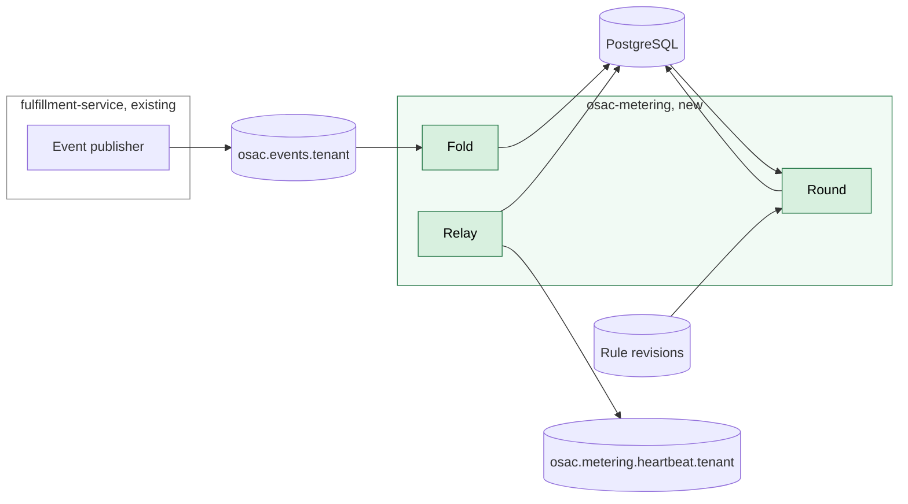

# Metering on the event log

OSAC will meter what it provisions by reading the event log it already publishes. A new component, osac-metering, folds each tenant's events into a usage database and meters them with versioned rules. It sends usage heartbeats to per-tenant topics for the provider's billing system. Cloud Provider Admins query usage across all tenants. Tenant Admins and Tenant Users see their own usage in the console. Provisioning is untouched.

Design for metering on the event log (OSAC-5753), from the metering and usage tracking PRD (OSAC-985).

## Today and with this design

| | Today | With this design |
|---|---|---|
| Usage data | Each provider builds their own | One pipeline reads the event log every tenant already has |
| Tenants | See no usage | See their own usage in the console, by project |
| Metering during an outage | No metering exists | Provisioning unaffected. Usage rebuilds from Kafka. |

## How it works

- **Fold.** The fold copies each tenant's events into a usage database, idempotently.
- **Measure.** Every round, rules turn history into usage quantities, and the difference goes to an outbox.
- **Send.** The relay publishes the difference as heartbeats on per-tenant usage topics.
- **Query.** Tenants and provider admins read usage through the API and the console.

Each step has its own section below.

## Definitions

- **Event log**: fulfillment's per-tenant topics `osac.events.<tenant>`, one partition each, from OSAC-983.
- **Heartbeat**: one CloudEvent with one measured quantity over one interval.
- **Correction**: a heartbeat with a negative quantity that takes back usage already sent.

## Fold

1. **The fold copies each event's billable facts into a `history` table, idempotently.** An event's identity is its topic and offset. Facts and folded offset are written in one transaction, so a duplicate event changes no meter.
2. **Billable fields are declared where the resources are defined.** Each billable proto field gets a metering annotation: constant, set once, or varying with a transition time. Fulfillment's triggers populate them, and a drift test fails on disagreement.
3. **The event log is the only input.** Catalog item, template, project and tenant references arrive as event fields, so usage traces back to the catalog offer. The fold writes nothing to fulfillment.

## Measure

4. **A round runs per tenant and emits only the difference.** The default interval is 60 seconds. Expected usage comes from history and the active rules. The difference against the ledger goes to an outbox in one transaction. Transition timestamps have whole-second precision, so a 30-second resource bills 30 seconds.
5. **Meters are data, in an immutable rule revision with an effective date.** Each rule names a meter's unit, billable states and dimensions:

| Meter | Unit | Bills while | Dimensions |
|---|---|---|---|
| `compute` | second | the VM is running | instance type, catalog item, template |
| `volume` | gibibyte-second | the volume exists | storage tier |
| `external_ip`, `nat_gateway` | second | the resource exists | — |
| cluster control plane | second | the cluster is ready or progressing | catalog item, cluster version |
| cluster worker set | host-class-second | the node set exists on an active cluster | host class, catalog item |
| bare metal instance | second | the instance is allocated | instance type |
| `inference` | token | the request completed | model, token type |

Every meter also gets tenant and project as dimensions. A cluster deleted before first ready bills nothing. A state or dimension change re-keys the usage.

6. **Corrections take back usage billed in error.** A resource that moves to failed state gets a negative heartbeat for the span already billed. Failure cause is left unclassified. Providers handle credits through billing policy.
7. **Inference usage reaches the event log within 30 seconds.** The model-serving platform reports each completed request to fulfillment's private API, which emits it on the tenant's topic. Tenants that use MaaS get 30-second rounds, so usage is queryable within 60 seconds.

## Send

8. **The relay publishes each outbox row as a heartbeat on `osac.metering.heartbeat.<tenant>`.** CloudEvent type `osac.resource.heartbeat.v1`, one partition per topic, at least once. The id is a SHA-256 of the usage key, interval and round time, so a resend keeps its id and the reader drops it.
9. **The reader owns retries and failed records.** OSAC's adapters forward heartbeats to the provider's system with dedup, retry and a per-tenant dead-letter topic `osac.metering.dlq.<tenant>`. OSAC sets no prices. The provider sums quantities per component and prices them.
10. **The usage feed is published documentation.** A reader-facing reference and a checkable JSON schema are generated from the field registry and rule revisions. A published schema version never changes.

## Query

11. **Usage is queried through the public API.** osac-metering serves a private Usage gRPC API. fulfillment-service adds public usage endpoints that proxy it and enforce tenant and project permissions. Filters cover tenant, project, resource type, meter and time range.
12. **Each persona sees their own scope.** A Cloud Provider Admin sees all tenants. A Tenant Admin sees their tenant by project, nested projects included. A Tenant User sees the projects they belong to. The console adds usage pages for all three. Prometheus gauges report fold lag and dead-letter depth.

## Guard Rails

13. **Provisioning never waits on metering.** An outage pauses usage, and the fold resumes from committed offsets with no gap.
14. **The same events and rules always produce the same usage.** History rebuilds from the event topics, the ledger from the heartbeat topic, revisions from the ConfigMaps, so restores and upgrades lose nothing.
15. **Kafka offsets commit only after successful processing and flush.** The fold commits with its facts transaction. The relay commits after the heartbeat send.
16. **Event, heartbeat and dead-letter records are kept indefinitely.** Event topics default to unlimited retention.
17. **Aggregated usage stays queryable for at least 13 months.** The retention value is configurable with a floor of 13 months.
18. **A released rule revision never changes.** A new meter or billable state is a new revision with a future effective date.
19. **Metering deploys beside provisioning, never into it.** The installer composes the chart without changing existing resources. A provider with their own metering reads the event log instead and omits the built-in stack.

## Security

20. **Kafka ACLs separate duties.** Fulfillment's publisher writes the event topics. Metering reads them and writes the heartbeat and dead-letter topics.
21. **Tenant isolation on query is enforced in fulfillment's public API.** A usage query names at most the caller's tenants and projects. Adapter errors reach dead-letter headers with no credentials or raw secrets.

## Where the code goes

- **New:** the `osac-metering` component: `schema`, `metering-service` with fold, rounds, relay, rules and the Usage API, `adapters`, and its Helm chart. Public usage endpoints in fulfillment-service. Usage pages in osac-ui.
- **Changed:** private protos gain metering annotations on billable fields. Fulfillment gains the table-to-payload mapping and triggers for new billable resources. osac-installer composes the chart.
- **Unchanged:** the event log's topics, publisher and Watch API. No CRD changes.

## API

| Name | What |
|---|---|
| `osac.events.<tenant>` | Input, read-only for metering. Existing, from OSAC-983. |
| `osac.metering.heartbeat.<tenant>` | Usage heartbeats out, covered by the published reference and schema. |
| `osac-metering-rules-<NNNN>` | Rule revision ConfigMaps, immutable. |

Chart values set the round interval, usage retention and `topics.retentionMs`.

## Alternatives

- **Consume through fulfillment's Watch API.** OSAC-983 sketched metering as a Watch consumer. The fold commits its position with its facts in one transaction, which a stream position cannot express.
- **Meter inside fulfillment-service.** Billing data would live in the provisioning database, and every new meter would touch provisioning code.
- **Publish raw events to the provider.** The event log stays internal. The published usage reference is the reader-facing feed.

## Not in this design

Costing, price lists, invoicing and quota enforcement, workload metering inside tenant clusters, object storage, subnet and bandwidth meters, and BMaaS allocation metering. Open: which component owns inference-request counting for MaaS.
