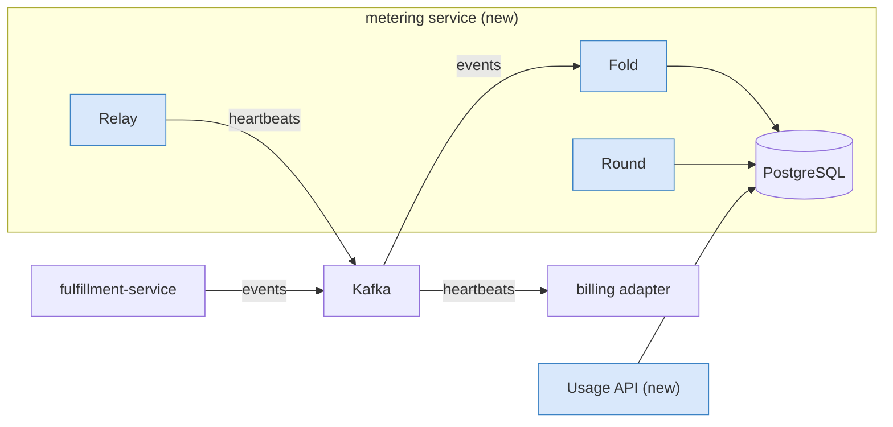

# Metering on the OSAC event log

OSAC provisions resources but cannot say what was consumed. This design adds a metering
service that reads the events fulfillment already publishes to each tenant's Kafka topic
and turns them into usage. Three loops run against one PostgreSQL database: the fold
copies each event's facts into a history, the round computes usage every minute from
versioned rules and writes the difference with what was already sent, and the relay sends
that difference to the billing provider as heartbeats. A new Usage API serves the same
data to tenants and providers, and osac-ui shows it. OSAC measures usage; the provider's
own billing system prices it and sends the invoice.

This is the metering on the event log design (OSAC-5753), for the metering PRD (OSAC-985).

## Today and with this design

| What | Today | With this design |
|---|---|---|
| Events | fulfillment publishes every change to `osac.events.<tenant>`; nothing bills from them | the fold turns them into usage |
| Metering | each provider builds their own | one pipeline; meters are data, not code |
| Usage visibility | no tenant or provider can query usage | Usage API and console pages |
| Billing input | providers scrape their own APIs | heartbeats on a published contract |

## How it works

- Fulfillment publishes each committed change as an event to the tenant's topic.
- The fold copies each event's facts into history.
- The round computes usage and writes the difference with the ledger to an outbox.
- The relay sends heartbeats, and the billing adapter delivers them to the provider.
- The Usage API answers queries from tenants, providers, and the console.

Each step has its own section below.

## Definitions

- Event: one committed change to a resource, on `osac.events.<tenant>`.
- Fact: one field value and the time it changed, stored in history.
- Meter: a named measure in a rule revision — unit, billable states, dimensions.
- Rule revision: an immutable ConfigMap (`osac-metering-rules-<NNNN>`) holding all meters.
- Heartbeat: a CloudEvent (`osac.resource.heartbeat.v1`) with an interval and a quantity.
- Ledger: the usage already sent, per meter and interval.

## The events

1. Fulfillment already publishes every committed change — API call or direct SQL — to the
   tenant's `osac.events.<tenant>` topic, in order (the reliable event distribution
   design, OSAC-983). Metering adds no publisher and changes no event.
2. Each event carries the tracked fields: state, instance type, template, catalog item,
   project, node set, size. Metering annotations on the resource protos declare the
   list, so it lives with the resource definitions and cannot drift.

## The fold

3. One fold per tenant reads the topic from its stored offset and writes the facts and
   the new offset in one transaction. A crash re-reads the same events, and a duplicate
   never counts twice.
4. The fold is generic: no per-resource logic. A new billable resource is annotations, a table
   mapping, a migration, and a rules revision; a startup check fails when these disagree.
5. The tenant topics keep every record, so history, ledger, and rules rebuild after
   losing the database; usage older than 13 months stays queryable.

## The round

6. Every minute, per tenant, the round computes expected usage from history and the
   active rule revision, compares it with the ledger, and writes the difference to an
   outbox in one transaction. Nothing bills twice and nothing is lost.
7. A meter names its unit, its billable states, and its dimensions. Compute meters run
   only while the VM runs; volumes and public IPs keep metering while it is stopped;
   bare metal has both an allocation and a consumption meter.
8. Worker nodes meter by bare metal instance type, so GPU and CPU workers price
   separately. Every meter carries tenant, project, catalog item, and template, so a
   bill traces back to the catalog offer.
9. FAILED is never billable. Usage already sent for a resource that later fails is
   corrected by a negative difference. A cluster deleted before it first becomes ready
   bills nothing, control plane or workers.
10. The shortest run that bills is 1 second, so a resource that lives 30 seconds appears
    in usage. Sub-second resources are not captured.
11. Meters are data: a provider adds one by shipping a new rules revision, with no code
    change. A revision is immutable and takes effect at its effective time; the service
    stops rather than bill under a revision it never loaded.

## The relay and the billing adapters

12. The relay sends each difference as a heartbeat to `osac.metering.heartbeat.<tenant>` and
    advances its offset only after the send succeeds. A heartbeat's ID names the piece of
    usage but not the quantity, so a resend after a crash keeps its ID and the provider drops
    the copy.
13. Adapters deliver heartbeats: an echo adapter for tests and an M360 adapter for billing. One
    shared runner owns deduplication, retries, and the dead-letter topic
    `osac.metering.dlq.<tenant>`; a rejected heartbeat is replayed by resetting its position.
14. Metering failures never touch provisioning: events wait in Kafka, and the backlog
    drains in order once metering recovers.

## The Usage API

15. A new Usage API returns usage per billing period, grouped by tenant, project, resource
    type, template, and meter. Fulfillment's public API wraps it, as for resources.
16. A Tenant Admin sees their own organization by project, nested projects rolled up; a
    Tenant User sees the projects they can view; a Cloud Provider Admin sees every tenant.
    osac-ui adds usage pages for both views, and no caller sees another tenant's usage.

## Security

- The metering service reads every tenant's topic on the private path, like the controllers;
  the Usage API is the only tenant-facing door and filters by the caller's organization.
- Events carry no secret material: a Secret event holds only metadata and the secret
  backend's coordinates, never the secret itself.
- Adapter errors reach the dead-letter headers without credentials or raw secrets.

## Where the code goes

- New: the metering service and adapters in osac-metering; the Usage API wrapper in
  fulfillment-service; usage pages in osac-ui.
- Changed: resource protos and fulfillment migrations for tracked fields; installer values.
- Unchanged: the event publisher and the per-tenant topics; the Kafka cluster.

## API

- `ListUsage`: period plus filters (tenant, project, resource type, meter); private in
  the metering service, wrapped by the public API.
- Heartbeat topics `osac.metering.heartbeat.<tenant>`: the published usage contract; a
  provider with their own billing reads these instead of running the adapters.
- Rule revisions: ConfigMaps shipped in the chart; the default meters are revision 0001.

## Alternatives

- Each operator emits its own usage events: rejected, that is the fragmentation the PRD removes.
- Poll each provider's API on a timer: rejected, snapshots lose durations and miss resources.
- Meter in the provider's billing system from the event topics: kept as the escape hatch.

## Not in this design

MaaS token metering (inference requests are not lifecycle events, and the PRD leaves the
data source open), network bandwidth, and pricing or invoices (the costing PRD).

## Questions for the developer

1. MaaS: the PRD puts inference tokens in scope, but the event log has no inference
   events. Who owns the token counts, and is MaaS a separate source beside the fold
   rather than a new meter over lifecycle events?
2. Deployment: the PRD says a provider with their own metering can consume the lifecycle
   data without the built-in stack, but billing is currently never optional in the
   installer. Should the installer grow a knob that turns the stack off, and if so, what
   still must run?
3. Retention: is keeping the event and heartbeat topics forever the agreed answer to the
   13-month audit floor, or must a trim be configured — and who pays for the storage?
