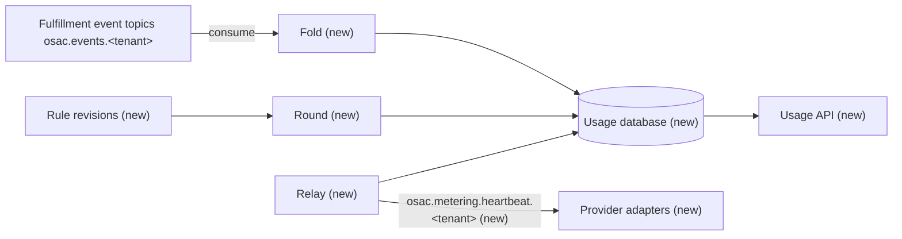

# Metering on the OSAC event log

OSAC now meters every provisioned resource by reading the event log fulfillment already publishes. A new metering service folds each tenant's `osac.events.<tenant>` topic into usage facts in PostgreSQL. Every minute it computes usage differences from versioned meter rules and sends them as heartbeat events to per-tenant usage topics. Provider adapters forward usage to billing systems, and outside readers can read the usage topics directly. Tenant Admins, Tenant Users, and Cloud Provider Admins query usage through a new read-only Usage API and the osac-ui console.

Design for metering on the OSAC event log (OSAC-5753). See the [PRD](prd.md).

## Today and with this design

| | Today | With this design |
|---|---|---|
| Usage data | OSAC provisions resources but measures no consumption. | Every billable resource accrues usage per second. |
| Billing input | Each provider builds their own metering. | Providers read one published usage event contract from per-tenant usage topics. |
| Meter changes | New meters need a new metering system. | An admin adds a meter by shipping a new rule revision. |
| Metering outages | Not applicable. | Provisioning keeps working. Usage arrives late, and none is lost. |
| Console | No usage views. | Tenant and provider roles see usage in the osac-ui console. |

## How it works

The diagram shows the metering service as a new reader beside the event topics the OSAC-983 design already delivers. Everything inside the service is new.

- **Fold.** The fold copies each tenant's events into usage facts in PostgreSQL, idempotently.
- **Round.** Every minute, per tenant, the round computes expected usage from the facts and the rule revisions and writes the difference to an outbox.
- **Relay.** The relay sends outbox rows as heartbeat events to the tenant's usage topic and deletes each row after Kafka acknowledges it.
- **Query.** The Usage API serves aggregated usage to the osac-ui console and the CLI.

Each step has its own section below.

## Definitions

- **Fold**: the loop that copies events into usage facts. It records each event's topic offset with its facts.
- **Fact**: one resource's billable field values and the times those values changed.
- **Heartbeat**: one CloudEvent that carries a measured quantity over one interval. A negative heartbeat takes back usage already sent.
- **Billing dimensions**: the name and value pairs that identify the priced variant of the usage, such as an instance type.
- **Rule revision**: an immutable ConfigMap that defines the meters. It names the resource, the states that bill, the dimensions, the multiplier, and the effective time.
- **Ledger**: the usage the round already sent, per resource, meter, and billing dimensions.

## Fold

1. **The metering service consumes each tenant's `osac.events.<tenant>` topic directly, with its own Kafka credentials.** It holds a read-only ACL on the `osac.events.` prefix.
2. **The service lists topics with that prefix every 30 seconds.** It starts loops for new tenants. It stops a gone tenant's loops after three missing passes, so one incomplete listing cannot destroy billing history.
3. **The fold writes the facts and the event offset in one database transaction.** A replayed event finds its offset recorded and changes nothing.
4. **Billable fields are declared by annotations on the private protos.** A shared registry in `proto/metering` collects them. Drift tests keep fulfillment's source triggers and the registry equal. Adding a billable resource is annotations, one fulfillment migration, and a rule revision.
5. **The fold keeps transition times at second granularity.** A resource that exists for 30 seconds bills 30 seconds. The minimum resolution is one second.
6. **The fold skips a record it cannot decode or date, and records the skip with a metric.** Folding undatable or misrouted data would bill the wrong customer or the wrong minutes. A fatal error rolls the transaction back and retries the batch.

## Round

7. **Every minute by default, per tenant, the round computes expected usage from the facts and the active rule revisions.** The `heartbeat.interval` value sets the interval. Each heartbeat is a rated transaction in the billing provider, so a longer interval sends fewer of them.
8. **The default rule revision 0001 defines these meters:**

| Resource | Meter | Unit | Bills in |
|---|---|---|---|
| ComputeInstance | compute | second | RUNNING |
| Cluster | control_plane | second | PROGRESSING and READY, after the cluster first reaches READY |
| Cluster workers | compute | second | the worker machine's billable states, with cluster, node set, and host class dimensions |
| Volume | capacity | gibibyte-second | AVAILABLE and DELETING, multiplied by the provisioned GiB |
| ExternalIP | allocation | second | ALLOCATED and DELETING, after first ALLOCATED |
| NATGateway | allocation | second | READY and DELETING, after first READY |
| BareMetalInstance | allocation and consumption | second | reserved after first STARTING, and RUNNING |

9. **Every heartbeat also sends the tenant, project, catalog item, and template dimensions.** A billing system can determine the catalog item, instance type, and image for any metered resource from the usage data alone.
10. **The round writes the usage difference, the ledger, and the outbox row in one transaction.** A crash mid-round never bills twice and never loses a difference.
11. **A cluster that never reaches READY never bills.** The control plane and the workers turn billable at first READY. A cluster that fails or is deleted before that generates no usage.
12. **Worker usage breaks down by node set and host class.** GPU and CPU worker nodes price separately through the host class dimension.
13. **A stopped or paused VM stops accruing compute seconds.** Its volumes and public IPs keep billing through their own meters for the VM's whole life.
14. **A state or dimension change re-keys the usage.** Later heartbeats send the new dimensions. Each key sums on its own.
15. **FAILED resources never bill, whatever caused the failure.** When usage was already sent for a span that ends in failure, the round sends a negative heartbeat that takes it back.
16. **Rule revisions are immutable ConfigMaps with an effective time.** Adding or changing a meter ships a new revision, with no redeploy. A revision whose effective time passes unloaded stops the service, because billing under unloaded rules is wrong.
17. **On restart the round catches up from the ledger.** It applies the heartbeat groups the ledger already recorded, one group per transaction.

## Relay

18. **The relay sends each outbox row as a heartbeat CloudEvent to `osac.metering.heartbeat.<tenant>`.** The type is `osac.resource.heartbeat.v1`. The payload names the resource, the meter, the billing dimensions, the interval, and the quantity.
19. **The relay deletes an outbox row only after Kafka acknowledges its send from all in-sync replicas.** A send the leader acknowledged but never replicated would lose committed usage forever.
20. **A resent heartbeat carries the same CloudEvent id.** The id is a SHA-256 over the tenant, resource, meter, dimensions, and interval. A reader drops an id it has already seen, so a crash between send and delete is safe.
21. **Provider adapters read the heartbeat topics and forward usage to the billing provider.** A shared runner owns deduplication, retries, and dead-letter routing. Heartbeats the provider rejects go to `osac.metering.dlq.<tenant>`. A dead-letter send failure never acknowledges the source event.

## Query

22. **A new `Usage` gRPC service serves aggregated usage from the usage database.** `Usage.Get` returns one tenant's usage over a period, broken down by project, resource type, meter, and dimensions. `Usage.Report` returns cross-tenant usage for a billing period, broken down by tenant, resource type, and template.
23. **Fulfillment's public API wraps the metering service.** Project-level filtering uses the Organizations permissions, such as `VIEW_PROJECT`. Cross-tenant data goes only to Cloud Provider Admins.
24. **Project breakdowns include nested projects.** Usage rolls up each project's subtree, so costs attribute to teams, grants, and departments.
25. **The usage database keeps facts, ledger, and aggregates indefinitely.** Thirteen-month queryability is the required floor.
26. **Cloud Infrastructure Admins monitor the pipeline from Prometheus metrics.** The metrics cover fold lag, outbox depth, heartbeat errors, and topic counts.

## Guard Rails

1. The fold writes each event's facts and its topic offset in one transaction. A replayed event changes nothing.
2. The round writes the usage difference, the ledger, and the outbox row in one transaction. A crash mid-round never bills twice and never loses a difference.
3. The relay deletes an outbox row only after Kafka acknowledges its heartbeat from all in-sync replicas.
4. A resent heartbeat carries the same CloudEvent id. A reader drops an id it has already seen.
5. Kafka offsets are committed only after the fold or the relay processes and flushes its batch.
6. The same events and rule revisions always produce the same usage, across restarts, upgrades, and database restores.
7. The usage database rebuilds from the topics. Facts come from the event topics, the ledger from the heartbeat topics, and the rules from the ConfigMaps. A restore never bills twice.
8. FAILED resources never bill. The round sends a negative heartbeat that takes back usage already sent.
9. Duplicate events never increase a meter. The fold dedupes by offset, and readers dedupe by heartbeat id.
10. Heartbeat and dead-letter topics retain every record. The usage database keeps facts and ledger indefinitely.
11. Metering reads event topics with a read ACL on the `osac.events.` prefix and never writes them.
12. The builtin `system` and `shared` tenants never bill.
13. The Usage API enforces fulfillment's existing tenancy checks. Cross-tenant data goes only to Cloud Provider Admins.
14. A dead-letter send failure never acknowledges the source event.
15. Metering outages never block provisioning. Fulfillment keeps publishing events, and metering catches up from its offsets on restart.

## Security

Metering is a trusted cluster-wide reader, like the fulfillment controllers. It holds one read ACL on the `osac.events.` prefix and read-write ACLs on the `osac.metering.` prefix. Tenant isolation on queries is enforced by fulfillment's public API, not by metering. Heartbeats name resource metadata only, never workload data or credentials. Adapter errors reach dead-letter headers without credentials or raw secrets. Kafka connections use TLS with the shared OSAC CA.

## Where the code goes

- **New:** `osac-metering` (schema, metering-service, adapters, Helm chart), the `Usage` proto service.
- **Changed:** `proto` (Usage service, metering field annotations), `fulfillment-service` (public Usage wrapper, source-contract triggers on mapped tables), `osac-installer` (umbrella chart adds the metering chart), `osac-ui` (usage views).
- **Unchanged:** the OSAC-983 event pipeline, the event format, the `Watch` API, existing resource APIs, and provisioning workflows.

## API

1. **Topic `osac.metering.heartbeat.<tenant>`** — usage heartbeats, one partition per tenant, CloudEvents type `osac.resource.heartbeat.v1`. The published usage event contract.
2. **Topic `osac.metering.dlq.<tenant>`** — heartbeats the billing provider rejected.
3. **`Usage` gRPC service, public and private** — `Usage.Get` returns one tenant's usage. `Usage.Report` returns the cross-tenant report.
4. **Rule revision ConfigMaps `osac-metering-rules-<NNNN>`** — immutable meter definitions with an effective time.
5. **Metering field annotations on the private protos** — the declaration list for billable fields, collected into `proto/metering`.

| Config value | Default | Who sets it |
|---|---|---|
| `heartbeat.interval` | `60s` | Cloud Infrastructure Admin |
| `topics.retentionMs` | `-1` (keep every record) | Cloud Infrastructure Admin |
| `kafka.brokers` | the `osac-kafka` bootstrap address | installer |
| `eventTopicPrefix` | `osac.events.` | installer, shared with fulfillment |

## UX Alignment

The console gains a tenant usage page broken down by project and resource, and a provider usage page across tenants. Both pages read the public Usage API through the Go API proxy. They follow the osac-ux list and table guidance for existing read-only console pages.

## Alternatives

- **Consume through the fulfillment `Watch` API.** Two transports, per-event CEL filtering in the bridge, and group offsets the fold cannot tie to its own transactions.
- **Meter inside fulfillment-service and push straight to providers.** Billing correctness would ride every provisioning deploy, against independent deployment.
- **Do nothing.** Each provider would reimplement state folding and corrections on the raw event topics.

## Not in this design

Costing, price lists, invoicing, and quota enforcement go to the separate costing PRD. Network bandwidth and object storage stay out (PRD non-goals). Open: the MaaS token-usage data source and its event shape. Open: whether cross-tenant reports need pre-aggregated rollups at large tenant counts. Open: event-topic retention for a full audit rebuild beyond the heartbeat ledger.
